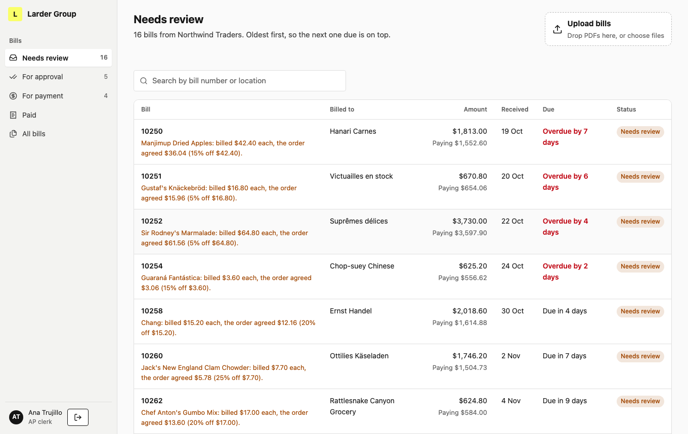
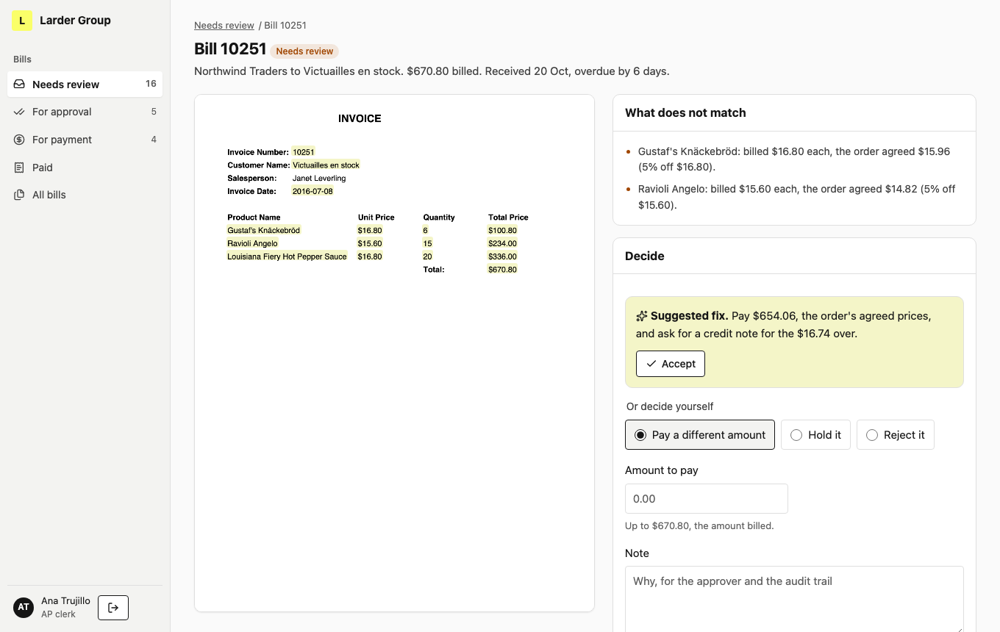
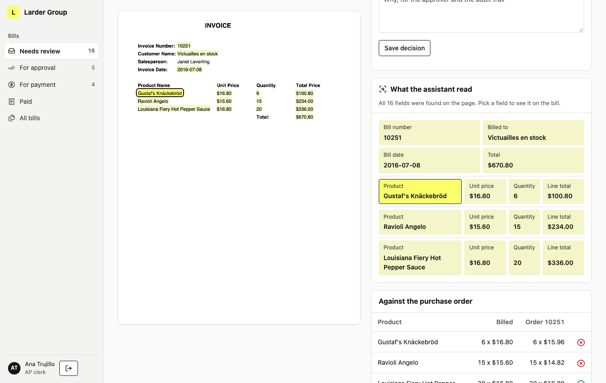
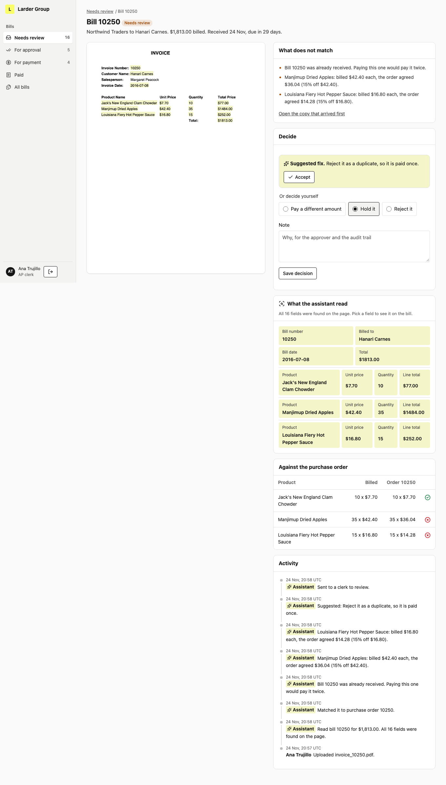
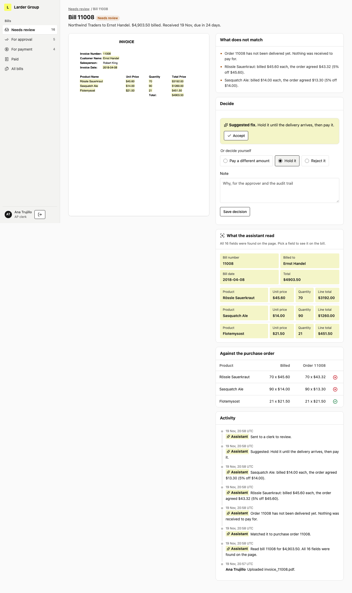
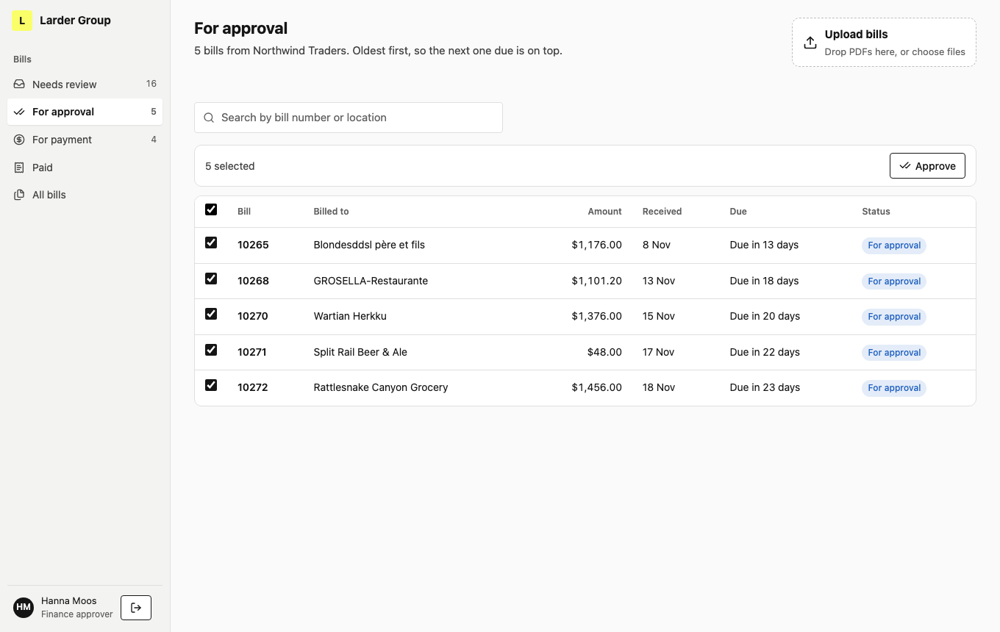
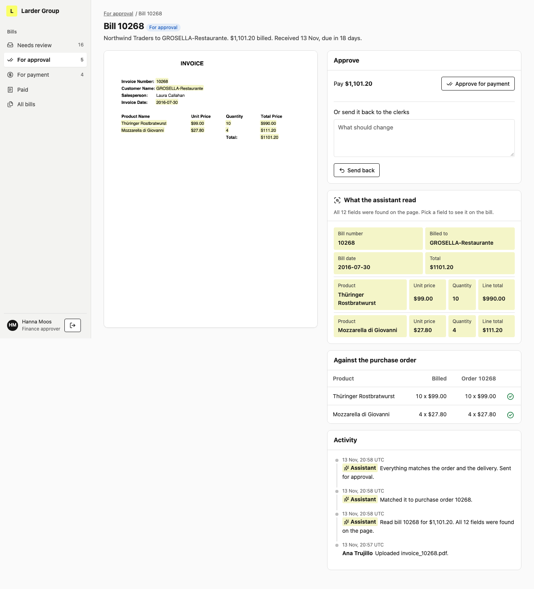
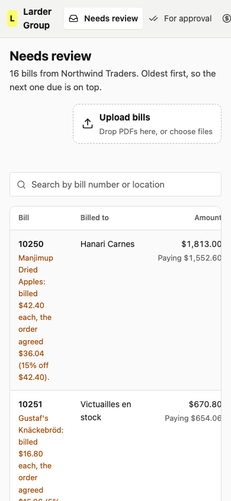
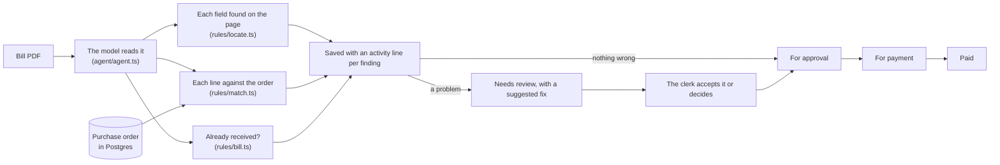

# Invoice inbox

A bills app for an accounts payable team, where an assistant reads and checks every bill before a person sees it.

## Why

An accounts payable clerk checks every supplier bill against the purchase order before it is paid.
A model can read a PDF in a second, but it cannot be trusted to say whether the bill is right.
It may "fix" a wrong total, or agree with a price nobody agreed to.

So the model does one job here: it copies what is printed on the page.
Plain code then checks that reading three ways: against the page itself, against the order in Postgres,
and against the bills already received. The model wrote none of them.

There is no chat box. The assistant works in the background, the way Ramp Bills does.
It shows up inline: a yellow mark on each field it read, a list of what does not match,
a suggested fix the clerk can take in one click, and a line in each bill's activity log.

## Goal

Open a queue of real supplier bills that the assistant has already read.
Find the bill with the wrong prices, the one sent twice and the one for goods not yet delivered.
Clear one as the clerk, then approve and pay it as the finance approver.

## Who uses it

| Person | What they do | Screens |
|---|---|---|
| AP clerk | Uploads bills, works the Needs review queue, accepts the suggested fix or decides another way with a note, reads a held bill again | Needs review, a bill with its PDF, the decision panel, All bills |
| Finance approver | Everything a clerk does, plus approving bills for payment, recording them paid, one at a time or ticked together, and sending a bill back with a note | For approval, For payment, Paid, a bill with Approve and Send back |
| Anyone else | Signs up and joins as a clerk. Only the approver script makes someone an approver | The clerk's screens |

The bills come from one supplier, Northwind Traders, to the restaurants of Larder Group, all in US dollars.

## Before you start

Finish [00-setup](../00-setup/README.md). Then load the sample team and bills from the repo root:

```bash
bun run seed invoice-inbox
```

It loads all 830 orders of Microsoft's Northwind sample database into Postgres, the order system.
It downloads 28 invoice PDFs from the public `northwind_invocies` dataset on Hugging Face.
They bill each order at list price and leave out any discount the order agreed, a real and common mistake.

Then it signs up two people through the real sign-up path: Ana Trujillo, a clerk, and Hanna Moos, an approver.
It uploads each PDF as if it arrived over the last 40 days, sends one bill twice,
and the assistant reads every one for real. That takes a few minutes and about 30 model calls.
Bills old enough have already been approved, and the oldest are paid.

To make your own account an approver, sign up first, then run:

```bash
bun 01-invoice-inbox/db/approver.ts you@example.com approver
```

## Run it

From the repo root:

```bash
bun run dev invoice-inbox
```

Open [http://localhost:3101](http://localhost:3101) and sign in as `ana@bills-seed.learnwithparam.test`
with the password `seeded bills password`. The approver is `hanna@bills-seed.learnwithparam.test`.

## What you will see

The clerk starts on **Needs review**, oldest first, because the oldest bill is due first.
Each row says why it waits, and late bills are marked overdue.



A bill opens beside the PDF. What does not match and the decision come first.
Below them is every field the assistant read, each marked in yellow on the page.



Pick a field and the page shows where it was printed. A field the page does not show is marked in red.



A bill sent twice links to the copy that came first. A bill for goods not yet delivered is held.





The approver ticks the bills to approve together, or opens one to approve it or send it back.





On a phone the queue becomes a single column.



## How it works



1. **A clerk uploads PDFs.** Each one is saved and shows as Reading. The page refreshes until the assistant is done.
2. **The model reads the PDF.** `generateText` with `Output.object` returns a bill in the shape of `invoiceSchema`.
   A reply that does not fit the shape is an error. The bill is marked unreadable, never guessed.
3. **The code finds each field on the page.** The PDF's own text layer gives each word's position.
   A value the model read that is not printed anywhere is shown in red, so a made-up number cannot hide.
4. **The rules check the bill.** The customer, each product, the quantity, the agreed price after discount,
   whether the order shipped, the sums, and whether this bill number arrived before.
5. **The rules suggest a fix.** The worst problem decides: a duplicate is rejected, an undelivered order is held,
   a wrong price is paid at what the order supports, with a credit note for the rest.
6. **People decide.** A clerk accepts the fix in one click or chooses another way, with a note for any other amount.
   Only an approver approves or pays. Each move changes a bill only if it is still where the person saw it.

## Try these

1. As Ana, open **Needs review**.
   Expect: 16 bills, oldest first, the oldest overdue, each with the reason it waits.
2. Open bill **10251** and click **Accept** on the suggested fix.
   Expect: the bill moves to For approval at $654.06, and the activity log names Ana and the fix.
3. Open the second **10250** at the bottom of the queue.
   Expect: "Bill 10250 was already received" with a link to the first copy, and the suggestion to reject it.
4. Open **11008**, **11019** or **11039**.
   Expect: "has not been delivered yet" and the suggestion to hold it until the delivery arrives.
5. On any bill to review, choose **Pay a different amount**, type an amount and click **Save decision** with no note.
   Expect: "Write a note that says why this amount." The choice and the amount you typed stay.
6. Sign in as Hanna and open **For approval**. Tick every bill and click **Approve**.
   Expect: "Approved 5 bills." and the For payment count goes up by five.
7. As Ana, open a bill in For approval.
   Expect: "Waiting for a finance approver to sign it off.", with no approve button.

## Read the code

Read in this order. Each file is short.

1. `agent/agent.ts` - start here. `readInvoice` is the only model call. `checkBill` runs the checks, `processBill` the whole job.
2. `agent/instructions.md` - the system prompt. It tells the model to copy, never to correct.
3. `rules/invoice.ts` - `invoiceSchema`, the shape the model must fill, and money in whole cents.
4. `rules/locate.ts` - `checkFields` finds each value the model read among the words printed on the page.
5. `rules/match.ts` - `matchInvoiceToOrder`, the checks a clerk would make against the order. No AI in this file.
6. `rules/bill.ts` - due dates, duplicates, `suggestFix`, and `may`, who may do what.
7. `db/bills.ts` - `moveBills` only moves a bill that is still in the status the person saw.
8. `app/actions.ts` and `app/approve-actions.ts` - every action checks who is signed in and their role first.
9. `app/bills/[id]/page.tsx` and `components/BillReader.tsx` - the bill page and the yellow marks.
10. `agent/seed.ts` - how the sample team and 29 bills are made through the real paths.

## Prove it

```bash
bun test 01-invoice-inbox/tests/rules.test.ts 01-invoice-inbox/tests/bill.test.ts 01-invoice-inbox/tests/duplicates.test.ts   # no model
bun run proof invoice-inbox   # the real model
```

`tests/rules.test.ts` checks each order rule on real Northwind orders in Postgres.
`tests/bill.test.ts` checks due dates, duplicates, roles, typed amounts, the suggested fix and finding fields on a page.
`tests/duplicates.test.ts` saves two copies of a new bill at the same moment and checks that exactly one is flagged.
Each bill number is saved under its own lock in Postgres, so two copies read together cannot both pass.

`tests/agent.test.ts` is the metric. The model reads all 28 sample bills.
The test checks that every line it read equals the order line in Postgres,
and that a bill needs review exactly when its order had a discount or has not shipped.
The answer key is Northwind itself, so nobody hand-labelled anything.

`tests/e2e.test.ts` walks both people's paths in a real browser. The clerk uploads two copies of bill 10251.
The assistant flags each as a duplicate. The clerk accepts the fix on one and pays the other with a note.
The approver approves and pays it. The test then removes both copies, so the sample queues stay as they were.

Last run (25 Nov 2026): 28 bills read for $0.0031, no misread line and no wrong call. All 23 proof tests passed.

## Learn the idea in depth

Structured output and checking a model against a record it did not write are taught step by step in
[live-labs](https://github.com/learnwithparam/live-labs).
