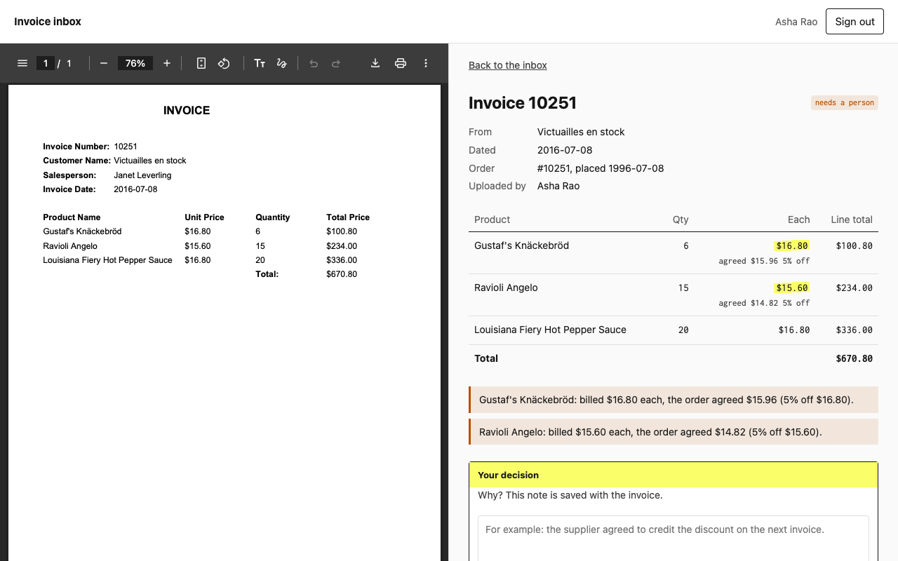
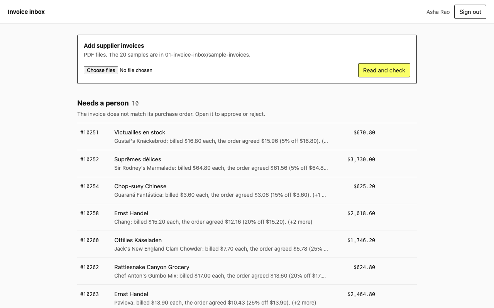
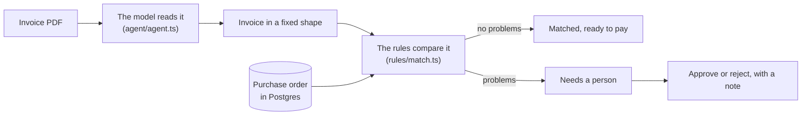

# Invoice inbox

Read supplier invoices and match each one to its purchase order.

## Why

An accounts payable clerk checks every supplier invoice against the purchase order before it is paid.
A model can read a PDF in a second, but it cannot be trusted to say whether the bill is right.
It may "fix" a wrong total, or agree with a price nobody agreed to.

So the model does one job here: it copies what is printed on the page.
Plain code then checks that reading against the order in Postgres, which the model never wrote.
Anything that does not match waits for a person.

## Goal

Upload 20 real invoices. See 9 of them matched and ready to pay, and 11 sent to a person,
each with the exact line and price that is wrong. Then clear one with a decision and a note.

## Before you start

Finish [00-setup](../00-setup/README.md). `bun run setup` has already done two things for this product:

- loaded all 830 orders of Microsoft's Northwind sample database into Postgres (the order system);
- downloaded 20 invoice PDFs for orders 10248 to 10267 into `sample-invoices/`.

The invoices come from the public `northwind_invocies` dataset on Hugging Face. They bill each order at
list price and leave out the discount the order agreed. That is a real and common billing mistake.

## Run it

From the repo root:

```bash
bun run dev invoice-inbox
```

Open [http://localhost:3101](http://localhost:3101) and click **Create an account**.
The account is real: better-auth stores it in Postgres with a hashed password.

## What you will see



The inbox has three lists. **Needs a person** comes first, oldest at the top, because those invoices wait longest.
**Matched, ready to pay** and **Decided** follow.



## How it works



1. **The model reads the PDF.** `generateText` with `Output.object` sends the PDF and gets back an invoice
   in the shape of `invoiceSchema`. A reply that does not fit the shape is an error, not a guess.
2. **The code finds the order.** The invoice number is the order number in Northwind.
3. **The rules compare them.** Customer, each product, quantity, the agreed price after discount, each line total
   and the invoice total. Each difference becomes a sentence a clerk can read.
4. **The result is saved.** No problems means matched. Any problem means it waits for a person.
5. **A person decides.** Approve for payment or reject to the supplier. Both need a note, and the note is kept.
   A second decision on the same invoice is refused, even when two people click at the same moment.

## Try these

1. Upload all 20 files from `sample-invoices/` at once and click **Read and check**.
   Expect: "Read 20 invoices." Then 11 in **Needs a person** and 9 in **Matched, ready to pay**.
2. Open invoice **#10250** (Hanari Carnes).
   Expect: Manjimup Dried Apples at $42.40 and Louisiana Fiery Hot Pepper Sauce at $16.80 are highlighted,
   each with "agreed ... 15% off" under it.
3. Open a matched invoice, such as **#10248**.
   Expect: no highlights and "Every line agrees with the order."
4. On #10250, write a note and click **Reject to supplier**.
   Expect: you are back in the inbox, 10 invoices wait, and #10250 is under **Decided** with your name and note.

## Read the code

Read in this order. Each file is short.

1. `agent/agent.ts` - start here. `readInvoice` is the only model call; `processInvoice` runs the three steps.
2. `agent/instructions.md` - the system prompt. It tells the model to copy, never to correct.
3. `rules/invoice.ts` - `invoiceSchema`, the shape the model must fill, and money in whole cents.
4. `rules/match.ts` - `matchInvoiceToOrder`, the checks a clerk would make. No AI in this file.
5. `db/schema.ts` - the orders, order lines and invoices tables.
6. `db/queries.ts` - `recordDecision` only changes an invoice that is still waiting.
7. `app/actions.ts` - the upload and the decision. Every action checks who is signed in first.
8. `app/invoices/[id]/page.tsx` and `components/InvoiceCheck.tsx` - the review page.

## Prove it

```bash
bun test 01-invoice-inbox/tests/rules.test.ts   # the rules, against the real orders in Postgres
bun run proof invoice-inbox                     # the real model reads all 20 invoices
```

`tests/rules.test.ts` checks each rule on real Northwind orders, with no model.

`tests/agent.test.ts` is the metric. The model reads all 20 sample invoices.
The test then checks that every line it read equals the order line in Postgres,
and that an invoice is flagged exactly when its order had a discount.
The answer key is Northwind itself, so nobody hand-labelled anything.

Last run: 20 of 20 read correctly, 0 wrong calls, $0.0022 for all 20 (about $0.0001 an invoice), 4 seconds with the calls in parallel,
on `openai/gpt-6-luna` through OpenRouter.

## Learn the idea in depth

Structured output and checking a model against a record it did not write are taught step by step in
[live-labs](https://github.com/learnwithparam/live-labs).
