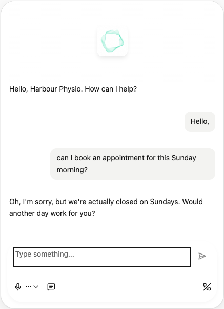
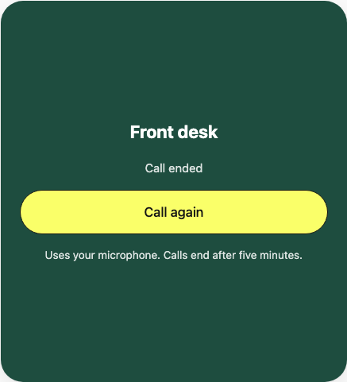
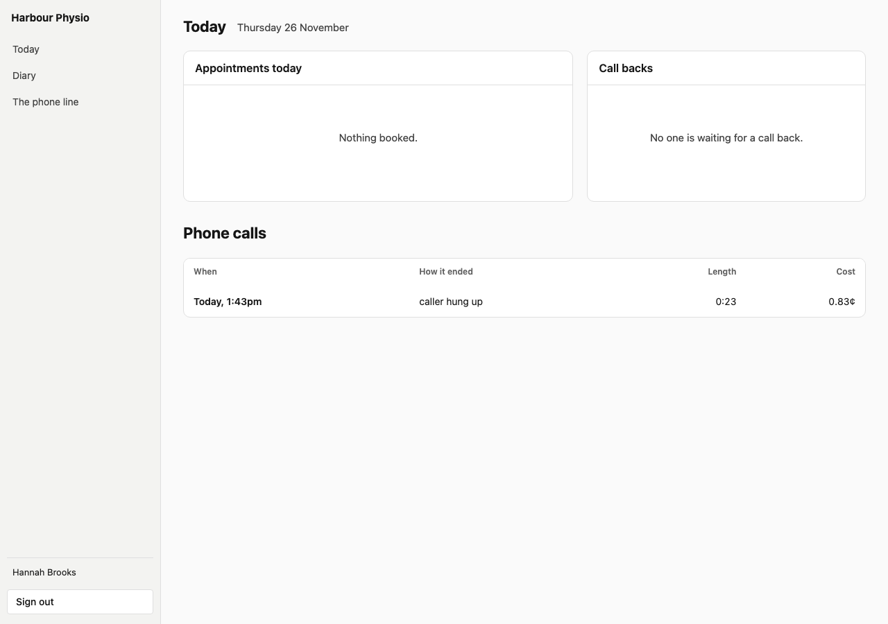
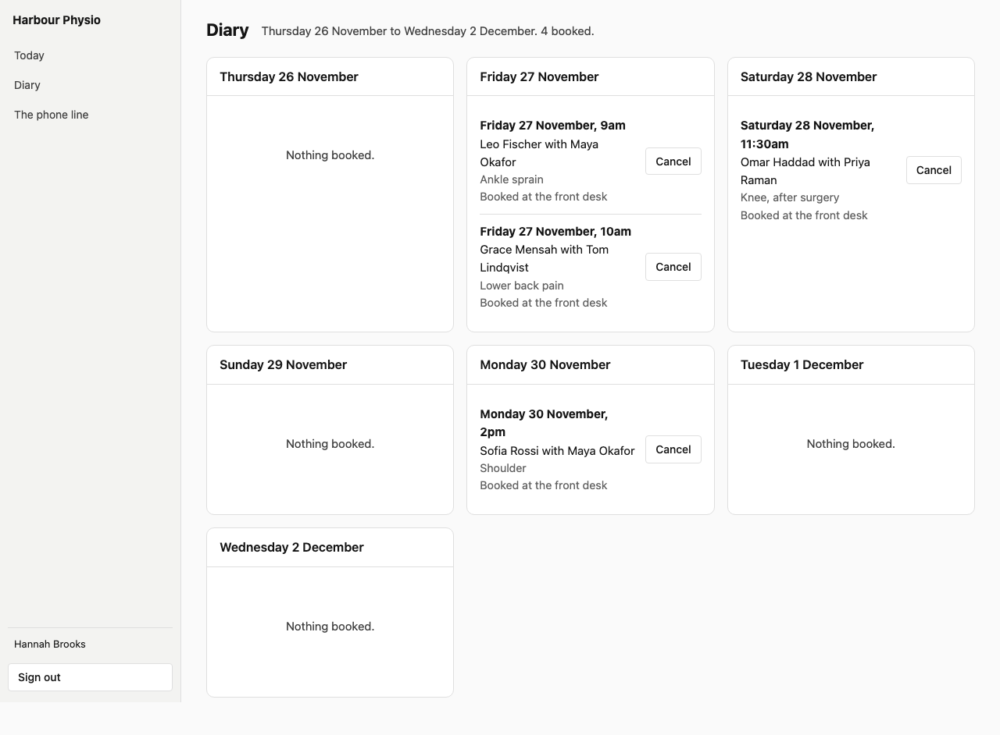
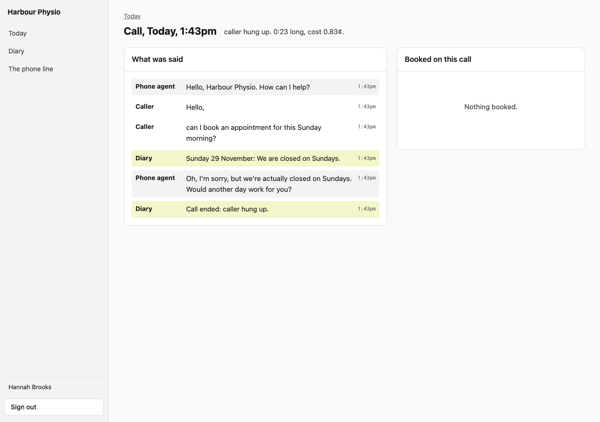
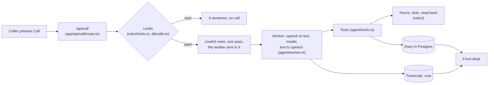

# Voice assistant

Answer a physio clinic's phone, book callers into the real diary, and leave the front desk a transcript.

## Why

A small clinic misses calls while the receptionist is with a patient, and every missed call is a booking that goes elsewhere.
A voice bot that books from one sentence will book the wrong day when it mishears "Tuesday" as "Thursday".
A voice bot that decides the hours itself will book a Sunday the clinic is closed.

So this phone line holds a slot and reads it back before anything is booked, and books only after the caller says yes.
The clinic's hours, the diary and the limits on cost live in code and Postgres, and the agent asks them every time.
Every call leaves a transcript, a cost and any call back on the front desk, so a person sees what the phone did.

## Goal

Press **Call the clinic**, ask for Tuesday at ten, and hear the time, your name and your number read back.
Say yes, and the appointment appears in the front desk's diary, booked by the phone.
Ask for a Sunday and hear that the clinic is closed, with nothing booked.

## Who uses it

| Person | What they do | Screens |
|---|---|---|
| Caller | Calls from the clinic's page with no account: books, finds or cancels an appointment, or leaves a message | The clinic page with the phone: ready to call, the live call with its transcript, call ended |
| Receptionist | Signs in to the front desk, reads the diary, calls people back, reads what each call said and cost | The front desk: today, the diary for the week, the calls and one call's transcript |
| Anyone else | Can sign up, but the front desk shows them a not-found page. Only `db/team.ts` adds an account to the team | The clinic page, like any caller |

## Before you start

Finish [00-setup](../00-setup/README.md). This product needs three more values in `.env`, from LiveKit Cloud:
`LIVEKIT_URL`, `LIVEKIT_API_KEY` and `LIVEKIT_API_SECRET`.
Make a free project at [cloud.livekit.io](https://cloud.livekit.io), then copy the URL and an API key and secret from Settings.
The free Build plan is enough. Speech to text, the model and text to speech all run on LiveKit Inference,
so these are the only keys the phone needs.

Then load the clinic's team and a few appointments the desk booked by hand:

```bash
bun run seed voice-assistant
```

It makes three physios, a receptionist who can open the front desk, and this week's diary.
It never makes calls: every call on the desk was a real one. Running it again replaces everything it made before.

## Run it

From the repo root:

```bash
bun run dev voice-assistant
```

This starts the site and the phone worker together. Open [http://localhost:3103](http://localhost:3103),
press **Call the clinic** and allow the microphone.

- **As the receptionist:** open [http://localhost:3103/desk](http://localhost:3103/desk) and sign in as
  `front-desk@seed.learnwithparam.test` with the password `seeded clinic password`.

To add your own account to the team, sign up, then run `bun 03-voice-assistant/db/team.ts you@example.com`.

## What you will see

The clinic's page, with the phone ready to call.


On a call, LiveKit's aura shows who is speaking, and the transcript fills in as both sides talk.



When the call ends, the phone says so and offers to call again.



The receptionist opens the front desk on today: the appointments, who wants a call back, and the calls the phone took.



The diary shows the week, with who booked each appointment: the front desk or the phone.



Each call opens to its transcript, line by line, with every tool the agent used.



## How it works



1. **A call takes its place before it rings.** `/api/call` counts the call against the limits under one lock:
   calls at once, minutes today, calls from this browser today. It counts at the longest and dearest a call may be,
   and settles at what the call really used once it ends.
2. **The browser gets a pass to one room.** The pass lets it join that room for no longer than one call.
   The phone is LiveKit's own Agents UI from agent-starter-react, given this pass instead of the starter's token endpoint.
3. **The worker is LiveKit's agent-starter-node.** It hears the caller with speech to text, waits for the end of a turn
   with LiveKit's turn detector, so a pause in a phone number is not taken as the end, thinks, and speaks.
4. **Booking is three tools in order.** `find_slots` offers the time asked for or the nearest free ones.
   `hold_slot` holds it and returns the words to read back. `confirm_booking` refuses until the caller has spoken again.
5. **The rules have the last word.** The hours, the slot length and how far ahead the phone may book are in `rules/clinic.ts`.
   A tool that says no tells the agent why, and the call goes on.
6. **One booking per slot is the database's rule.** The phone and the front desk book through the same `bookSlot`,
   and a unique index decides who wins, not a read before the write.
7. **Every line is saved as it happens.** The caller's words, the agent's words and each tool go to Postgres,
   so the front desk can read a call while it is still going. The cost is added up in code from what the call used.

## Try these

1. Say "I'd like an appointment next Tuesday at ten for my knee."
   Expect: the agent offers ten, asks your name and number, reads them back, and books only after you say yes.
2. Ask for Tuesday at ten again from a second call.
   Expect: ten is taken, and the agent offers the nearest free times.
3. Ask for an appointment on Sunday.
   Expect: the clinic is closed on Sundays, and nothing is booked.
4. Say "I need to cancel my appointment", then give the number you booked with.
   Expect: the agent finds it by that number and cancels it, and it leaves the front desk's diary.
5. Ask "How much is a first appointment?"
   Expect: the agent takes a message, and it appears under **Call backs** on the front desk.
6. Call three times from the same browser, then try a fourth.
   Expect: the phone says you have called three times today, and no call starts.

## Read the code

Read in this order. Each file is short.

1. `agent/worker.ts` - start here. The phone line on LiveKit's agent-starter-node: the models, the turn detector, the transcript and the cost.
2. `agent/instructions.md` - the system prompt: how to speak on a phone, and booking always in the same order.
3. `agent/prompt.ts` - today's date, the hours, the team and the dates of the coming days, added to the instructions.
4. `agent/tools.ts` and `agent/booking.ts` - the agent's tools on one call. Each answer is a sentence to say.
5. `rules/clinic.ts` - the hours, how long an appointment is, and how far ahead the phone may book.
6. `rules/hold.ts` - the read back, and why a held slot may not be booked yet.
7. `rules/slots.ts` and `rules/offer.ts` - which times exist, and which few to offer.
8. `rules/time.ts` - clinic time, so ten o'clock means ten in London whatever the server's zone.
9. `rules/limits.ts` and `rules/cost.ts` - what a call may use, and what it cost. No AI in these files.
10. `db/calls.ts` - the call ledger behind the limits, taken before the call and settled after.
11. `db/diary.ts` - the diary and `bookSlot`, used by the phone and the front desk.
12. `app/api/call/route.ts` - placing a call: the ledger, the room, the worker sent to it and the pass.
13. `components/Phone.tsx` - the caller's phone on LiveKit's Agents UI.
14. `app/desk/page.tsx` and `app/desk/actions.ts` - the front desk, and its actions checked on the server.

## Prove it

```bash
bun test 03-voice-assistant/tests/rules.test.ts 03-voice-assistant/tests/calls.test.ts   # no model
bun run proof voice-assistant                    # real phone calls, and a real browser
```

`tests/rules.test.ts` checks the hours, the slots, the times offered, the read back and the limits, with no model,
on a Monday in winter and one in summer, so clinic time holds across the clock change.
`tests/calls.test.ts` runs the database code against Postgres: two bookings for one slot leave one,
two callers pressing Call at once for the last line leave one call,
and removing a call removes its transcript but keeps what it booked.

`tests/agent.test.ts` is the metric. A bot caller speaks recorded lines into a real LiveKit room,
and the real worker answers with the real speech models and the real model. Four calls:
a booking read back and confirmed, a full ten o'clock that books eleven instead, a Sunday refused, and a cancel found by phone number.
It passes only when Postgres shows exactly that, the hold came before the booking, and every call cost under $0.10.

`tests/e2e.test.ts` walks each role in a real browser on a real call: a caller presses Call with a recorded line
as the microphone and hears that Sunday is closed, the receptionist finds that call and reads its transcript,
and an account not on the team gets a not-found page. It removes every account and call it made.

Last run (26 Nov 2026): 25 of 25 passed. The four real calls took 76, 79, 38 and 58 seconds
and cost $0.0414, $0.0444, $0.0205 and $0.0324, each under the $0.10 ceiling.

## Learn the idea in depth

Voice agents, turn taking and tools on a live call are taught step by step in
[live-labs](https://github.com/learnwithparam/live-labs).
