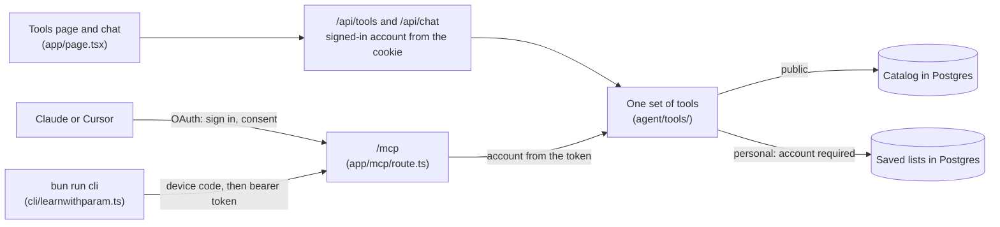

# MCP server and CLI

Offer the school's catalog as one set of tools, used from a chat, from Claude or Cursor, and from a terminal.

## Why

People want to ask about courses where they already work: in a chat on the site, in Claude or Cursor, or in a terminal.
Writing the same feature three times means three sets of bugs, and three places where a personal tool might forget to check who is asking.

So this product writes each tool once. The chat, the MCP server and the CLI all call the same four tools.
Two tools are public: anyone can search the catalog and see what is coming up.
Two are personal: saving an item and reading your saved list. They only run for a signed-in account, and only on that account's list.
Signing in from Claude, Cursor or the CLI uses OAuth, so none of them ever sees your password.

## Goal

Run every tool from the web page, and watch a personal tool refuse until you sign in.
Sign the CLI in by typing a short code in the browser, then save a lab from the terminal and see it in your list.
Connect the same address to an MCP client and get the same answers.

## Before you start

Finish [00-setup](../00-setup/README.md). `bun run setup` has already done two things for this product:
it read the live catalog from learnwithparam.com/llms.txt into Postgres (about 80 labs, courses, posts and more),
and it registered the CLI as an OAuth client.

This product needs one more line in `.env`, which `.env.example` already has:

```bash
MCP_SERVER_URL=http://localhost:3104
```

Access tokens are issued for `<this address>/mcp`, so it must match the address clients use to reach the server.

## Run it

From the repo root:

```bash
bun run dev mcp-server-and-cli
```

Open [http://localhost:3104](http://localhost:3104). The public tools and the chat work without an account.

Then sign the CLI in, in a second terminal:

```bash
bun run cli login
```

It prints a code and waits. Open [http://localhost:3104/device](http://localhost:3104/device), sign in or create an account,
check the code matches, and click **Approve**. The CLI prints "Signed in." and keeps its tokens in
`~/.config/learnwithparam/tokens.json`, readable only by you.

## What you will see


The CLI's code, shown in the browser before you approve it. The page says exactly what the CLI will be able to do.


An MCP client that signs in with OAuth gets a consent page with its own name on it. You see it once per app.


## How it works



1. **Each tool is written once,** in `agent/tools/`, with a name, a description and an input schema.
   `publicTool` runs for anyone. `personalTool` throws "sign in first" when there is no account, before its code runs.
2. **The web page** calls `/api/tools/<name>` with your session cookie. The chat gives the same tools to the model,
   so the model is told to sign in by the tool itself, not by a rule in the prompt.
3. **The MCP server** checks the bearer token on every request. A request with no token gets a 401 that names
   `/.well-known/oauth-protected-resource`, which tells the client where to sign in.
   The token says who you are, and that account is the only one the personal tools see.
4. **Claude and Cursor** sign in with OAuth and PKCE. They name themselves with a Client ID Metadata Document,
   a public JSON page about the app, so nobody registers them by hand. You see a consent page once.
5. **The CLI** has no browser of its own, so it uses the device flow: it gets a short code, you approve it on `/device`,
   and it polls until it gets a token. The device page only accepts codes for the CLI's own client.
6. **Tokens expire.** The CLI uses its refresh token when less than a minute is left.

## Try these

1. On the page, run **search_catalog** with query "agents" and kind "lab".
   Expect: JSON with past labs about agents, each with a title, link and date.
2. Signed out, run **my_saved_list**.
   Expect: a red box saying you need to sign in. No list is shown.
3. Ask the chat "What live labs are coming up?"
   Expect: a short list of linked labs with dates from today on, and an **upcoming_sessions** tool card.
4. After `bun run cli login`, run `bun run cli upcoming-sessions`, then `bun run cli save-for-later <url>` with a url it printed.
   Expect: `{"saved": "<title>", ...}`, and the item appears in `bun run cli my-saved-list`.
5. Run `bun run cli save-for-later https://example.com/not-ours`.
   Expect: a message that the url is not in the catalog, and the command exits with status 1.
6. Run `bun run cli logout`, then `bun run cli my-saved-list`.
   Expect: "Signed out on this computer.", then a new code to approve, because every call to `/mcp` needs a token.
   Press Ctrl+C to stop waiting.
7. Add `http://localhost:3104/mcp` to an MCP client that runs on your machine and supports OAuth sign-in.
   Expect: a sign-in page, then the consent page with the client's name, then the same four tools.
   Claude on the web runs in the cloud and cannot reach `localhost`, so it needs a public https address.

## Read the code

Read in this order. Each file is short.

1. `agent/tools/tool.ts` - start here. `publicTool` and `personalTool`, and the one place that refuses a caller with no account.
2. `agent/tools/search-catalog.ts` and `agent/tools/upcoming-sessions.ts` - the two public tools.
3. `agent/tools/save-for-later.ts` and `agent/tools/my-saved-list.ts` - the two personal tools.
4. `agent/tools/all.ts` - the one list every way in reads.
5. `agent/mcp-server.ts` - the list, offered as an MCP server for one account.
6. `agent/agent.ts` - the same list, offered to the model in the chat.
7. `auth/auth.ts` - the OAuth server: sign-in, consent, client metadata documents and the device flow.
8. `app/mcp/route.ts` - checks the token, then answers MCP for that account.
9. `app/api/tools/[name]/route.ts` - the web page's way in, with the session cookie.
10. `cli/login.ts` - the device flow and the token refresh.
11. `cli/learnwithparam.ts` - turns `save-for-later <url>` into an MCP call.
12. `app/device/page.tsx` and `app/consent/page.tsx` - the two pages where you approve an app.
13. `../packages/catalog/catalog.ts` - reads llms.txt into items, and which sessions are upcoming. No AI in this file.
    The admin assistant reads the same catalog, so it lives in `packages/`.
14. `rules/same-path.ts` - the sign-in page sends you back only to a path on this site.

## Prove it

```bash
bun test 04-mcp-server-and-cli/tests/rules.test.ts   # reading the catalog and the queries, no model
bun test 04-mcp-server-and-cli/tests/tools.test.ts   # every tool, every way in
bun run proof mcp-server-and-cli                     # the real model, and the real CLI sign-in in a browser
```

`tests/tools.test.ts` walks every tool in `agent/tools/all.ts`, so a new tool is covered with no new test.
Each tool must be in the chat and in the MCP server's list with the same description,
and each personal tool must refuse a caller with no account both directly and over MCP.

`tests/agent.test.ts` is the metric. It asks four real questions and passes only when the chat picks the right tool
every time and every link in its answer came from a tool: what is coming up, a blog post on a topic,
saving a lab by its name, and a signed-out "show my saved list" that must end in "sign in".

`tests/e2e.test.ts` walks the learner's path: `/mcp` with no token is a 401, `bun run cli login` is approved in a real browser,
the token file is readable only by you, the CLI saves an item and lists it, and an edited consent link is a 404.

Last run: 4 of 4 right, five runs in a row, about $0.0008 for all four questions,
on `openai/gpt-6-luna` through OpenRouter.

## Learn the idea in depth

MCP servers, OAuth for agents and tools shared across clients are taught step by step in
[live-labs](https://github.com/learnwithparam/live-labs).
