# MCP server and CLI

Offer the school's catalog as one set of tools, used from a web page, from Claude or Cursor, and from a terminal.

## Why

People want to ask about courses where they already work: in Claude or Cursor, in a terminal, or on the site.
Writing the same feature three times means three sets of bugs, and three places where a personal tool might forget to check who is asking.

So this product writes each tool once. The web page, the MCP server and the CLI all call the same four tools.
Two tools are public: anyone can search the catalog and see what is coming up.
Two are personal: saving an item and reading your saved list. They only run for a signed-in account, and only on that account's list.
Signing in from Claude, Cursor or the CLI uses OAuth, so none of them ever sees your password.

The web page is built like a developer settings page, not a chat. Each tool is a form you can run, with the same call
shown for the terminal and for Claude. Connected apps lists every app you let in, with a revoke button.
Activity lists every call made as you, from every way in, including the ones that failed.

## Who uses it

| Person | What they do | Screens |
|---|---|---|
| Visitor | Runs the public tools, copies the command for the terminal or Claude, and sees a personal tool ask to sign in | The tools page signed out; the "Call it from" panel |
| Ana, a learner with apps | Uses the CLI and a study planner app, asks a question in plain words, checks what ran as her, revokes an app | The tools page signed in, "Ask in plain words", Connected apps, the revoke question, Activity and its Failed tab |
| Ben, a learner with no apps yet | Signs the CLI in with a code, and lets an app connect for the first time | Connected apps with nothing in it, the CLI's code page, an app's consent page |

`bun run seed mcp-server-and-cli` makes Ana and Ben through the real sign-up path, signs the CLI in for them with the real
device flow, and replays ten days of their calls through the real tools. Ana's history has two failed calls:
a link that is not in the catalog and a one-letter search. Her one plain-words question is answered by the real model,
for about $0.0002.

## Goal

Run every tool from the web page, and watch a personal tool refuse until you sign in.
Sign the CLI in by typing a short code in the browser, then save a lab from the terminal and see it in your list.
Connect the same address to an MCP client and get the same answers.
See every call in Activity, and revoke an app so its next call is refused.

## Before you start

Finish [00-setup](../00-setup/README.md). `bun run setup` has already done two things for this product:
it read the live catalog from learnwithparam.com/llms.txt into Postgres (about 80 labs, courses, posts and more),
and it registered the CLI as an OAuth client.

This product needs one more line in `.env`, which `.env.example` already has:

```bash
MCP_SERVER_URL=http://localhost:3104
```

Access tokens are issued for `<this address>/mcp`, so it must match the address clients use to reach the server.

## Run it

From the repo root:

```bash
bun run seed mcp-server-and-cli   # optional: Ana and Ben, their apps and ten days of calls
bun run dev mcp-server-and-cli
```

Open [http://localhost:3104](http://localhost:3104). The public tools work without an account.
To see the seeded pages, sign in as `ana@tools-seed.learnwithparam.test` or `ben@tools-seed.learnwithparam.test`,
password `seeded developer password`.

Then sign the CLI in, in a second terminal:

```bash
bun run cli login
```

It prints a code and waits. Open [http://localhost:3104/device](http://localhost:3104/device), sign in or create an account,
check the code matches, and click **Approve**. The CLI prints "Signed in." and keeps its tokens in
`~/.config/learnwithparam/tokens.json`, readable only by you.

## What you will see

Signed out, each tool is a form. A public tool runs and shows its result as a list. A personal tool asks you to sign in.

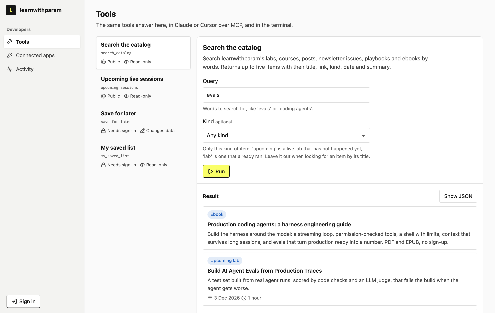

Under each result, the same call for the terminal and for Claude or Cursor, ready to copy.

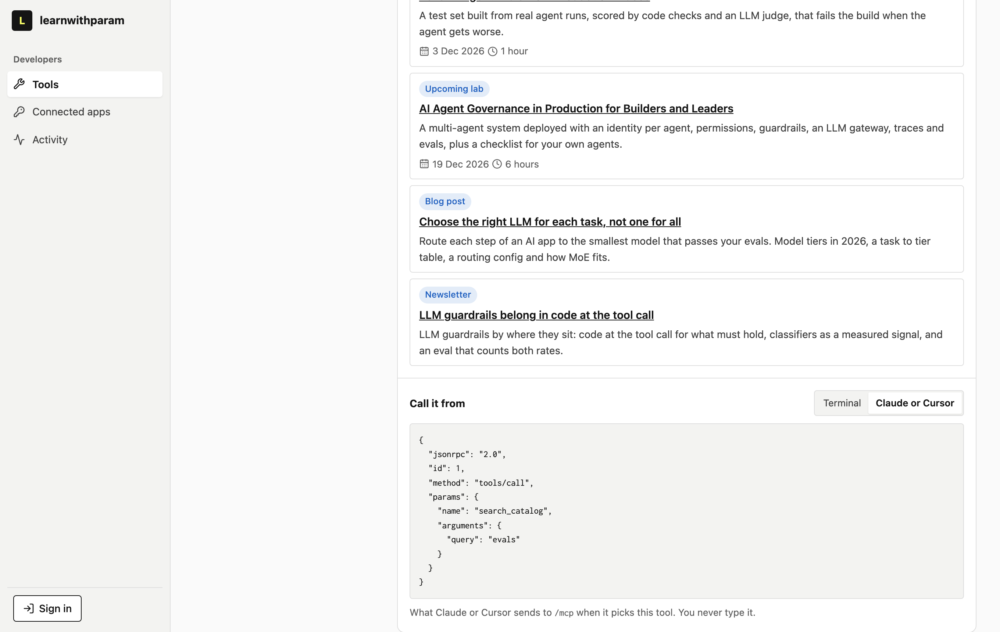

Signed in as Ana, the personal tools run on her own list. "Ask in plain words" picks the tools for a question and shows each call it made.

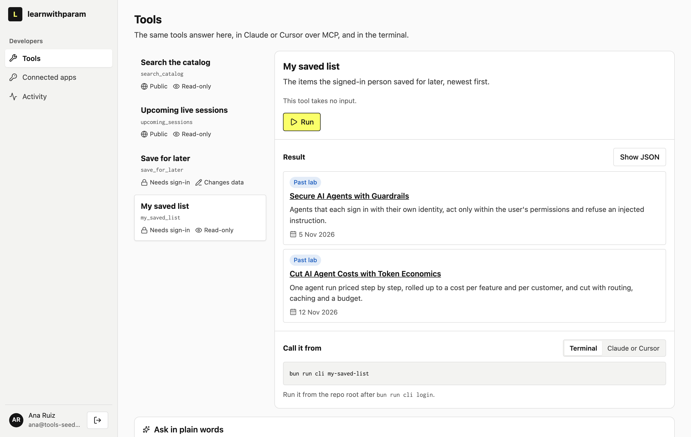

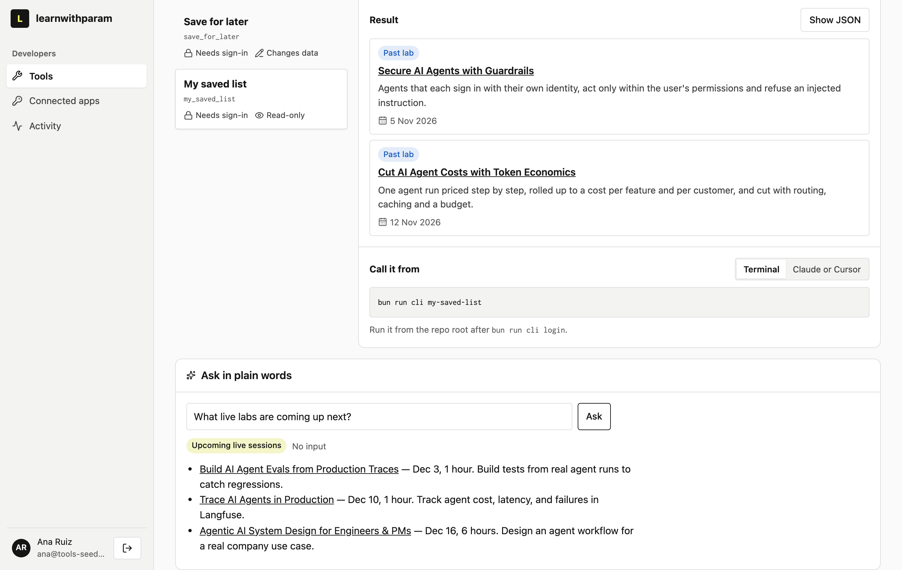

Connected apps lists each app Ana let in, what it may do, and when it last ran a tool. Revoking asks first.

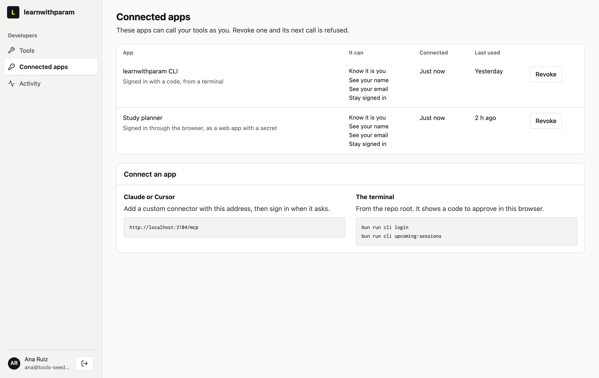

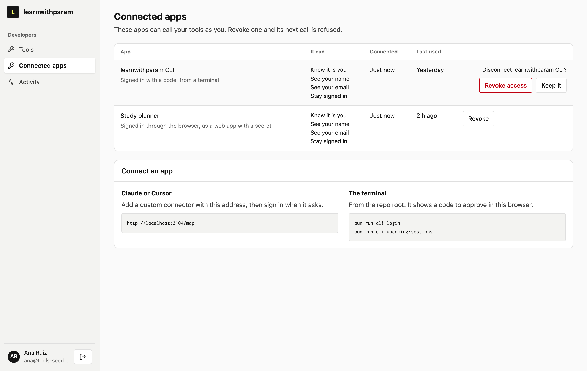

Ben has no apps yet, so the page says how to connect one.

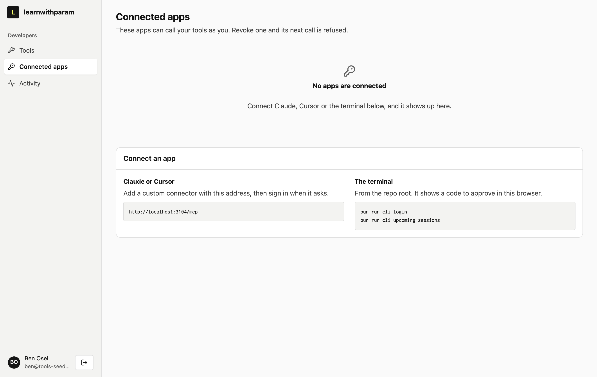

Activity is every call made as Ana: when, which tool, from where, the input in plain words, the outcome and how long it took.

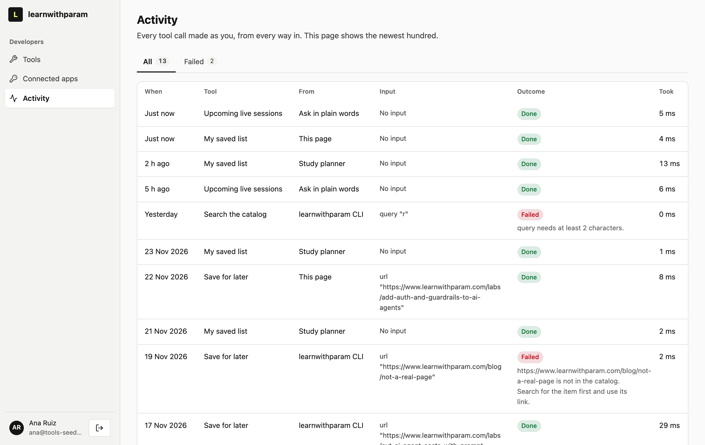

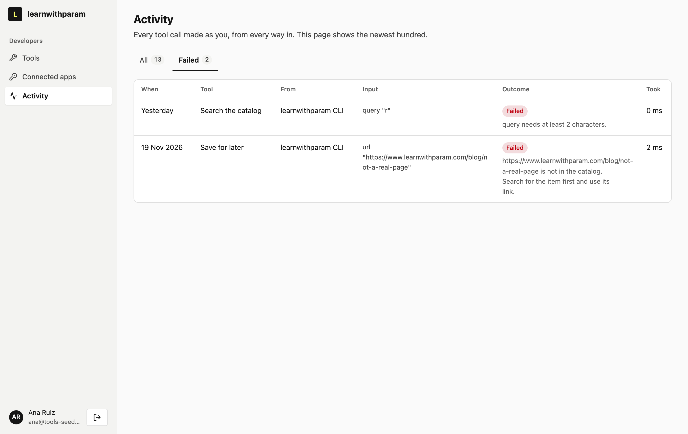

The CLI's code, shown in the browser before Ben approves it. The page names every tool the CLI can run and whether it changes data.

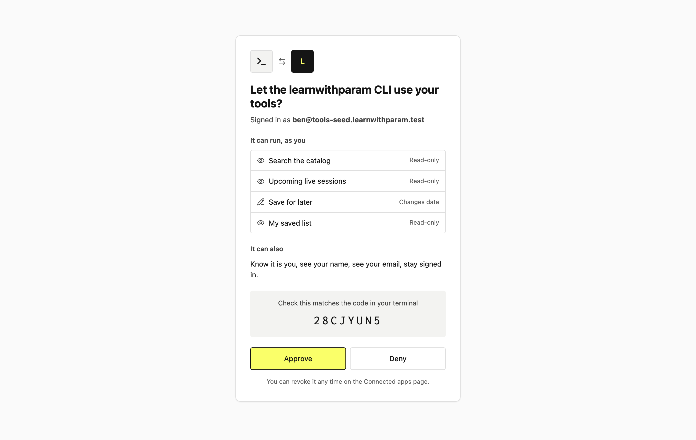

An app that signs in through the browser gets the same page with its own name, once.

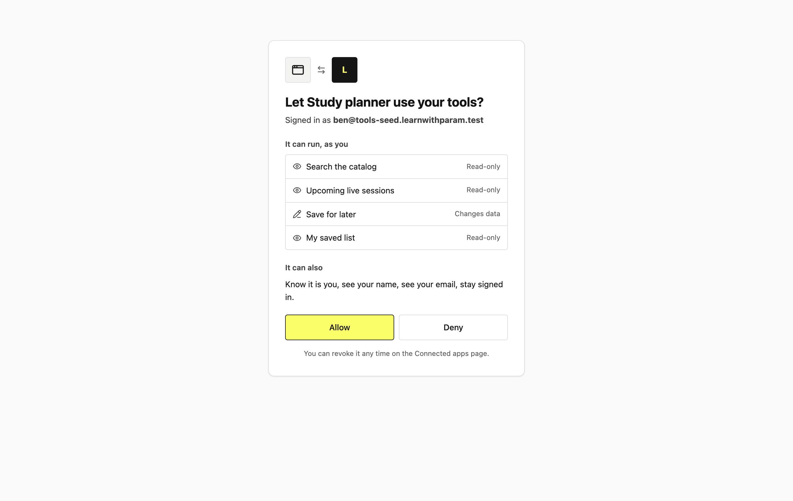

On a phone, the tool list scrolls sideways and each activity row becomes a small card.

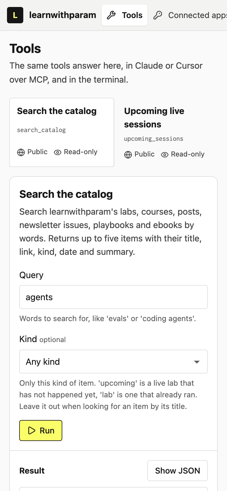

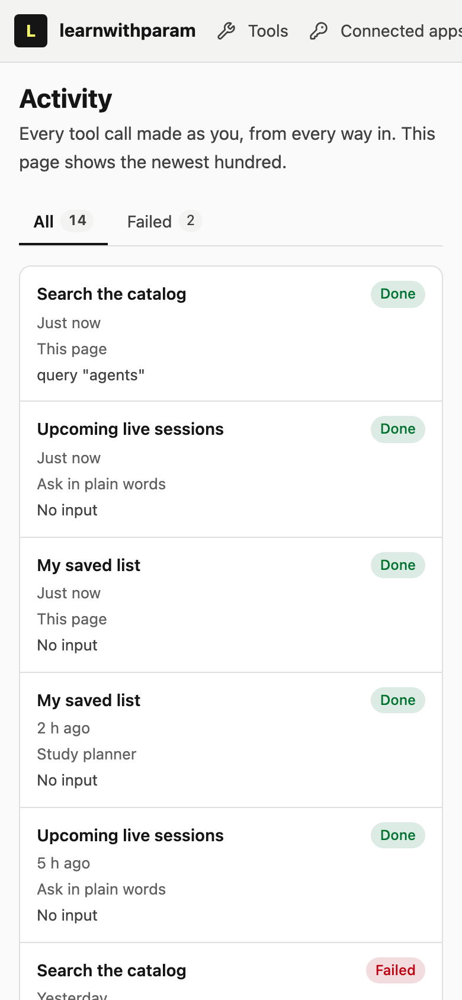

## How it works

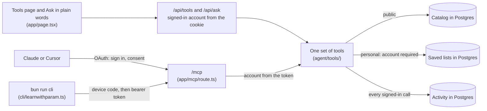

1. **Each tool is written once,** in `agent/tools/`, with a name, a description and an input schema.
   `publicTool` runs for anyone. `personalTool` throws "sign in first" when there is no account, before its code runs.
2. **The web page** builds each tool's form from its input schema and calls `/api/tools/<name>` with your session cookie.
   A bad input comes back as a plain sentence, such as "query needs at least 2 characters."
   "Ask in plain words" gives the same tools to the model. It needs a signed-in account, so a stranger cannot spend on the model.
3. **The MCP server** checks the bearer token on every request. A request with no token gets a 401 that names
   `/.well-known/oauth-protected-resource`, which tells the client where to sign in.
   The token says who you are, and that account is the only one the personal tools see.
4. **Claude and Cursor** sign in with OAuth and PKCE. They name themselves with a Client ID Metadata Document,
   a public JSON page about the app, so nobody registers them by hand. You see a consent page once.
5. **The CLI** has no browser of its own, so it uses the device flow: it gets a short code, you approve it on `/device`,
   and it polls until it gets a token. The device page only accepts codes for the CLI's own client.
6. **Tokens expire.** The CLI uses its refresh token when less than a minute is left.
7. **A web app that connects for its users** runs on a server and can keep a secret, so you register it by hand:
   `bun 04-mcp-server-and-cli/auth/register-app.ts "Team workspace" http://localhost:3109/api/connectors/callback`.
   It prints a client id and a secret once. The [team workspace](../09-team-workspace/README.md) connects this way.
8. **Each tool says whether it changes data.** MCP clients see the others marked `readOnlyHint`,
   so a client may run a search without asking and ask before a save. The approval page shows the same mark.
9. **Every signed-in call is kept,** with where it came from and how it ended (`db/activity.ts`).
   A signed-out call belongs to nobody, so it is not kept.
10. **Revoking an app deletes its consent and its tokens** (`db/apps.ts`). `/mcp` checks the consent on every call,
    so a token the app still holds is refused from the next call on.

## Try these

1. On the page, open **Search the catalog**, type "agents", pick the kind "lab" and click **Run**.
   Expect: a list of labs about agents, each with its link and date, and the same call under "Call it from".
2. Signed out, open **My saved list**.
   Expect: a "Sign in to run it" link instead of a Run button. No list is shown.
3. Search for "a".
   Expect: a red box saying "query needs at least 2 characters." and no result.
4. Sign in as Ana, and ask "What live labs are coming up next?" under **Ask in plain words**.
   Expect: an **Upcoming live sessions** call, then an answer with linked labs dated from today on.
5. After `bun run cli login`, run `bun run cli upcoming-sessions`, then `bun run cli save-for-later <url>` with a url it printed.
   Expect: `{"saved": "<title>", ...}`, the item in `bun run cli my-saved-list`, and both calls in **Activity**.
6. Run `bun run cli save-for-later https://example.com/not-ours`.
   Expect: a message that the url is not in the catalog, the command exits with status 1, and the call is in Activity's **Failed** tab.
7. On **Connected apps**, revoke the CLI, then run `bun run cli my-saved-list`.
   Expect: the CLI leaves the list, and the command is refused even though its token has not expired.
8. Add `http://localhost:3104/mcp` to an MCP client that runs on your machine and supports OAuth sign-in.
   Expect: a sign-in page, then the consent page with the client's name, then the same four tools.
   Claude on the web runs in the cloud and cannot reach `localhost`, so it needs a public https address.

## Read the code

Read in this order. Each file is short.

1. `agent/tools/tool.ts` - start here. `publicTool` and `personalTool`, and the one place that refuses a caller with no account.
2. `agent/tools/search-catalog.ts` and `agent/tools/upcoming-sessions.ts` - the two public tools.
3. `agent/tools/save-for-later.ts` and `agent/tools/my-saved-list.ts` - the two personal tools.
4. `agent/tools/all.ts` - the one list every way in reads.
5. `agent/tools/call.ts` - runs a tool and records the call in the activity log, whichever way it came in.
6. `agent/tools/describe.ts` - turns each tool's input schema into the fields of its form on the web page.
7. `agent/mcp-server.ts` - the list, offered as an MCP server for one account.
8. `agent/agent.ts` - the same list, offered to the model for "Ask in plain words".
9. `auth/auth.ts` - the OAuth server: sign-in, consent, client metadata documents and the device flow.
10. `app/mcp/route.ts` - checks the token and the consent, then answers MCP for that account.
11. `app/api/tools/[name]/route.ts` - the web page's way in, with the session cookie.
12. `cli/login.ts` - the device flow and the token refresh.
13. `cli/learnwithparam.ts` - turns `save-for-later <url>` into an MCP call.
14. `components/GrantCard.tsx`, `app/device/page.tsx` and `app/consent/page.tsx` - the pages where you approve an app.
15. `db/apps.ts` - the apps an account let in, and revoking one.
16. `db/activity.ts` - the activity log.
17. `rules/plain.ts` - scopes, inputs, times and input errors in plain words. No AI in this file.
18. `../packages/catalog/catalog.ts` - reads llms.txt into items, and which sessions are upcoming. No AI in this file.
    The admin assistant reads the same catalog, so it lives in `packages/`.
19. `rules/same-path.ts` - the sign-in page sends you back only to a path on this site.
20. `auth/register-app.ts` - registers a web app with a client secret and its one return address.
21. `agent/seed/seed.ts` and `agent/seed/stories.ts` - Ana's and Ben's ten days, replayed through the real tools.

## Prove it

```bash
bun test 04-mcp-server-and-cli/tests/rules.test.ts   # reading the catalog and the queries, no model
bun test 04-mcp-server-and-cli/tests/tools.test.ts   # every tool, every way in
bun test 04-mcp-server-and-cli/tests/apps.test.ts    # the activity log, connected apps and revoking
bun run proof mcp-server-and-cli                     # the real model, and the real CLI sign-in in a browser
```

`tests/tools.test.ts` walks every tool in `agent/tools/all.ts`, so a new tool is covered with no new test.
Each tool must be in "Ask in plain words" and in the MCP server's list with the same description,
and each personal tool must refuse a caller with no account both directly and over MCP.

`tests/agent.test.ts` is the metric. It asks four real questions and passes only when the model picks the right tool
every time and every link in its answer came from a tool: what is coming up, a blog post on a topic,
saving a lab by its name, and a signed-out "show my saved list" that must end in "sign in".

`tests/e2e.test.ts` walks the learner's path: `/mcp` with no token is a 401, `bun run cli login` is approved in a real browser,
the token file is readable only by you, the CLI saves an item and lists it, its failed call is in Activity,
revoking it on Connected apps makes its next call fail, and an edited consent link is a 404.

Last run (26 Nov 2026): 4 of 4 right, $0.0008 for all four questions on `openai/gpt-6-luna` through OpenRouter.
All 40 proof tests passed.

## Learn the idea in depth

MCP servers, OAuth for agents and tools shared across clients are taught step by step in
[live-labs](https://github.com/learnwithparam/live-labs).
