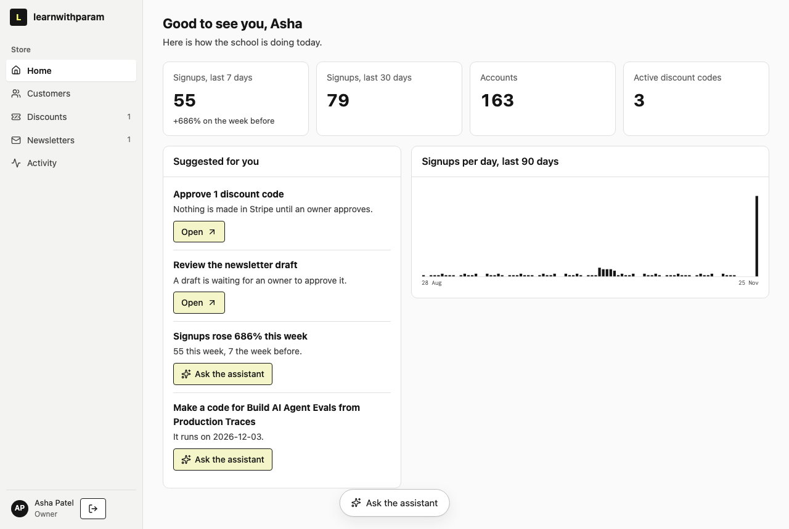
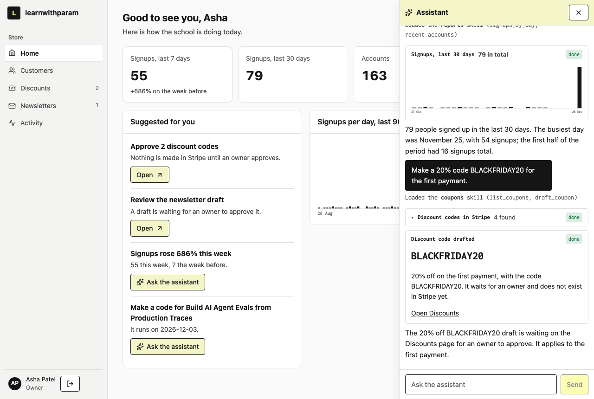
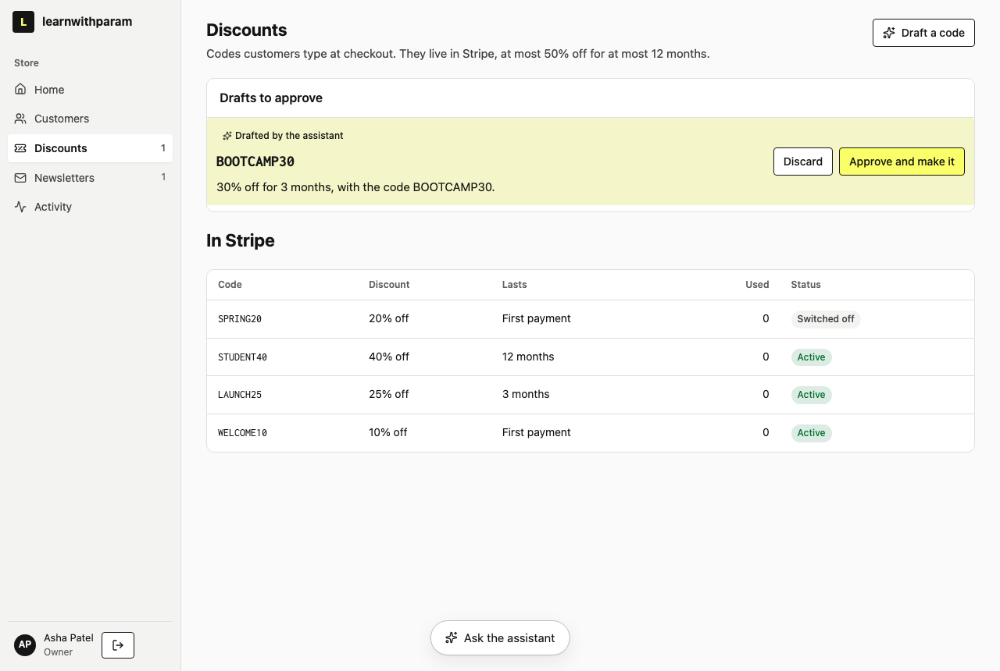
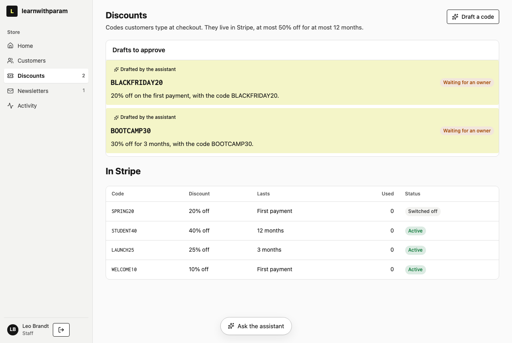
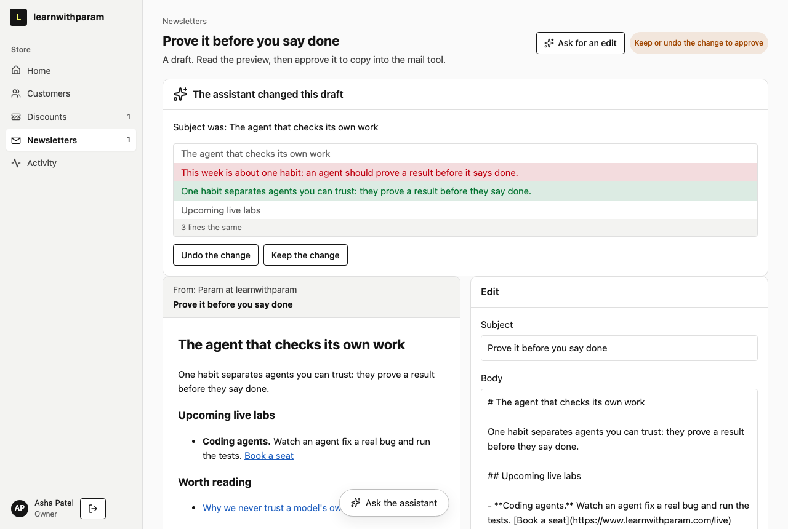
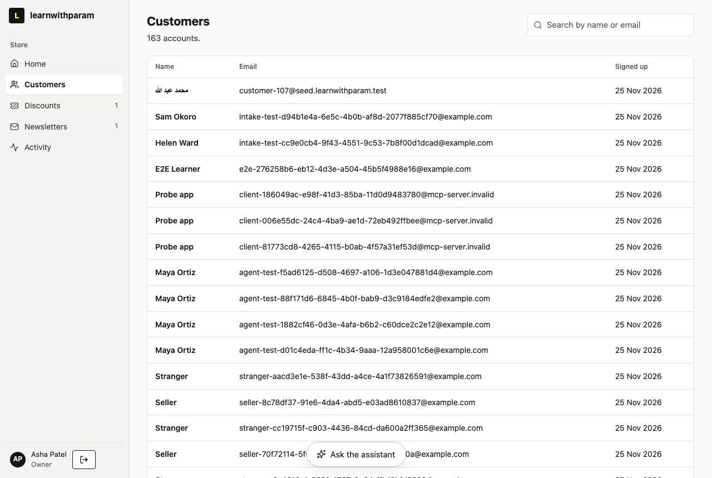
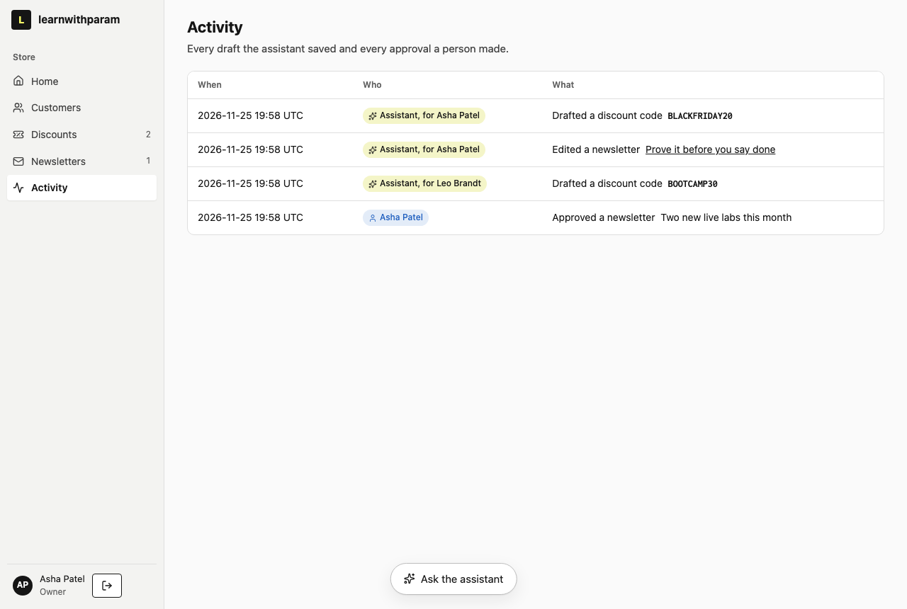
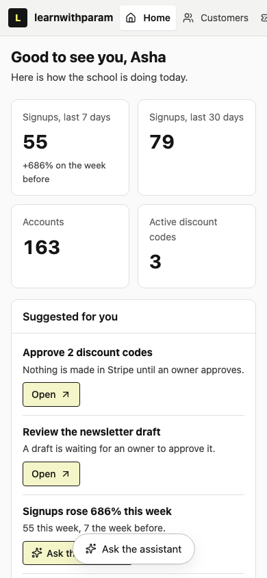
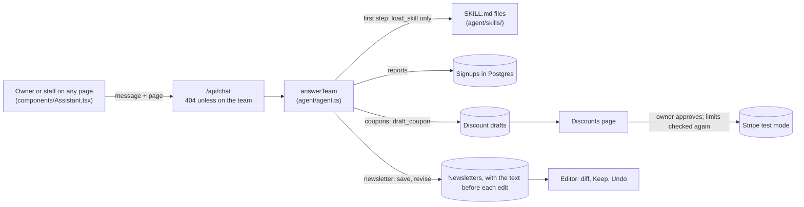

# Admin assistant

The school's admin, built like Shopify's: real pages for customers, discounts and newsletters, with an assistant that works on them.

## Why

An owner checks the same few things every week: signups, live discount codes, and the newsletter.
A chat window that does all three is the easy build, but its work then lives in a transcript, far from the page where it matters.

Shopify's Sidekick shows a better shape. The admin stays the admin.
A small prompt waits at the bottom of every page and opens a side panel for longer work.
What the assistant makes lands on the object itself: a code is a draft row on the Discounts page, and an edit is a diff in the newsletter editor.

So this product shows four ideas.
**Skills:** the assistant starts with one tool, `load_skill`, and gets a skill's tools only after it loads that skill.
**UI the agent draws:** a tool's result is a card, such as a bar chart, never a paragraph of numbers.
**Drafts, not actions:** the assistant cannot reach Stripe's write calls or send mail. It saves drafts, and the server makes a code only when an owner approves it.
**The page as context:** the panel tells the assistant which page is open, so "make the subject shorter" edits the newsletter on screen.

## Goal

Open Home and read what needs you: drafts waiting, the signup trend, and ideas for the next lab.
Ask for a 20% code and see it appear as a draft on the Discounts page, then approve it and see it in Stripe's test mode.
Ask the assistant to edit a newsletter and read its change as a diff before you keep it.
Sign in as staff and see the same pages, with every approval left to an owner.

## Who uses it

| Person | What they do | Screens |
|---|---|---|
| Owner | Reads Home, asks the assistant, approves or discards discount drafts, keeps or undoes edits, approves newsletters | Home, Customers, Discounts, Newsletters and the editor, Activity, the assistant panel |
| Staff | Everything an owner reads, asks the assistant for drafts and edits, and writes newsletters. Cannot approve a code or a newsletter | The same pages, with "Waiting for an owner" in place of each approval |
| Anyone else with an account | Nothing. Every page and the assistant's address answer not found | None |

## Before you start

Finish [00-setup](../00-setup/README.md). This product uses the Stripe test key from `.env`, the same one the site assistant uses.
It refuses a live key outside production.

Load the sample store from the repo root:

```bash
bun run seed admin-assistant
```

It signs up about a hundred customers through the real sign-up path and dates them across 90 days.
Some names are hard on a screen: long ones, other scripts, an apostrophe, and one written to steer the model.
It also makes four discount codes in Stripe's test mode, one switched off, and two newsletters.
It prints an owner and a staff account to sign in with.

To join the team with your own account, sign up on the sign-in page, then run:

```bash
bun 05-admin-assistant/db/team.ts you@example.com owner
```

## Run it

From the repo root:

```bash
bun run dev admin-assistant
```

Open [http://localhost:3105](http://localhost:3105) and sign in as the owner the seed printed.

## What you will see

Home shows four numbers, the work waiting for a person, and ideas from the live catalog. Each idea opens the page or asks the assistant.



The assistant is a small prompt at the bottom of every page. Asked for signups, it loads the reports skill and draws a chart. Asked for a code, it saves a draft and links to it.



On Discounts, the draft is a yellow row. Only an owner sees Approve. The table below lists the codes in Stripe.





When the assistant edits a newsletter, the editor shows what changed before anything else. The email is drawn as the reader will see it.



Customers is a searchable list. Activity records every draft the assistant saved and every decision a person made.





On a phone the nav becomes a top row and the panel fills the screen.



## How it works



1. **Each skill is a `SKILL.md` file** with a name, a description and the tools it may use.
   The instructions list only the names and descriptions, so the prompt stays short as skills are added.
2. **Tools follow skills.** Before each step, `prepareStep` sets the active tools: `load_skill`, plus the tools of every skill loaded so far.
3. **The assistant only drafts.** `draft_coupon` checks the limits and saves a row. No tool file imports Stripe's write calls or the mail package, and a test reads every tool file to prove it.
4. **Approval is a page, not a chat card.** The Discounts form sends only the draft's id. The server checks the role, claims the draft so a second click does nothing, checks the limits again, and then calls Stripe.
5. **An edit keeps what it replaced.** `revise_newsletter` saves the old subject and body beside the new ones. The editor draws the diff, and Undo puts the old text back.
6. **The page is context.** The panel sends the path with each message. The agent turns it into one sentence from a fixed list, so a crafted path can never become an instruction.
7. **Home is plain code.** `rules/pulse.ts` turns counts into at most five suggestions, with no model call.

## Try these

1. On Home, click **Ask the assistant** in the bottom bar, then "How many people signed up in the last 30 days?"
   Expect: "Loaded the reports skill", a bar chart with 30 days, and a total that matches it.
2. Ask "Make a 20% code SPRINGSALE for the first payment."
   Expect: a "Discount code drafted" card, a new yellow row on Discounts, and nothing in Stripe yet.
3. On Discounts, click **Approve and make it**.
   Expect: the row leaves, the code appears in the Stripe table as Active, and Activity shows your approval.
4. Ask "Make a 90% code HALFOFF90."
   Expect: a reply that the limit is 50%, and no new draft.
5. Open the draft newsletter, click **Ask for an edit**, and ask "Make the subject shorter."
   Expect: the "assistant changed this draft" panel with the old subject struck through. **Undo the change** puts it back.
6. Sign in as the staff account and open Discounts.
   Expect: "Waiting for an owner" on every draft, and no Approve button.

## Read the code

Read in this order. Each file is short.

1. `agent/skills/coupons/SKILL.md` - start here. A skill: its header, and plain instructions for the model.
2. `rules/skill-file.ts` - reads a skill file into its name, description, tools and instructions. No AI in this file.
3. `agent/skills/skills.ts` - the three skills, and the short menu the model sees.
4. `agent/agent.ts` - which tools are active at each step, and the page sentence.
5. `agent/tools/all.ts` - every tool.
6. `rules/coupon.ts` - the limits, in code. No AI in this file.
7. `agent/tools/draft-coupon.ts` - checks the limits and saves a draft. It never calls Stripe.
8. `db/approve.ts` - the owner's approval: claim the draft, check again, make the code in Stripe.
9. `app/(admin)/discounts/page.tsx` - the drafts and the codes, with Approve only for owners.
10. `agent/tools/newsletter-edit.ts` and `db/newsletters.ts` - an edit that keeps the text it replaced.
11. `rules/diff.ts` and `components/DiffView.tsx` - the line diff the editor shows.
12. `rules/email.ts` and `components/EmailPreview.tsx` - the newsletter drawn as an email, with only https links.
13. `rules/pulse.ts` - the suggestions on Home. No AI in this file.
14. `components/Assistant.tsx` - the prompt, the panel, and the page sent with each message.
15. `app/session.ts` - the team check for every page, and the owner check for approvals.

## Prove it

```bash
bun test 05-admin-assistant/tests/rules.test.ts     # skill files, coupon limits, days, the newsletter's items, roles
bun test 05-admin-assistant/tests/screens.test.ts   # suggestions, the diff, the email preview, the page sentence
bun test 05-admin-assistant/tests/tools.test.ts     # every skill's tools exist; no tool reaches Stripe's writes or mail
bun run proof admin-assistant                       # the real model, Stripe's test mode, and each role in a browser
```

`tests/tools.test.ts` walks every skill and every tool file, so a new one is covered with no new test.

`tests/agent.test.ts` is the metric. It sends six real requests and passes only when each takes the right path:
a signups question loads only the reports skill, a 20% code becomes a draft that only an approval makes in Stripe,
a 90% code is refused and saves nothing, an edit to the open newsletter keeps the text it replaced,
every link in a newsletter draft came from the live catalog,
and an account whose name holds instructions shows on the card while the model is sent only a count.

`tests/e2e.test.ts` walks each role in a real browser: a signed-in stranger gets a 404 on the page and on the chat,
the owner opens the panel from Home and gets a chart, staff see a draft with no Approve button,
the owner approves a draft and it exists in Stripe, and Undo on a newsletter puts the old text back.

Last run: 37 of 37 tests passed, about $0.003 for the six model requests, on `openai/gpt-6-luna` through OpenRouter.

## Learn the idea in depth

Skills, tool approvals and generative UI are taught step by step in
[live-labs](https://github.com/learnwithparam/live-labs).
