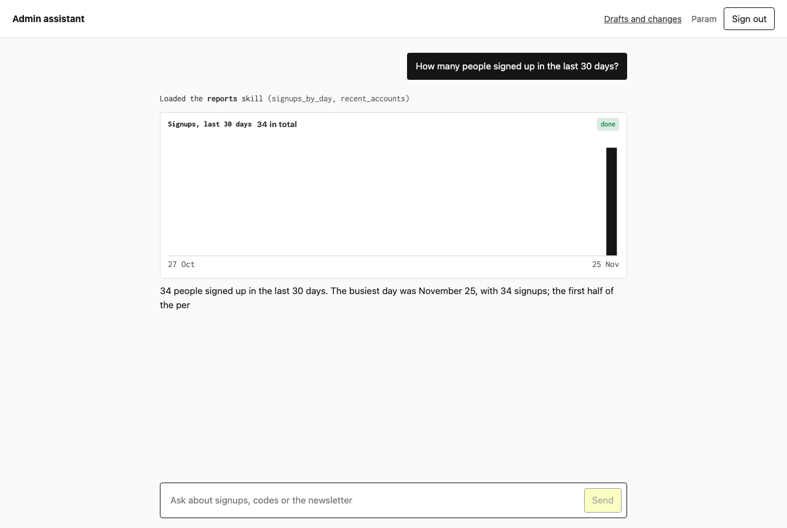
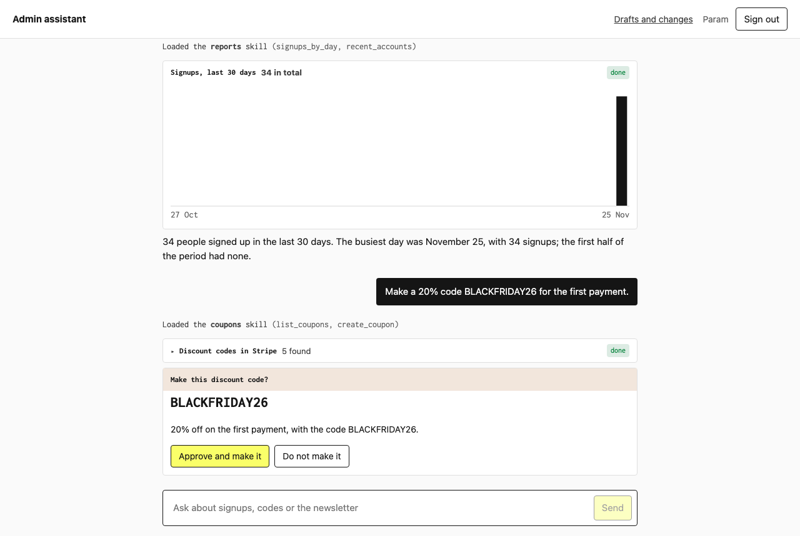
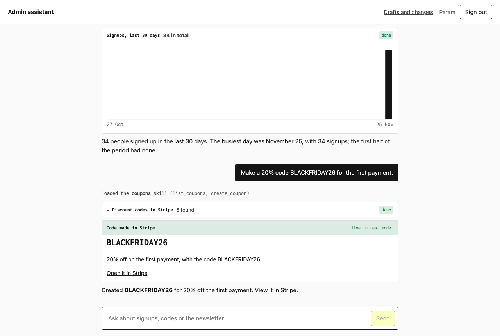
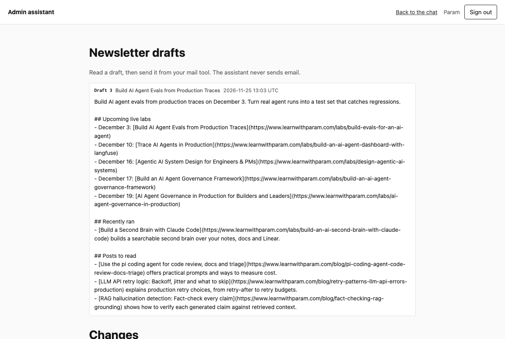
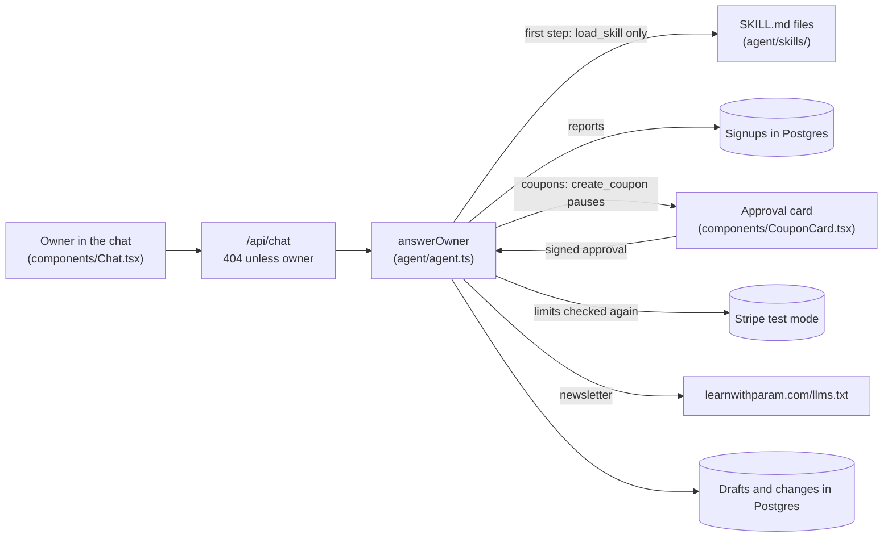

# Admin assistant

A chat panel for the school's owner: signups as a chart, discount codes in Stripe after an approval, and newsletter drafts.

## Why

An owner checks the same few things every week: how many people signed up, which discount codes are live, and what goes in the newsletter.
Each one means opening a different dashboard. A chat that can do all three saves that time, but only if it is safe.

So this product shows three ideas.
**Skills:** the assistant starts with one tool, `load_skill`, and gets a skill's tools only after it loads that skill.
A question about signups never sees the tool that makes discount codes.
**UI the agent draws:** a tool's result is shown as a card, such as a bar chart, not as a paragraph of numbers.
**A human in the loop:** making a code pauses on an approval card. The server makes it only when the approval is signed for that exact code,
and the limits are set in code, so no message in the chat can raise them.

## Goal

Ask for last month's signups and see a chart from the real database.
Ask for a 20% code, approve it on the card, and open it in Stripe's test dashboard.
Ask for 90% and watch it be refused before any card appears.
Draft the newsletter and read it on the log page, with links only to real pages on learnwithparam.com.

## Before you start

Finish [00-setup](../00-setup/README.md). This product uses the Stripe test key from `.env`, the same one the site assistant uses.
It refuses a live key outside production.

The page is for the owner only. Create an account at [http://localhost:3105/sign-in](http://localhost:3105/sign-in) once the product runs,
then make it the owner from the repo root:

```bash
bun 05-admin-assistant/db/owner.ts you@example.com
```

Any other account gets a not-found page, and so does the chat's address.

## Run it

From the repo root:

```bash
bun run dev admin-assistant
```

Open [http://localhost:3105](http://localhost:3105) and sign in as the owner.

## What you will see

The owner asks for 30 days of signups. The assistant loads the reports skill and draws a bar per day.



Asked for a code, it loads the coupons skill, lists the codes already in Stripe, then stops on a card until the owner decides.



After the approval the code is made in Stripe's test mode, and the card links to it.



Drafts are saved, never sent. The log page lists every draft and every change the assistant made.



## How it works



1. **Each skill is a `SKILL.md` file** with a name, a description and the tools it may use.
   The instructions list only the names and descriptions, so the prompt stays short as skills are added.
2. **Tools follow skills.** Before each step, `prepareStep` sets the active tools: `load_skill`, plus the tools of every skill
   loaded so far in the conversation. The model cannot call a tool it was never given.
3. **Results are cards.** Each tool has a card in `components/cards.tsx`. The chart is plain SVG, with no chart library.
4. **`create_coupon` needs approval.** The AI SDK stops the reply and sends an approval request, signed by the server.
   The card sends back the same request with the owner's answer. A changed code or a forged approval fails the signature check,
   and nothing is made.
5. **The limits live in `rules/coupon.ts`.** At most 50% off, for one payment or 1 to 12 months.
   The card shows a warning, the skill tells the model, and the tool checks again before it calls Stripe.
6. **Every change is written down.** The tool saves what it was asked and what Stripe returned, so the log page shows it later.

## Try these

1. Ask "How many people signed up in the last 30 days?"
   Expect: "Loaded the reports skill", a bar chart with 30 days, and a total that matches the chart.
2. Ask "Make a 20% code SPRING20 for the first payment", then click **Approve and make it**.
   Expect: the approval card, then "Code made in Stripe" with a link that opens the coupon in Stripe's test dashboard.
3. Ask "Make a 90% code HALFOFF90".
   Expect: a reply that the limit is 50%, an offer of the largest code that fits, and no approval card.
4. Ask for a 10% code and click **Do not make it**.
   Expect: "you said no" on the card, and nothing new in Stripe.
5. Ask "Draft this week's newsletter", then open **Drafts and changes**.
   Expect: a draft with upcoming labs and recent posts, and every link on learnwithparam.com. The reply calls it a draft.
6. Sign in with an account that is not the owner.
   Expect: a not-found page.

## Read the code

Read in this order. Each file is short.

1. `agent/skills/coupons/SKILL.md` - start here. A skill: its header, and plain instructions for the model.
2. `rules/skill-file.ts` - reads a skill file into its name, description, tools and instructions. No AI in this file.
3. `agent/skills/skills.ts` - the three skills, and the short menu the model sees.
4. `agent/agent.ts` - which tools are active at each step, the approval secret, and the call to the model.
5. `agent/tools/all.ts` - every tool, and the one that needs approval.
6. `rules/coupon.ts` - the limits, in code. No AI in this file.
7. `agent/tools/create-coupon.ts` - checks the limits again, makes the code, and writes the change down.
8. `db/coupons.ts` - the Stripe calls: list, check, make.
9. `components/CouponCard.tsx` - the approval card and the two buttons.
10. `components/SignupsChart.tsx` - the bar chart, drawn as SVG.
11. `agent/tools/whats-new.ts` and `rules/whats-new.ts` - what goes in the newsletter, from the live catalog.
12. `app/api/chat/route.ts` - only the owner reaches the model.
13. `app/session.ts` - the same check for the pages.

## Prove it

```bash
bun test 05-admin-assistant/tests/rules.test.ts   # skill files, coupon limits, days, the newsletter's items, no model
bun test 05-admin-assistant/tests/tools.test.ts   # every skill's tools exist, and only load_skill is active at first
bun run proof admin-assistant                     # the real model, Stripe's test mode, and the owner's path in a browser
```

`tests/tools.test.ts` walks every skill, so a new skill or tool is covered with no new test.
Each tool a skill allows must exist, each tool must belong to exactly one skill, and only `load_skill` is active before a skill is loaded.

`tests/agent.test.ts` is the metric. It sends six real requests and passes only when each takes the right path:
a signups question loads only the reports skill, a 20% code waits for approval and then exists in Stripe,
a 90% code is refused with no approval card, an approval for an edited code fails its signature and makes nothing,
every link in a newsletter draft came from the live catalog,
and an account whose name holds instructions shows on the owner's card while the model is sent only a count.

`tests/e2e.test.ts` walks the owner's path in a real browser: a signed-in stranger gets a 404 on the page and on the chat,
the owner gets a 30-day chart, and a code approved by clicking the button exists in Stripe.

Last run: 6 of 6 right, about $0.002 for all six requests, on `openai/gpt-6-luna` through OpenRouter.

## Learn the idea in depth

Skills, tool approvals and generative UI are taught step by step in
[live-labs](https://github.com/learnwithparam/live-labs).
