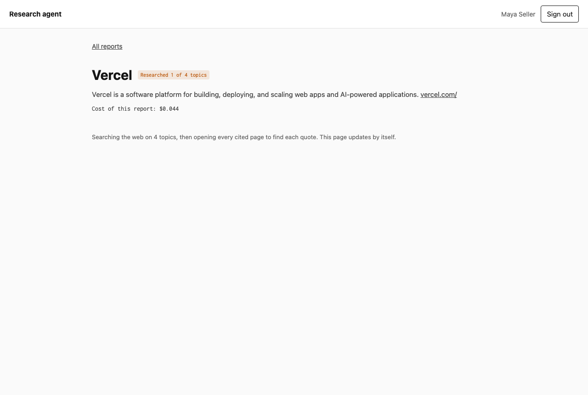
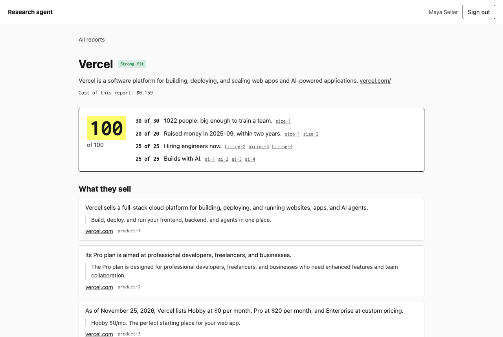
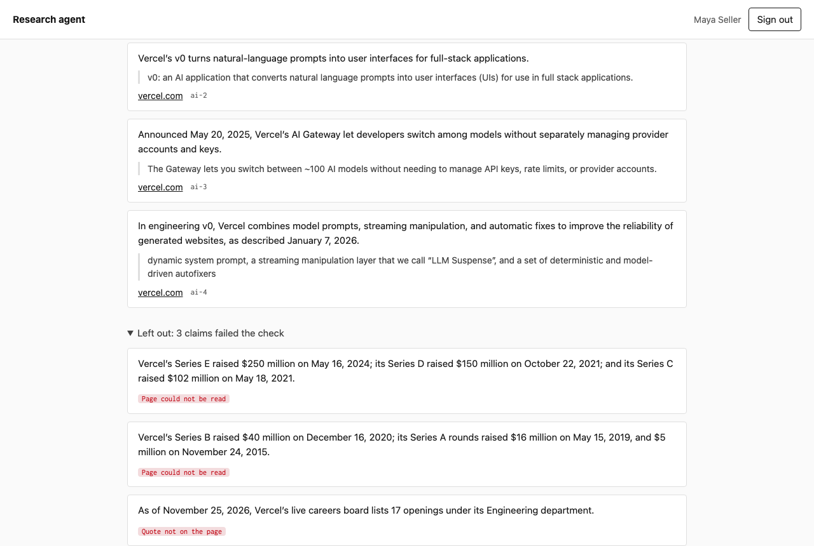
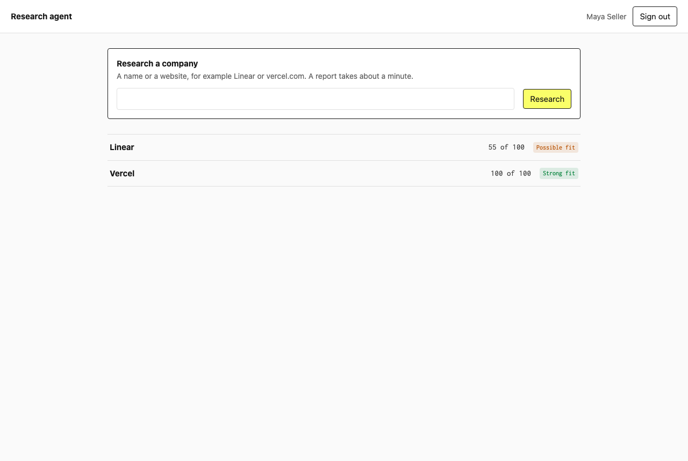
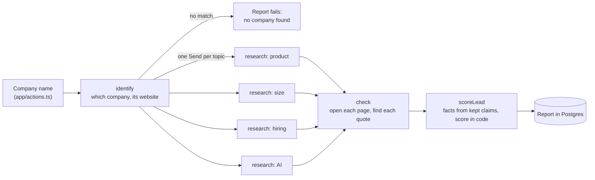

# Research agent

Type a company, get a report built from the live web. Every claim links to its page, and the lead score says why.

## Why

Before a sales call, someone spends half an hour reading a company's site, its job board and its funding news.
A model with web search does it in a minute. But a model also writes sentences no page ever said, and a seller who repeats one loses the deal.

So this product shows two ideas.
**A graph:** the work is split into steps, and four researchers run at the same time, one per topic.
**Checking each claim:** the model must copy a quote from the page it cites. The server opens that page itself and looks for the quote.
A claim whose quote is not there never reaches the report or the score.

## Goal

Research a real company and read a report with a score out of 100.
Click any source and find the quoted words on that page.
Open "Left out" and see which claims failed the check, and why.

## Before you start

Finish [00-setup](../00-setup/README.md). This product needs only the OpenRouter key from `.env`.
Web search runs through OpenRouter on the model in `SEARCH_MODEL`, so there is nothing else to sign up for.

Each report costs about $0.12 to $0.19. An account may run one report at a time and 10 a day.

## Run it

From the repo root:

```bash
bun run dev research-agent
```

Open [http://localhost:3106](http://localhost:3106) and create an account.

## What you will see

Type a company. The page moves to the report at once and fills in as each step finishes.



When it is done, the score comes first. Each reason names the claims it rests on, and each claim shows its quote and its source.



Claims that failed the check are kept apart, with the reason. They do not count toward the score.



Your reports are listed on the home page, newest first.



## How it works



1. **The form saves a report row and answers at once.** The graph runs after the answer is sent, with Next.js `after`.
   The page reloads every two seconds while the row says "running".
2. **identify** asks the search model which company was meant, and for its website. No match ends the graph with a clear message.
3. **research** runs once per topic, all four at the same time. LangGraph's `Send` starts them, and a reducer joins their claims.
   Each claim must name the exact page it came from and copy 8 to 30 words from it.
4. **check** has no model in it. It opens each cited page once, strips it to its visible words, and looks for each quote.
   Only public web addresses are opened. The check runs inside the lookup the connection uses, and again on every redirect,
   so neither a page nor a name can send the server into a private network.
5. **scoreLead** asks the model for four facts, each naming the claims it came from. A fact that leans on a failed claim is dropped.
   Then plain code turns the facts into points: team size 30, a recent round 20, hiring engineers 25, building with AI 25.
6. **Every step is saved.** `agent/agent.ts` listens to the graph and writes each step's result and the running cost to the row.

## Try these

1. Research `vercel.com`.
   Expect: within about a minute, a score, claims under four topics, and the cost of the report under $0.25.
2. Click any source link on a claim, then search that page for the quote.
   Expect: the quoted words are on the page.
3. Open **Left out** at the bottom of a report.
   Expect: claims marked "Quote not on the page" or "Page could not be read", and none of their ids in the score's reasons.
4. Research `Qzxvbnmplk Widgets Zebrafjord`.
   Expect: the report fails with "No company called ... was found on the web".
5. Start a report, and before it ends, go back and start another.
   Expect: "A report is still running. Wait for it to finish, then start the next one."
6. Copy a report's address, sign out, and open it with a different account.
   Expect: a not-found page.

## Read the code

Read in this order. Each file is short.

1. `agent/graph.ts` - start here. The state, the four nodes, and how one researcher per topic is started.
2. `rules/topics.ts` - what every report covers. Add a topic here and the graph and the page pick it up.
3. `agent/nodes/identify.ts` and `agent/prompts/identify.md` - finds which company was meant.
4. `agent/nodes/research.ts` and `agent/prompts/research.md` - one researcher, and the quote it must copy.
5. `rules/claims.ts` - how a quote is matched to a page, with no AI in this file.
6. `agent/read-page.ts`, `agent/open-url.ts` and `rules/public-url.ts` - opens a cited page, and only a public one.
7. `agent/nodes/check.ts` - marks each claim found, missing or unreadable.
8. `agent/nodes/score.ts` and `rules/score.ts` - facts from kept claims, then the score in code.
9. `agent/agent.ts` - runs the graph and saves each step.
10. `app/actions.ts` and `rules/limits.ts` - starts a report, within the limits.
11. `db/queries.ts` - a report is found only by the account that asked for it.

## Prove it

```bash
bun test 06-research-agent/tests/rules.test.ts   # quotes, page text, the score, the address guard, limits, queries; no model
bun test 06-research-agent/tests/check.test.ts   # the quote check against a real web server on this machine
bun run proof research-agent                     # the real model, the live web, and the whole path in a browser
```

`tests/check.test.ts` serves pages from this machine and checks that a quote is found, missing or unreadable.
It also proves that a trusted page which redirects to a private address is refused, that a name resolving to this machine
is refused, and that an endless page is read only up to the limit.

`tests/agent.test.ts` is the metric. It researches Vercel for real, then opens every kept claim's page again, apart from the agent,
and passes only when every quote is there. It also checks that the score's reasons name only kept claims,
and that a made-up company fails with a clear message.

`tests/e2e.test.ts` walks the path in a real browser: create an account, research Linear, wait for the score and its sources,
then open the same report as another account and get a 404.

Last run: 15 of 16 claims kept, every kept quote found again on its page, $0.124 for the report,
with web search on `openai/gpt-6-luna` through OpenRouter.

## Learn the idea in depth

Graphs, parallel steps and checking a model's claims are taught step by step in
[live-labs](https://github.com/learnwithparam/live-labs).
