# Research agent

An accounts table for a sales team, where each cell is an agent researching one question about one company from the live web.

## Why

Before a sales call, someone spends half an hour reading a company's site, its job board and its funding news.
A model with web search does it in a minute. But a model also writes sentences no page ever said, and a seller who repeats one loses the deal.

So this product shows two ideas.
**A graph:** the work is split into steps, and four researchers run at the same time, one per topic.
**Checking each claim:** the model must copy a quote from the page it cites. The server opens that page itself and looks for the quote.
A claim whose quote is not there never reaches the table, the report or the score.

There is no chat box. The agents meet people the way Clay does: as a table.
Each row is a company and each column is a research question. Cells fill in as their agent finishes,
and every answer opens its sources in place.

## Goal

Read a team's accounts table where every cell was researched from the live web.
Open a cell's sources and find the quoted words on the page.
Add a company as an account executive and watch its cells fill in. Assign it to someone else as the sales lead.

## Who uses it

| Person | What they do | Screens |
|---|---|---|
| Account executive | Adds up to 5 companies at a time, which become theirs. Takes unassigned accounts. Reads each cell's sources before a call | My accounts, Unassigned with Take, the sources card, an account's full report |
| Sales lead | Sees every account, adds companies for the team to Unassigned, and gives each account an owner | All accounts with an owner menu on every row, Unassigned, an account's report with its owner menu |
| Anyone else | Signs up and joins as an account executive | The account executive's screens |

The team is Priya Raman, the sales lead, and two account executives, Tomás Ortega and Grace Okafor.
Their 11 accounts are real companies, researched for real, and include the hard cases:
a misspelt name (`Notoin`), a website instead of a name (`posthog.com`), a product name instead of the company (`Basecamp`),
weak fits, and a company that does not exist.

## Before you start

Finish [00-setup](../00-setup/README.md). This product needs only the OpenRouter key from `.env`.
Web search runs through OpenRouter on the model in `SEARCH_MODEL`, so there is nothing else to sign up for.

Then load the sample team and its accounts from the repo root:

```bash
bun run seed research-agent
```

It signs the three people up through the real sign-up path and researches all 11 companies on the live web.
That takes a few minutes and costs about $1.60. Running it again replaces the sample team and its accounts.

Each company costs about $0.10 to $0.19. A person may have 5 companies researching at once and 15 a day.

## Run it

From the repo root:

```bash
bun run dev research-agent
```

Open [http://localhost:3106](http://localhost:3106) and sign in as `priya@research-seed.learnwithparam.test`
with the password `seeded research password`. The account executives are `tomas@` and `grace@` on the same domain.

## What you will see

The sales lead starts on **All accounts**. Each row shows the owner, a checked answer per question with its source count,
and the lead score.

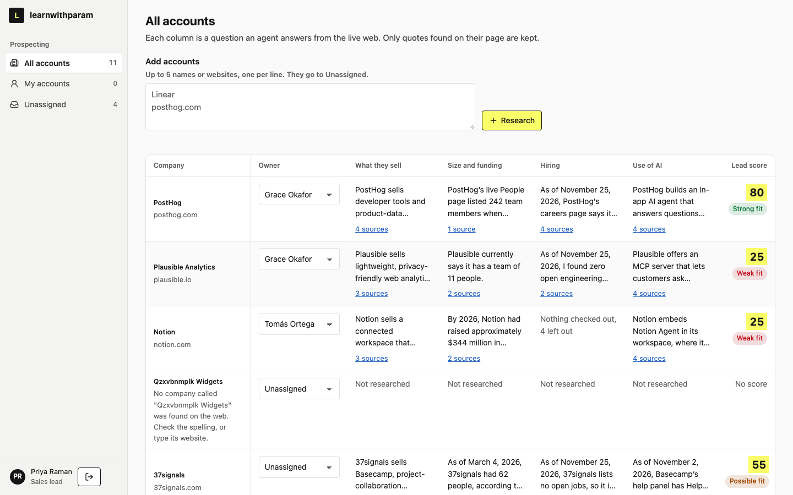

**Unassigned** holds the companies the lead added for the team. The lead gives each one an owner.

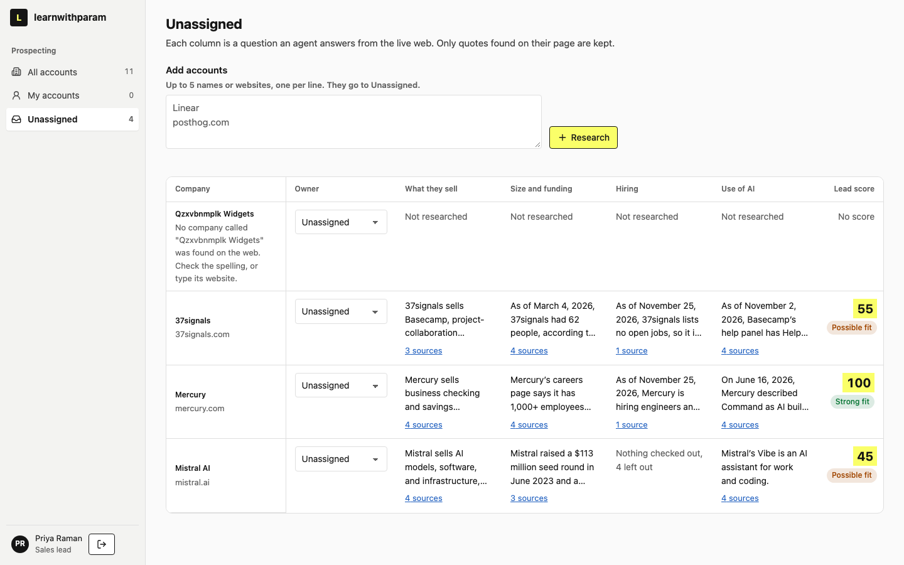

An account executive sees **My accounts**. A company they add is theirs, and its cells fill in as each agent finishes.

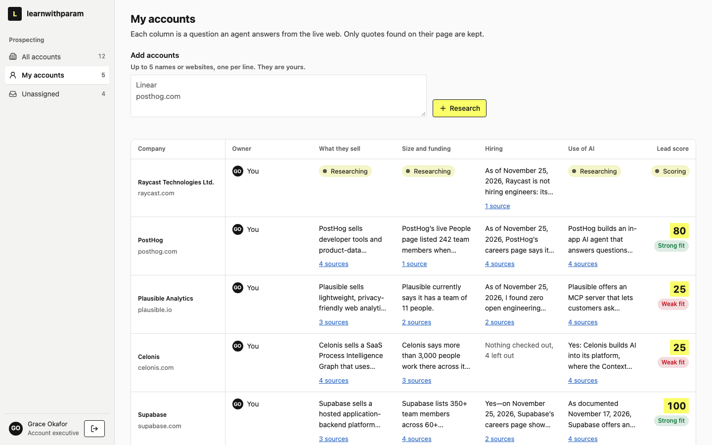

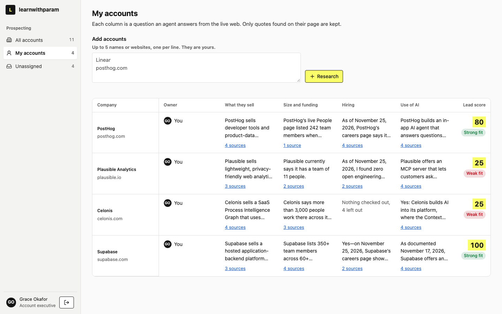

Click a source count to read the claims behind the cell, each with the quote found on its page and a link to that page.

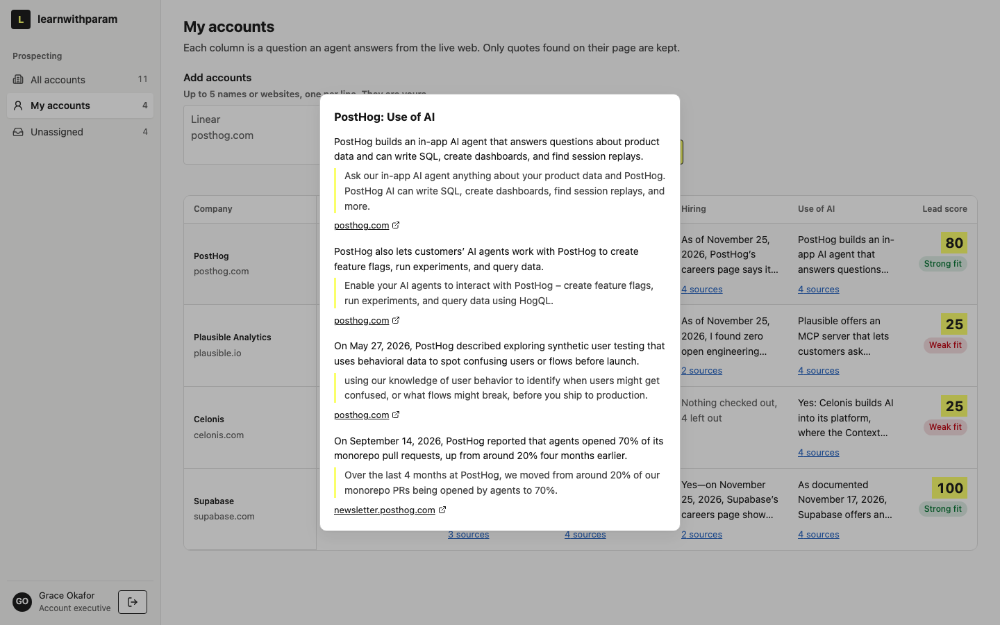

On **Unassigned** an account executive takes an account with one click.

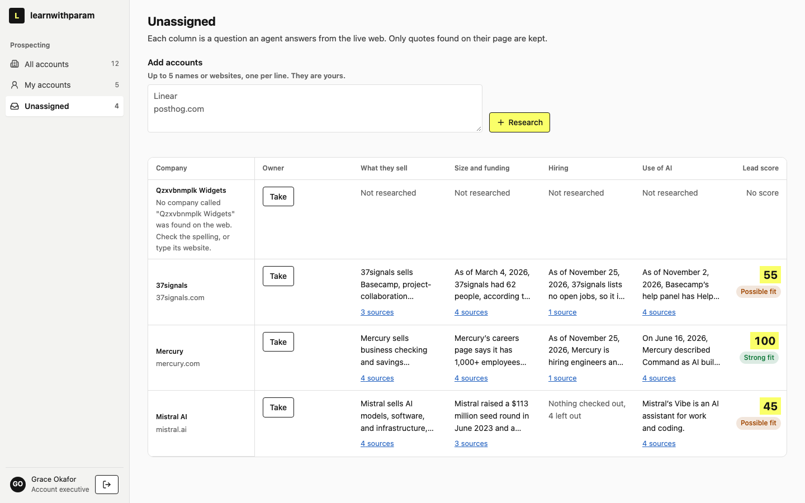

Pasting more than 5 companies is refused before any research starts.

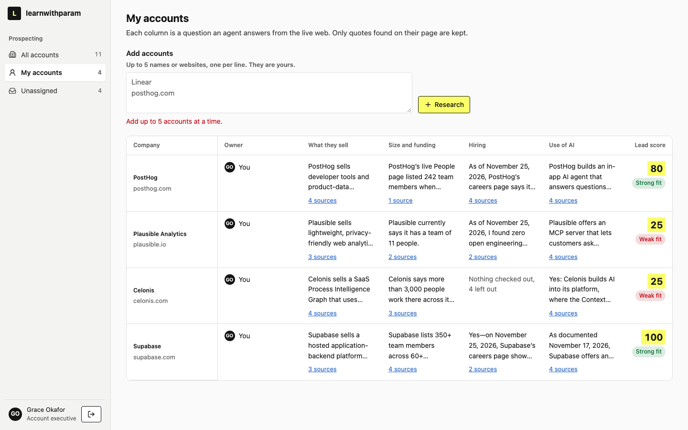

Opening a row gives the full report. The score comes first, and each reason names the claims it rests on.
A misspelt name is researched as the company it meant, and the page says what was typed.

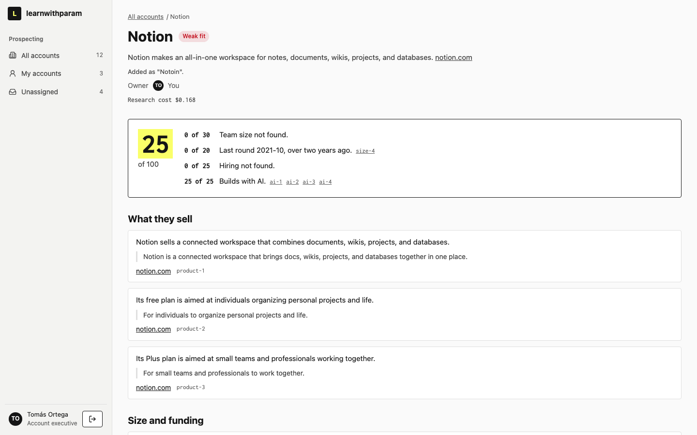

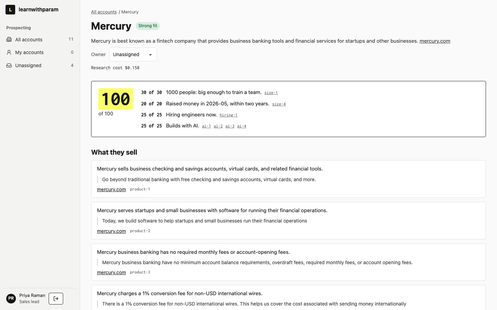

On a phone the side menu moves to the top and the table scrolls sideways, with the company name kept in view.

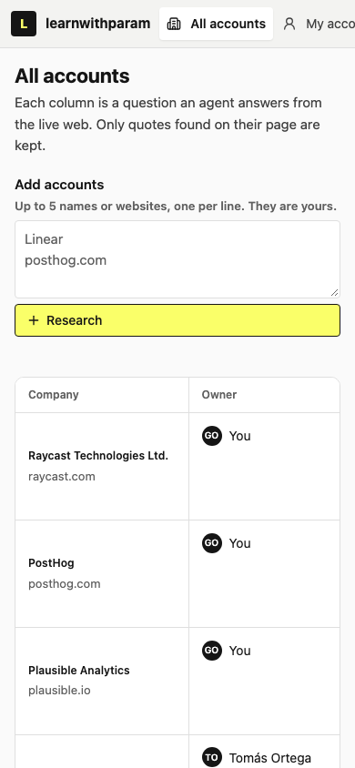

## How it works

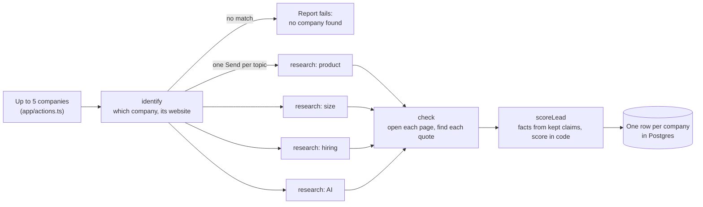

1. **The form saves one row per company and answers at once.** A graph per company runs after the answer is sent, with Next.js `after`.
   The limits are checked under a lock in Postgres, so two pastes at the same moment cannot pass them together.
   The table refreshes every two seconds while any row is still researching.
2. **identify** asks the search model which company was meant, and for its website. No match ends the graph with a clear message.
3. **research** runs once per topic, all four at the same time. LangGraph's `Send` starts them, and a reducer joins their claims.
   Each claim must name the exact page it came from and copy 8 to 30 words from it.
4. **check** has no model in it. It opens each cited page once, strips it to its visible words, and looks for each quote.
   Only public web addresses are opened. The check runs inside the lookup the connection uses, and again on every redirect,
   so neither a page nor a name can send the server into a private network.
5. **scoreLead** asks the model for four facts, each naming the claims it came from. A fact that leans on a failed claim is dropped.
   Then plain code turns the facts into points: team size 30, a recent round 20, hiring engineers 25, building with AI 25.
6. **Every step is saved.** `agent/agent.ts` listens to the graph and writes each step's result and the running cost to the row.
   So a column's cells fill in as soon as their researcher is done.
7. **People own accounts.** An account executive's add is theirs. A lead's add goes to Unassigned.
   Taking an account succeeds only if it is still unassigned, so two people clicking Take at once cannot both win.

## Try these

1. As Priya, open **All accounts**.
   Expect: 11 accounts, each with an owner menu, four research columns and a score. Qzxvbnmplk Widgets says no company was found.
2. Click **4 sources** in the Use of AI column for Mercury.
   Expect: a card titled "Mercury: Use of AI" with claims, each with its quote and a link that opens the page in a new tab.
3. Open one of those links and search the page for the quote.
   Expect: the quoted words are on the page.
4. Open **Notion**.
   Expect: "Added as "Notoin"." under the summary, and a weak fit with each reason naming its claims.
5. Sign in as Grace and add `Raycast` in **My accounts**.
   Expect: "Researching 1 new account.", a row with Researching in each cell, then a score within about two minutes, owned by You.
6. As Grace, paste six company names and click **Research**.
   Expect: "Add up to 5 accounts at a time." and no new rows.
7. As Priya, pick **Tomás Ortega** in Raycast's owner menu, then sign in as Tomás.
   Expect: Raycast is in Tomás's **My accounts**, owned by You.
8. As Tomás, open **Unassigned** and click **Take** on Mercury.
   Expect: Mercury moves to **My accounts**.

## Read the code

Read in this order. Each file is short.

1. `agent/graph.ts` - start here. The state, the four nodes, and how one researcher per topic is started.
2. `rules/topics.ts` - every column of the table. Add a topic here and the graph, the table and the report pick it up.
3. `agent/nodes/identify.ts` and `agent/prompts/identify.md` - finds which company was meant, even when misspelt.
4. `agent/nodes/research.ts` and `agent/prompts/research.md` - one researcher, and the quote it must copy.
5. `rules/claims.ts` - how a quote is matched to a page, with no AI in this file.
6. `agent/read-page.ts`, `agent/open-url.ts` and `rules/public-url.ts` - opens a cited page, and only a public one.
7. `agent/nodes/check.ts` - marks each claim found, missing or unreadable.
8. `agent/nodes/score.ts` and `rules/score.ts` - facts from kept claims, then the score in code.
9. `agent/agent.ts` - runs the graph and saves each step, so cells fill in as they finish.
10. `rules/team.ts` and `rules/limits.ts` - who may do what, who owns a new account, and how many may run.
11. `app/actions.ts` and `db/queries.ts` - adding, taking and assigning accounts, each checked against the signed-in person.
12. `components/AccountTable.tsx` and `components/TopicCell.tsx` - the table and the sources card.
13. `agent/seed.ts` - how the sample team and its 11 accounts are made through the real paths.

## Prove it

```bash
bun test 06-research-agent/tests/rules.test.ts   # quotes, page text, the score, the address guard, limits, roles, team queries; no model
bun test 06-research-agent/tests/check.test.ts   # the quote check against a real web server on this machine
bun run proof research-agent                     # the real model, the live web, and both people's paths in a browser
```

`tests/rules.test.ts` also sends two pastes at the same moment and checks that only one gets past the limit,
and two Take clicks at the same moment and checks that exactly one wins.

`tests/check.test.ts` serves pages from this machine and checks that a quote is found, missing or unreadable.
It also proves that a trusted page which redirects to a private address is refused, that a name resolving to this machine
is refused, and that an endless page is read only up to the limit.

`tests/agent.test.ts` is the metric. It researches Vercel for real, then opens every kept claim's page again, apart from the agent,
and passes only when every quote is there. It also checks that the score's reasons name only kept claims,
and that a made-up company fails with a clear message.

`tests/e2e.test.ts` walks both people's paths in a real browser. Grace adds Raycast and waits for its score.
She opens a sources card and finds a link. Priya assigns Raycast to Tomás, and Tomás sees it as his.
The test then removes Raycast, so the sample table stays as it was.

Last run (25 Nov 2026): Vercel researched with 10 of 15 claims kept, every kept quote found again on its page, $0.181 for the report. All 20 proof tests passed, both browser paths included.

## Learn the idea in depth

Graphs, parallel steps and checking a model's claims are taught step by step in
[live-labs](https://github.com/learnwithparam/live-labs).
