# Legal intake

A law firm's client intake, shaped like Clio Grow. A client tells their story in their own words, and the intake form fills in beside them as they talk.
The firm's staff work from an intake board. The work stops and waits for a lawyer, for minutes or for days, and keeps its place if the server restarts.

## Why

A small firm gets dozens of requests a week. Most people do not know what a lawyer needs to hear, so a blank form gets half filled or abandoned.
Someone at the firm then reads each request, works out the area of law, spots any deadline, and checks the firm has not acted for the other side.
That last check matters most: a firm that takes a case against its own client breaks its professional rules.

This product shows three ideas.
**Collecting data by talking, not by form:** the agent reads each message, fills in what it can, and asks only for what is still missing.
The client sees every field and can change any of them before sending.
**A graph that pauses for a human:** the work is a series of steps, and two of them wait for a lawyer.
The place it stopped is saved in Postgres, so a restart loses nothing.
**Limits the model cannot cross:** the conflict check is plain code over the firm's records.
A lawyer can never accept a request with an exact conflict, whatever the model said.

## Goal

Tell the assistant about a problem as a client, check the form it filled, and send it.
Sign in as a lawyer, accept the request, edit the letter the model drafted and approve it.
Then open the client's private link and read the approved letter.
Sign in as a paralegal and see that only a lawyer can decide.

## Who uses it

| Person | What they do | Screens |
|---|---|---|
| Prospective client | Tells their story with no account, checks the form, sends it, comes back for the reply | Firm site, intake (conversation and live form), request page |
| Paralegal | Reads the board, opens requests, reads the summary and the conflict check. Cannot accept, decline or approve | Intake board, matter page, conflict records |
| Lawyer | Everything a paralegal does, plus accepting or declining a request and approving the letter | Intake board, matter page with its Next step panel, conflict records |

## Before you start

Finish [00-setup](../00-setup/README.md). This product needs only the OpenRouter key from `.env`.

`bun run setup` in 00-setup already made the tables for the paused steps and loaded the firm's records: nine past clients and opponents.
`bun run seed legal-intake` loads those records again and sends 12 client stories through the real graph.
The stories cover the hard cases: an urgent date, an exact and a possible conflict, a family matter the firm does not take, and a client who writes in Portuguese.
Two end answered, one declined, one waits for its letter to be approved, and the rest wait for a lawyer.

Only staff see the board. Start the product (below), open [http://localhost:3107/sign-in](http://localhost:3107/sign-in),
create an account, then give it a role from the repo root:

```bash
bun 07-legal-intake/db/lawyer.ts you@example.com lawyer
bun 07-legal-intake/db/lawyer.ts someone@example.com paralegal
```

Each conversation turn costs about $0.00015, and reading a request and drafting its letter about $0.0003.
One visitor may send `LEGAL_INTAKE_TURNS_PER_VISITOR` messages in 24 hours (60 in `.env.example`), and one email 3 requests a day.
The firm takes 200 requests a day in all.
A visitor is counted by the address in the one header your proxy sets, named by `LEGAL_INTAKE_IP_HEADER` in `.env`.
Any other header can be typed by the visitor, so it is never read.
On your own machine no proxy sets that header, so every browser counts as one visitor.
If you run the browser agent's proof often, raise `LEGAL_INTAKE_TURNS_PER_VISITOR` in your `.env`.

## Run it

```bash
bun run dev legal-intake
```

The firm's site is at [http://localhost:3107](http://localhost:3107). The intake board is at [http://localhost:3107/queue](http://localhost:3107/queue).

## What you will see

The firm's home page. It says which matters the firm takes, and what happens after you write.

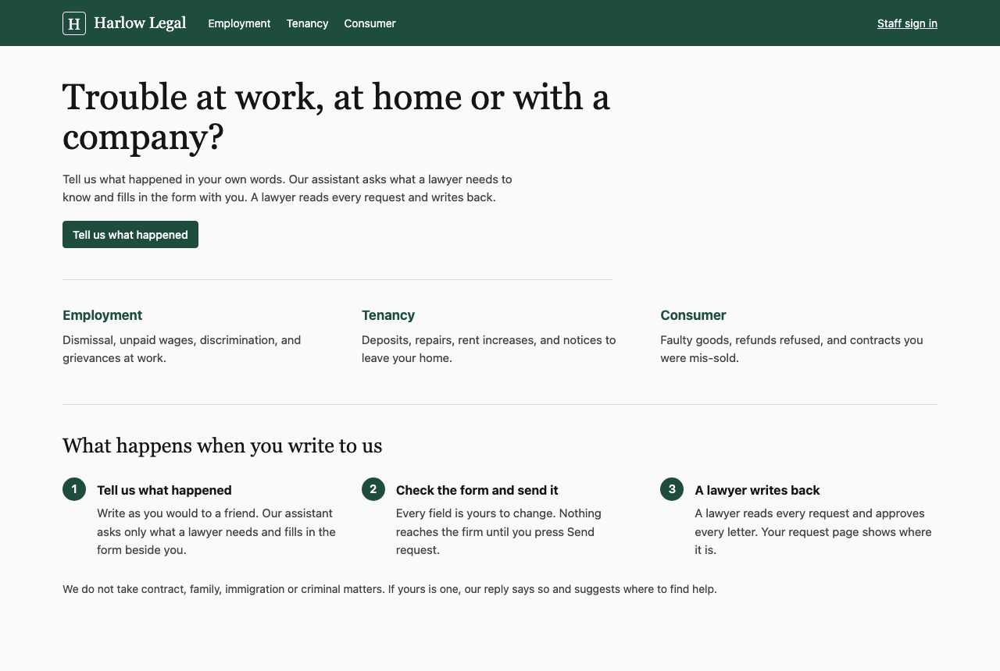

Lena writes one message about her gym. The form beside her fills in her name and the other side from her words, and shows what is still needed.

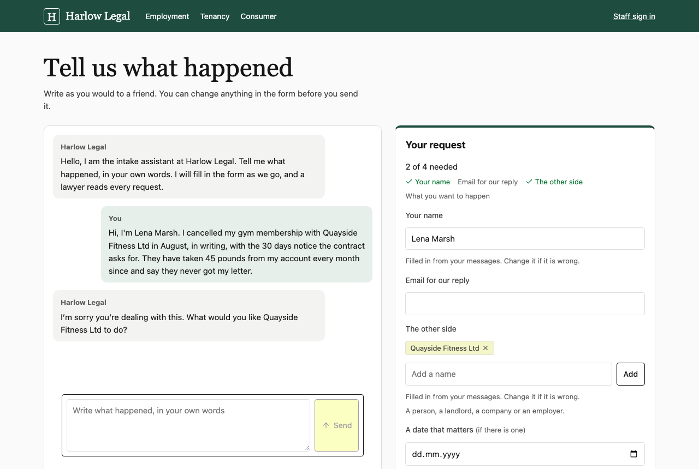

The same page on a phone puts the conversation first.

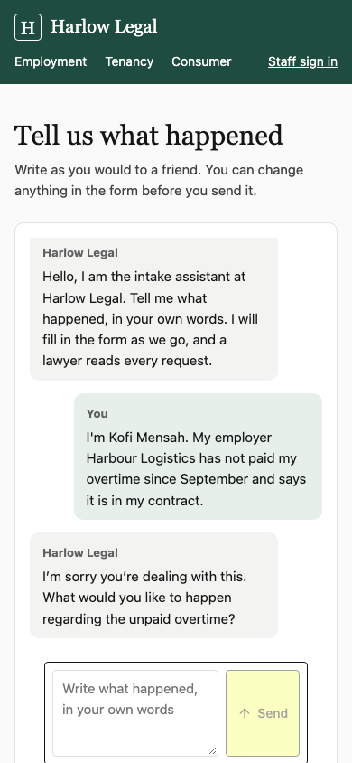

After sending, the client lands on a private page. Only someone with this link can open it.

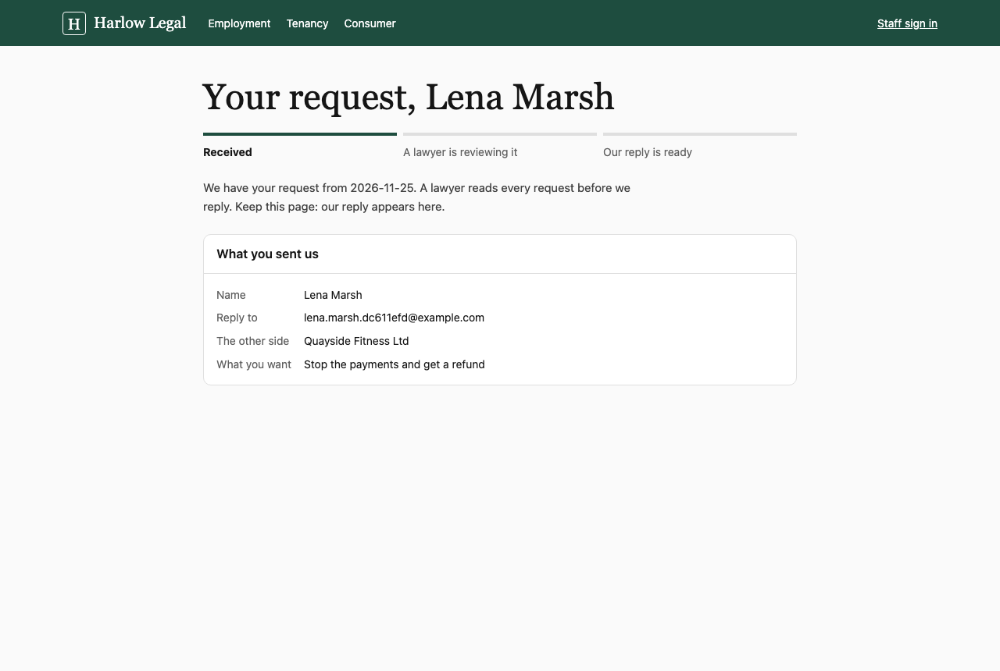

The lawyer's intake board lists every open request with its area, the date that matters, the conflict check and its status. The closest date comes first.

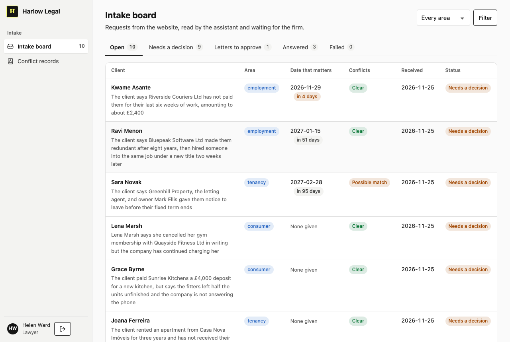

A matter opens on its summary. The steps along the top show where the graph is paused, and the Next step panel holds the one action it waits for.

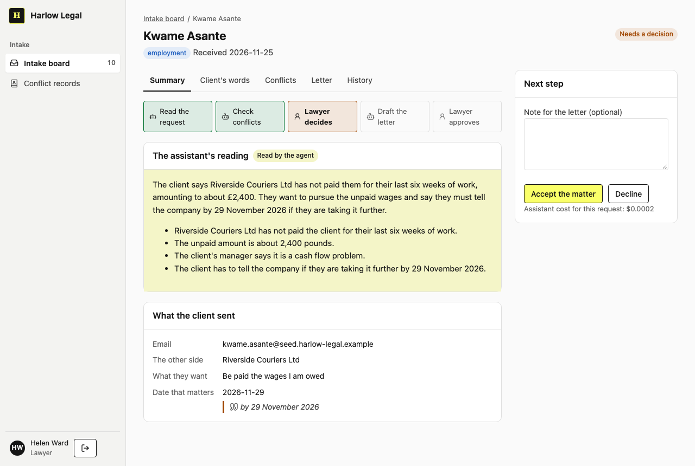

Tom's story names Marcus Bell, who is the firm's own client. Tom never typed that name as the other side; the model found it in his story, and code matched it.


A paralegal sees the same matter, but the decision buttons are off.

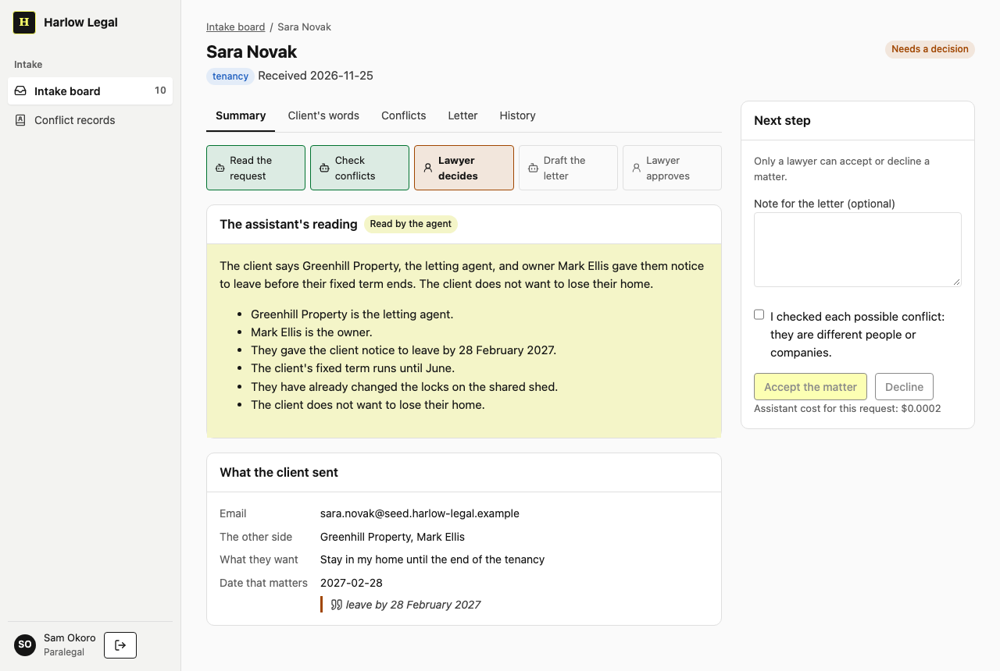

After a lawyer decides, the model drafts a letter. The lawyer edits it, then approves it.

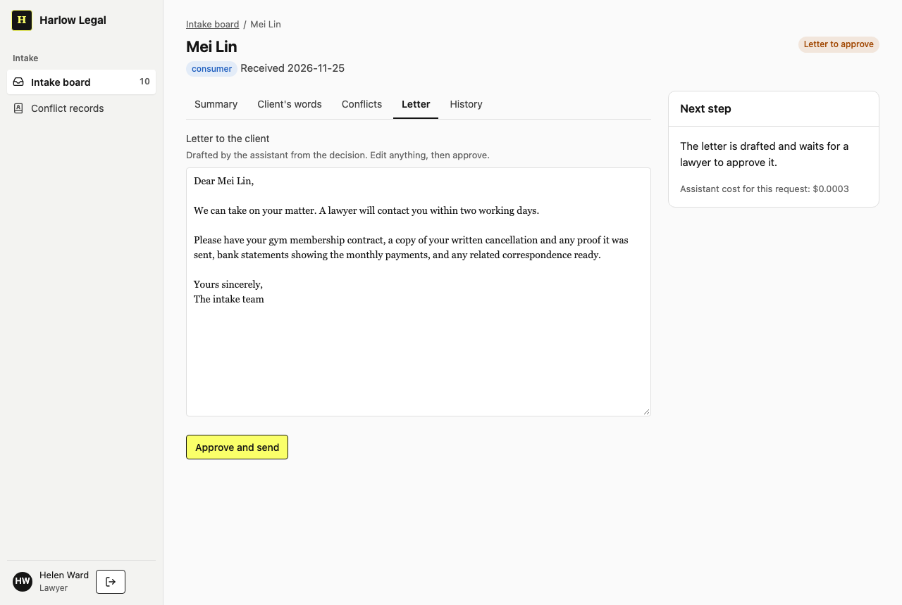

The History tab reads the saved run back from its checkpoints.

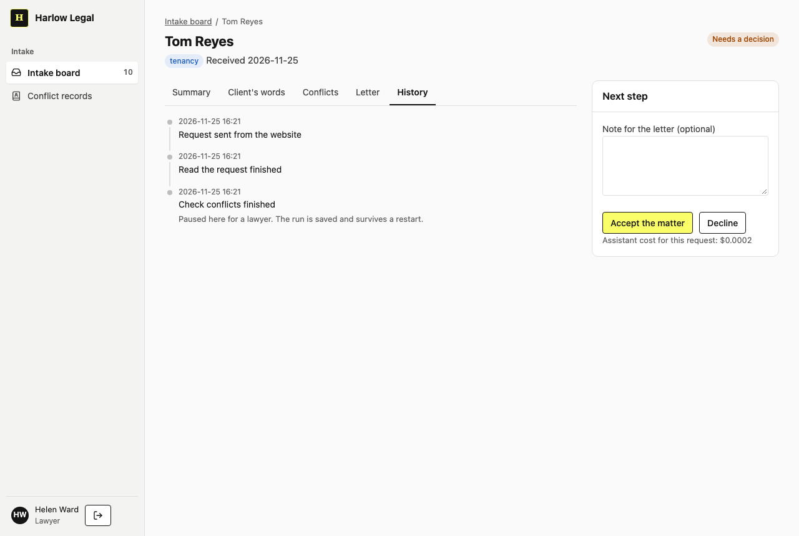

The conflict records are the firm's past clients and opponents. Code checks each new request against them.

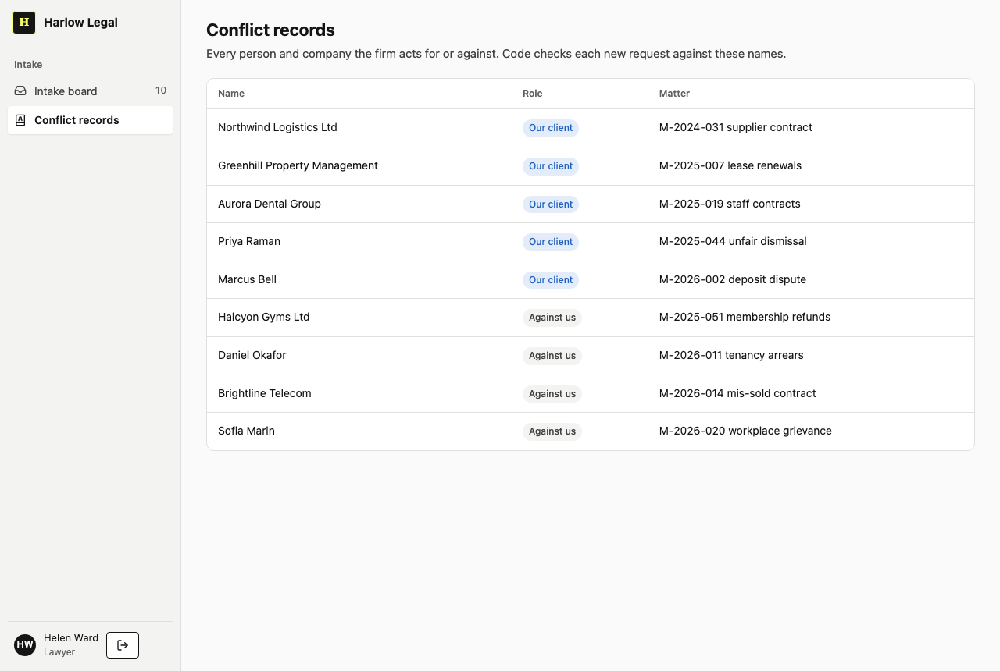

## How it works

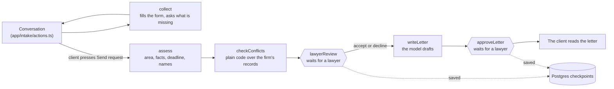

1. **The conversation fills the form.** Each client message goes to `collect`, which reads the whole conversation and returns the fields it found and one question.
   Code keeps a field only when the client's own words back it up: a name or email the client never typed is dropped.
2. **The client's edit always wins.** A field the client changed by hand is never written over by the agent.
   Only the client sends the form, and the server checks every field again, whatever the page showed.
3. **Sending saves the request and answers at once.** It gives the client a private link. Only a hash of the link is stored.
   The graph runs after the answer is sent, with Next.js `after`.
4. **assess** asks the model for the area of law, a summary, the facts, a deadline and every person or company named.
   Code then keeps a deadline only when it is a real date and its quote is in the story, and a name only when the story contains it.
5. **checkConflicts** has no model in it. It compares the client with the people the firm acted against,
   and the other side with the firm's own clients. Names are compared without case, accents or words like Ltd.
6. **lawyerReview** calls LangGraph's `interrupt()`. The graph stops, and its state is saved in Postgres under the request's id.
   A lawyer's decision resumes it with `Command({ resume })`, even from a new server process.
   If the decision breaks a rule, the step asks again with the reason, so the request is never stuck.
7. **writeLetter** asks the model for a short letter that gives no advice. A decline gets no details of the request at all,
   so the draft has no name from the conflict check to repeat.
8. **approveLetter** pauses again. The lawyer's edited text is what the client reads, not the model's draft.
   Code refuses any letter that names a party from the conflict check, even one the lawyer typed in.
9. **Only a lawyer decides, and only once.** The action checks the role on the server, so a paralegal's request is refused even without the page.
   Each button first moves the status in one guarded update, so two lawyers pressing at once cannot both resume a request.

## Try these

1. On the intake page, write "I cancelled my gym in August and they keep taking money".
   Expect: the assistant asks your name or what you want to happen, and the form shows what is still needed.
2. Tell the assistant your name, then change the name in the form, then send another message.
   Expect: the name stays as you typed it.
3. Send a request whose story says "the letting agent, Marcus Bell, told me...".
   Expect: a Conflict chip on the board, and "Accept the matter" refused with "must be declined".
4. Send a request with "I have until 12 December 2026 to reply".
   Expect: 2026-12-12 on the board, and the quote shown on the matter's summary.
5. Accept a request, and before you approve the letter, stop the dev server and start it again.
   Expect: the request still waits with its draft, and approving it works.
6. Sign in as a paralegal and open a request that needs a decision.
   Expect: "Only a lawyer can accept or decline a matter", and the buttons are off.
7. Open a client's link and change one character.
   Expect: a not-found page.
8. Sign in with an account that has no role and open `/queue`.
   Expect: a not-found page.

## Read the code

Read in this order. Each file is short.

1. `agent/collect.ts` and `agent/prompts/collect.md` - start here. The conversation that fills the form.
2. `rules/collect.ts` - the form, `grounded` (keep only what the client said) and `merge` (the client's edit wins).
3. `app/intake/actions.ts` - the two things a client can do: `talk` and `sendIntake`.
4. `agent/graph.ts` - the state, the five steps, and the saved checkpoints.
5. `rules/intake.ts` - the shapes, and what a lawyer may decide: `whyNotAccept`, `deadlineInStory`, `whyNotSend`.
6. `agent/nodes/assess.ts` and `agent/prompts/assess.md` - the model reads the request; code drops what the story does not say.
7. `rules/conflicts.ts` and `agent/nodes/conflicts.ts` - the conflict check, with no AI in it.
8. `agent/nodes/review.ts` - the pause, and asking again when a decision breaks a rule.
9. `agent/nodes/write.ts`, `agent/prompts/letter.md` and `agent/nodes/approve.ts` - the draft and the second pause.
10. `db/checkpoints.ts` and `agent/history.ts` - where the paused state lives, and how the History tab reads it back.
11. `agent/agent.ts` - starts, resumes and retries a request, and saves each step to its row.
12. `rules/board.ts` and `app/queue/actions.ts` - who may decide, the board's tabs, and the lawyer's buttons.

## Prove it

```bash
bun test 07-legal-intake/tests/rules.test.ts     # the conflict check, what a lawyer may decide, the public form; no model
bun test 07-legal-intake/tests/collect.test.ts   # filling the form, the client's edit wins, the board; no model
bun test 07-legal-intake/tests/pause.test.ts     # the pause survives the process that made it; no model
bun run proof legal-intake                       # the real model, and the whole path in a browser
```

`tests/pause.test.ts` runs the graph to the lawyer's pause in a separate process, which then exits.
The test process finds the pause in Postgres, tries an accept that breaks the rules and sees it refused while the request still waits,
then resumes it with a decline.

`tests/agent.test.ts` is the metric. It sends real requests through the real model.
Ana's is read as tenancy with her deadline of 12 December 2026, the draft mentions that date, and the client gets the lawyer's edited letter.
Tom's story names one of the firm's clients, the conflict is found, and an accept is refused.
The decline letter names neither the conflict nor the person, and a letter with that name typed in is refused.

`tests/e2e.test.ts` walks the path in a real browser. A client talks to the assistant and sends the form it filled.
A paralegal finds the decision buttons off. A lawyer checks conflicts, accepts, edits and approves the letter, and the client reads it on their link.
An account with no role gets a 404 on the board and the records.

## Learn the idea in depth

Graphs that pause for a person and resume later are taught step by step in
[live-labs](https://github.com/learnwithparam/live-labs).
