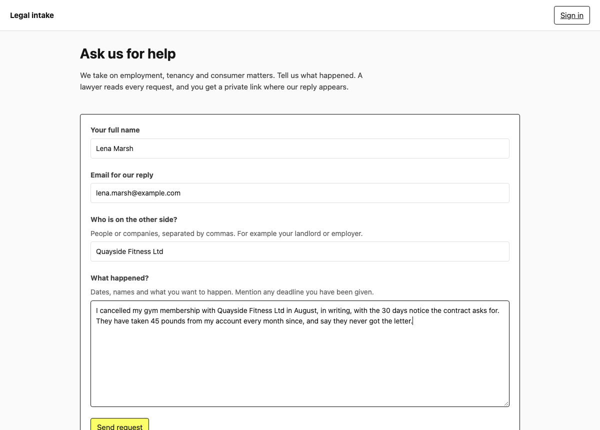
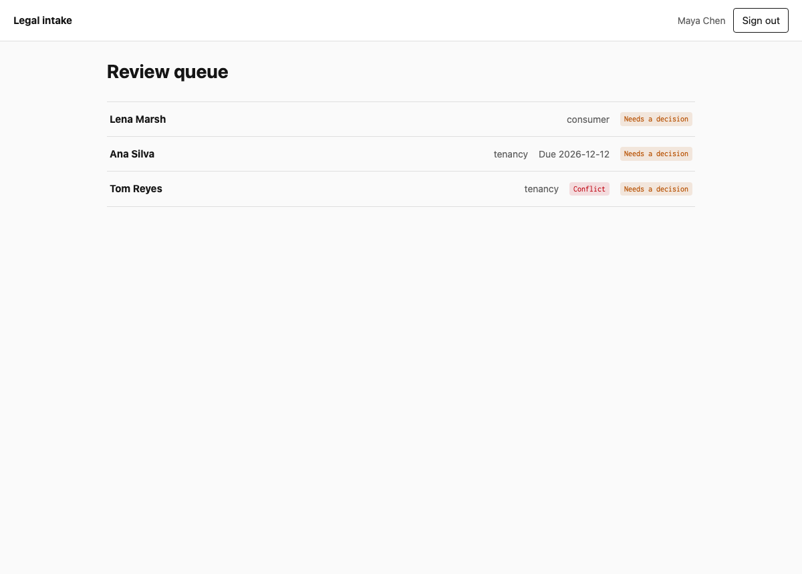
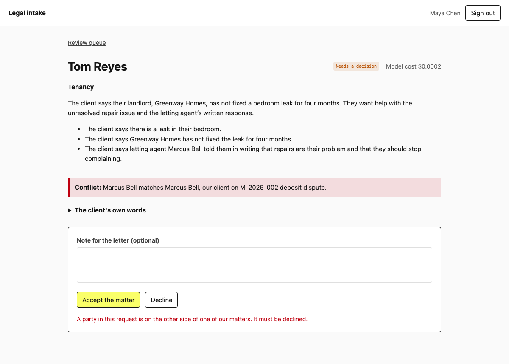
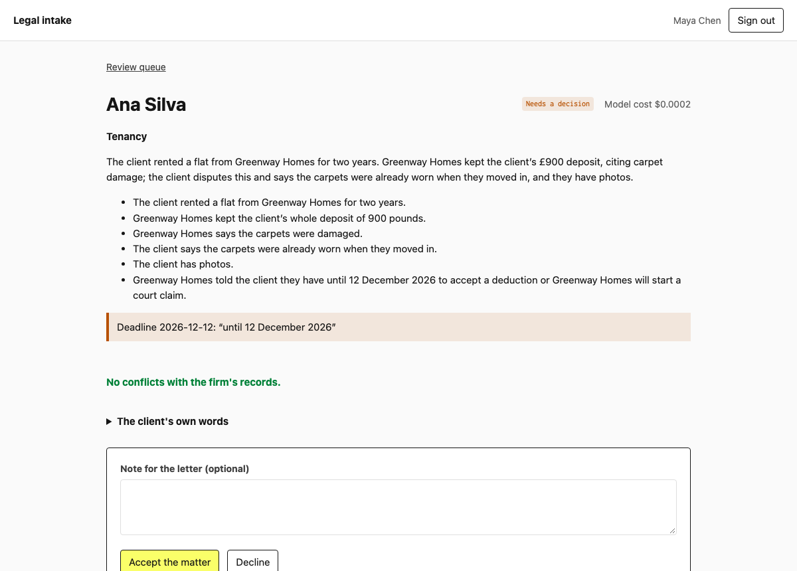
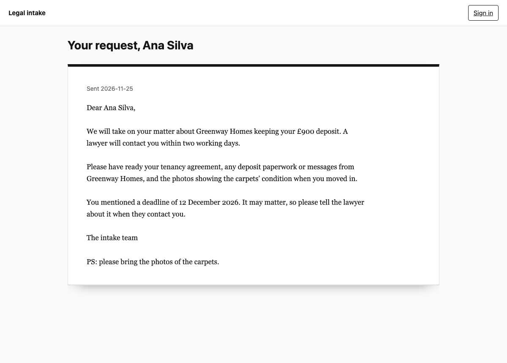
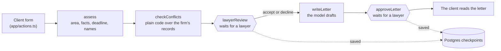

# Legal intake

A law firm's client intake. A client asks for help with no account. The model reads the request and checks it against the firm's records.
Then the work stops and waits for a lawyer, for minutes or for days, and keeps its place even if the server restarts.

## Why

A small firm gets dozens of requests a week. Someone reads each one, works out the area of law, spots any deadline,
and checks that the firm has not acted for the other side. That last check matters most: a firm that takes a client
against its own client breaks its professional rules.

A model reads a request in seconds. But a model must not decide to take on a client, and a reply must not go out until a lawyer has read it.
So this product shows two ideas.
**A graph that pauses for a human:** the work is a series of steps, and two of them wait for a lawyer.
The place it stopped is saved in Postgres, so a restart loses nothing.
**Limits the model cannot cross:** the conflict check is plain code over the firm's records.
A lawyer can never accept a request with an exact conflict, whatever the model said.

## Goal

Send a request as a client. Sign in as a lawyer, accept it, edit the letter the model drafted and approve it.
Then open the client's private link and read the approved letter.
Try to accept a request that names one of the firm's own clients, and watch it refused.

## Before you start

Finish [00-setup](../00-setup/README.md). This product needs only the OpenRouter key from `.env`.

`bun run setup` in 00-setup already made the tables for the paused steps and loaded the firm's records: nine past clients and opponents.
`bun run seed legal-intake` loads those records again.

Only lawyers see the queue. Start the product (below), open [http://localhost:3107/sign-in](http://localhost:3107/sign-in),
create an account, then make it a lawyer from the repo root:

```bash
bun 07-legal-intake/db/lawyer.ts you@example.com
```

Each request costs about $0.0003 for the model to read it and draft the letter.
One email may send 3 requests a day, and the firm takes 200 a day in all.

## Run it

```bash
bun run dev legal-intake
```

The client form is at [http://localhost:3107](http://localhost:3107). The lawyer's queue is at [http://localhost:3107/queue](http://localhost:3107/queue).

## What you will see

The client fills in a short form. No account is needed.



They land on a private page. Only someone with this link can open it.


The lawyer's queue shows each request with its area, any deadline, and any conflict.



Tom's story names Marcus Bell, who is the firm's own client. Tom never typed that name as the other side; the model found it in the story.
Accepting is refused, and the request stays waiting.



Ana's request has a deadline, quoted from her own words, and no conflict.



After the lawyer accepts, the model drafts a letter. The lawyer edits it, then approves it.


The client's page now shows the letter, exactly as the lawyer approved it.



## How it works



1. **The form saves the request and answers at once.** It gives the client a private link. Only a hash of the link is stored.
   The graph runs after the answer is sent, with Next.js `after`.
2. **assess** asks the model for the area of law, a summary, the facts, a deadline and every person or company named.
   Code then keeps a deadline only when it is a real date and its quote is in the story, and a name only when the story contains it.
3. **checkConflicts** has no model in it. It compares the client with the people the firm acted against,
   and the other side with the firm's own clients. Names are compared without case, accents or words like Ltd.
4. **lawyerReview** calls LangGraph's `interrupt()`. The graph stops, and its state is saved in Postgres under the request's id.
   A lawyer's decision resumes it with `Command({ resume })`, even from a new server process.
   If the decision breaks a rule, the step asks again with the reason, so the request is never stuck.
5. **writeLetter** asks the model for a short letter that gives no advice. A decline gets no details of the request at all,
   so the draft has no name from the conflict check to repeat.
6. **approveLetter** pauses again. The lawyer's edited text is what the client reads, not the model's draft.
   Code refuses any letter that names a party from the conflict check, even one the lawyer typed in.
7. **Two lawyers pressing at once cannot both resume a request.** Each button first moves the status in one guarded update, and only the winner goes on.

## Try these

1. Send a request about a gym that keeps charging after you cancelled.
   Expect: within a few seconds the queue shows it as consumer, waiting for a decision.
2. Send a request whose story says "the letting agent, Marcus Bell, told me...".
   Expect: a Conflict chip in the queue, and "Accept the matter" refused with "must be declined".
3. Send a request with "I have until 12 December 2026 to reply".
   Expect: "Due 2026-12-12" in the queue, and the quote shown on the request.
4. Accept a request, and before you approve the letter, stop the dev server and start it again.
   Expect: the request still waits with its draft, and approving it works.
5. Open a client's link and change one character.
   Expect: a not-found page.
6. Decline Tom's request, then add "We act for Marcus Bell." to the letter and approve it.
   Expect: "Take out "Marcus Bell"", and the letter still waits.
7. Sign in with an account that is not a lawyer and open `/queue`.
   Expect: a not-found page.

## Read the code

Read in this order. Each file is short.

1. `agent/graph.ts` - start here. The state, the five steps, and the saved checkpoints.
2. `rules/intake.ts` - the shapes, and what a lawyer may decide: `whyNotAccept`, `deadlineInStory`, `whyNotSend`.
3. `agent/nodes/assess.ts` and `agent/prompts/assess.md` - the model reads the request; code drops what the story does not say.
4. `rules/conflicts.ts` and `agent/nodes/conflicts.ts` - the conflict check, with no AI in it.
5. `agent/nodes/review.ts` - the pause, and asking again when a decision breaks a rule.
6. `agent/nodes/write.ts`, `agent/prompts/letter.md` and `agent/nodes/approve.ts` - the draft and the second pause.
7. `db/checkpoints.ts` - where the paused state lives.
8. `agent/agent.ts` - starts, resumes and retries a request, and saves each step to its row.
9. `app/queue/actions.ts` - the lawyer's buttons, each guarded by `claim` in `db/queries.ts`.
10. `app/actions.ts`, `rules/form.ts` and `db/queries.ts` - the public form, its limits, and the private link.

## Prove it

```bash
bun test 07-legal-intake/tests/rules.test.ts   # the conflict check, what a lawyer may decide, the form, the queries; no model
bun test 07-legal-intake/tests/pause.test.ts   # the pause survives the process that made it; no model
bun run proof legal-intake                     # the real model, and the whole path in a browser
```

`tests/pause.test.ts` runs the graph to the lawyer's pause in a separate process, which then exits.
The test process finds the pause in Postgres, tries an accept that breaks the rules and sees it refused while the request still waits,
then resumes it with a decline.

`tests/agent.test.ts` is the metric. It sends two real requests through the real model.
Ana's is read as tenancy with her deadline of 12 December 2026, the draft mentions that date, and the client gets the lawyer's edited letter.
Tom's story names one of the firm's clients, the conflict is found, and an accept is refused.
The decline letter names neither the conflict nor the person, and a letter with that name typed in is refused.

`tests/e2e.test.ts` walks the path in a real browser: a client sends a request, a lawyer accepts and approves it,
and the client reads the letter on their link. A signed-in account that is not a lawyer gets a 404 on the queue.

Last run: $0.0003 per request from reading to approved letter, the deadline read as 2026-12-12,
and the conflict found in Tom's story.

## Learn the idea in depth

Graphs that pause for a person and resume later are taught step by step in
[live-labs](https://github.com/learnwithparam/live-labs).
