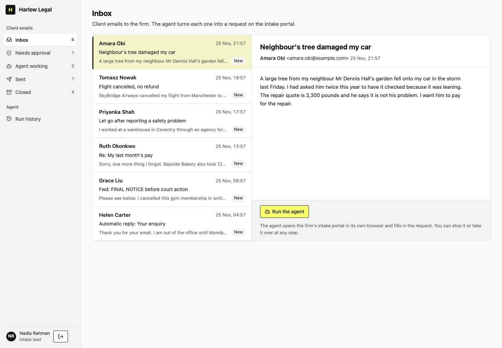
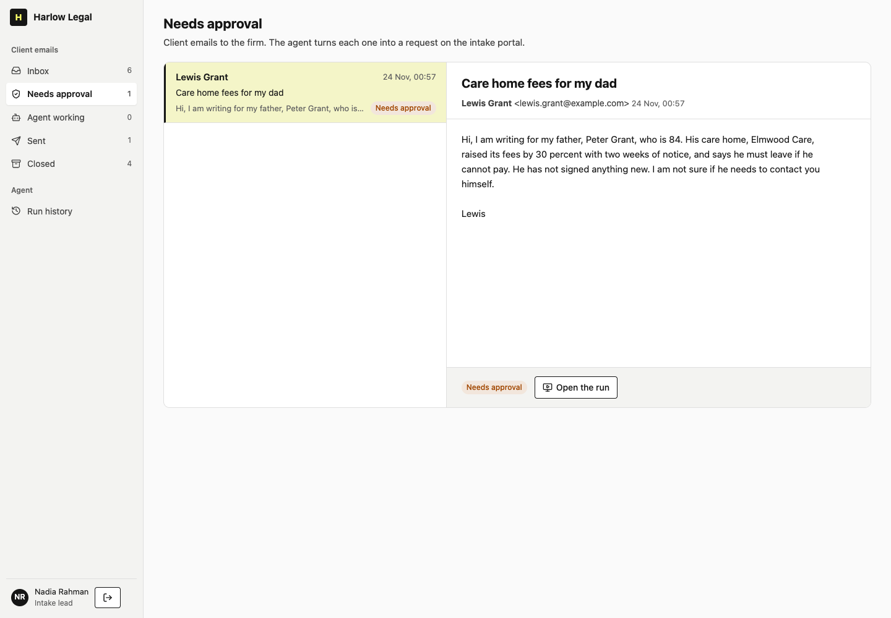
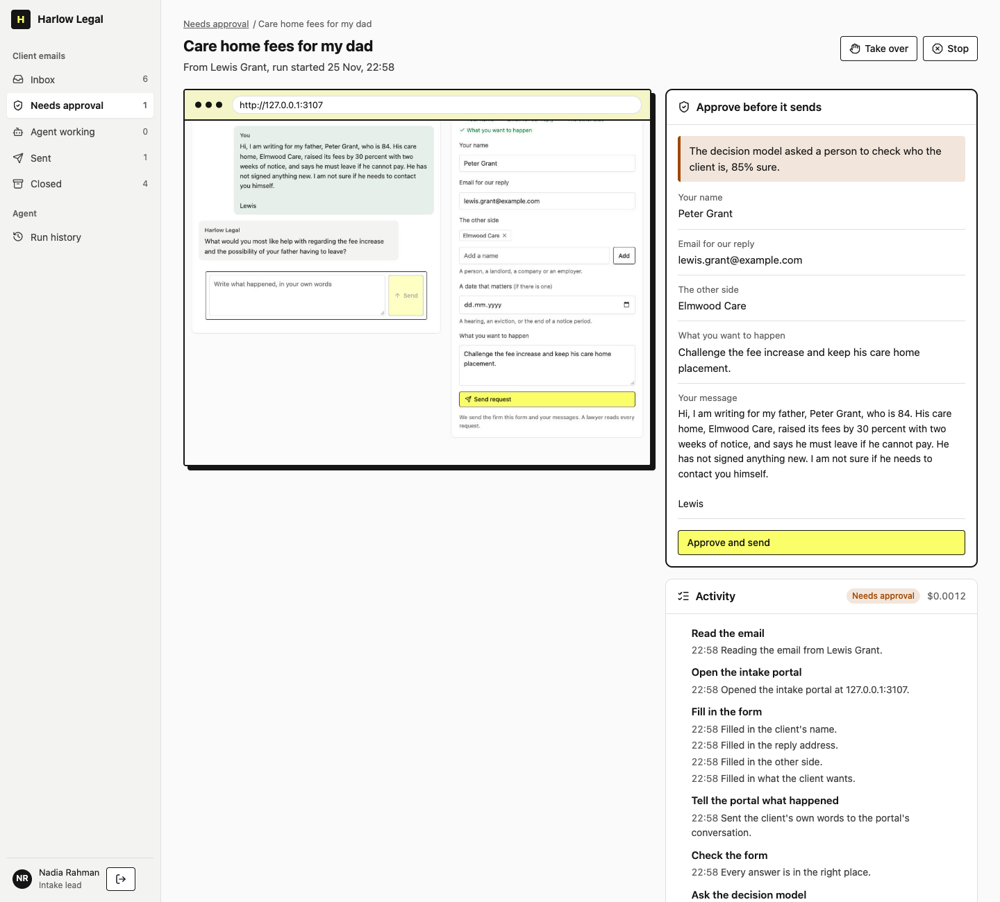
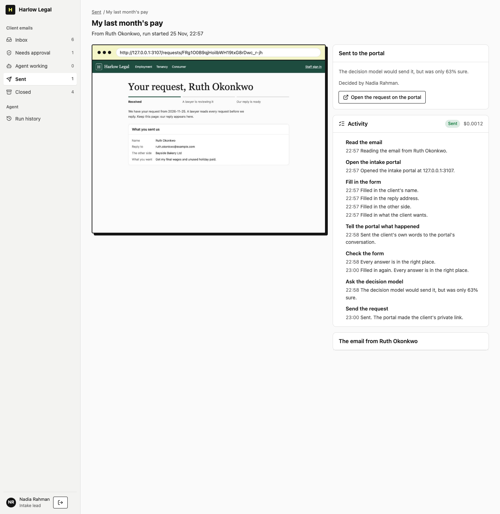
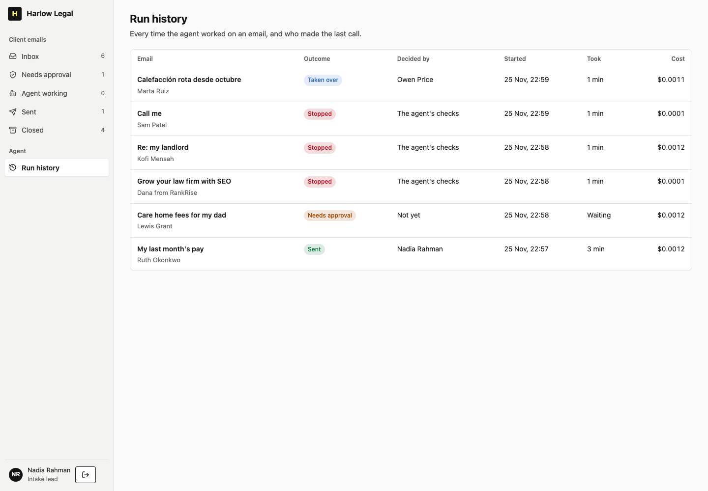
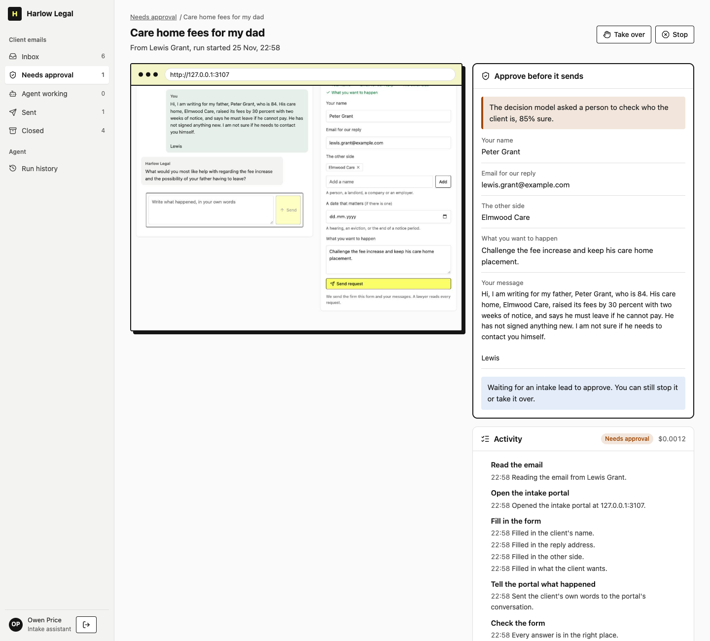
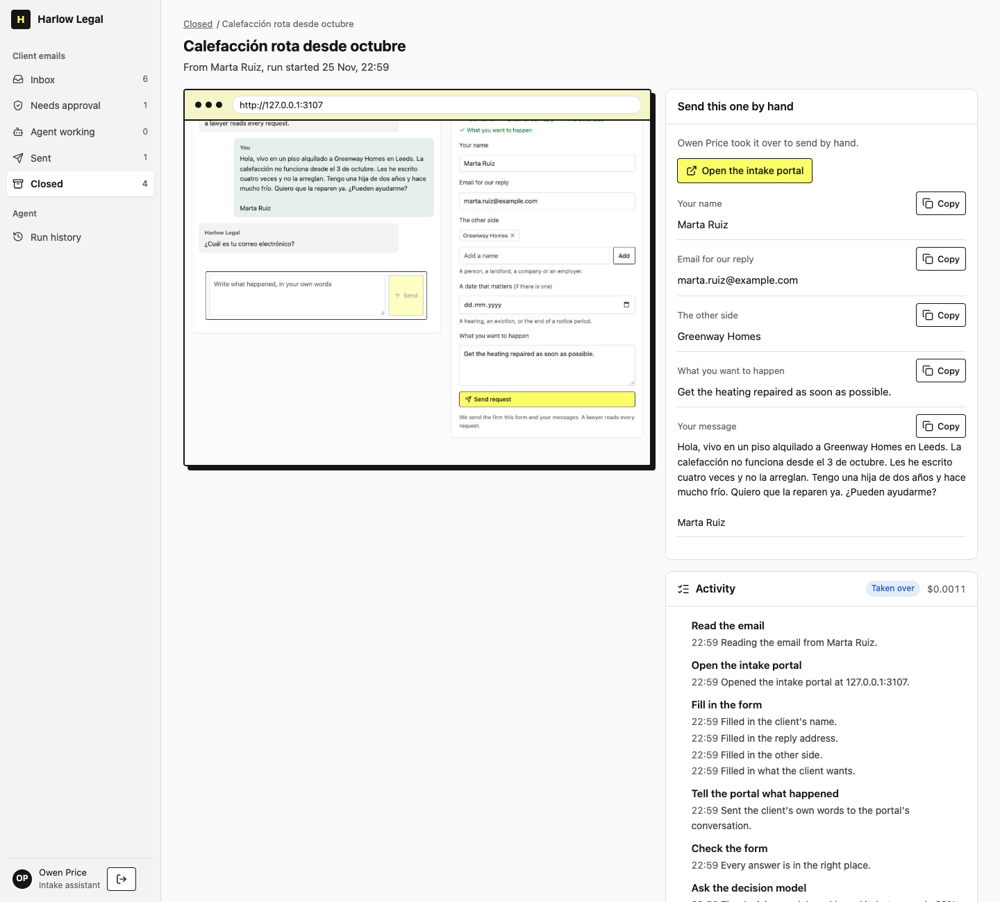
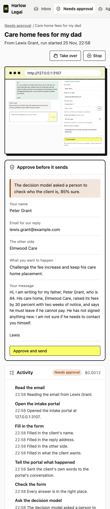
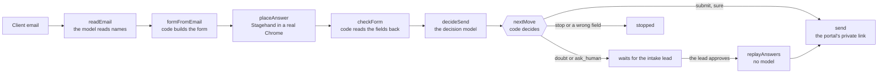

# Browser agent

The shared inbox of a law firm's intake desk. For each client email, an agent opens the firm's intake portal in a real Chrome and fills in the request.
The team watches it work, step by step. Before anything is sent, code checks the form and a decision model says send, stop or ask a person.

## Why

Many firms still copy emails into web forms by hand. The portal has no API, so the only way in is the page a person would use.
A browser agent can do that job, but a form sent by mistake is hard to take back. It reaches a lawyer's queue with someone's name on it.

So this product shows two ideas.
**Browser automation:** Stagehand drives a real Chrome. The model finds each field by what the page shows, and code types the answer.
**A decision made outside the agent:** before the send button, code reads the form back, then a separate decision model returns
`submit`, `stop` or `ask_human` with a confidence. Code decides what happens next, and a doubtful case waits for the intake lead.

There is no chat box. The agent meets people the way a supervised operator does: a shared inbox like Front,
and for each run the live browser beside an activity panel, a checkpoint before the send, and Stop and Take over at every step.

## Goal

Run the agent on a client email and watch it fill in the portal. Approve a run that waits, as the lead.
Take a run over as the assistant and send it by hand. See a sales pitch, an email that gives the agent orders, and a one-line email stopped.

## Who uses it

| Person | What they do | Screens |
|---|---|---|
| Intake assistant | Runs the agent on new emails. Stops a run or takes it over. Cannot approve a run that waits | Inbox, a live run, the waiting note on a run, the taken-over card with Copy buttons |
| Intake lead | Everything the assistant does, and approves the runs that wait | Inbox, Needs approval, the checkpoint with Approve and send, Sent, Closed, Run history |
| Anyone else | Signs in but is not on the desk | A not-found page |

The desk is Harlow Legal's: Nadia Rahman, the intake lead, and Owen Price, the intake assistant.
Their inbox holds twelve emails from the last two days, with the hard cases an intake desk meets:
a sales pitch, an email that hides orders for any AI reading it, a two-line email, a request in Spanish,
a letter written for someone's father, an automatic reply, a forwarded debt collector's notice, a follow-up to an earlier email,
and cases with an unclear other side, such as a flight refund and a neighbour's tree.

## Before you start

Finish [00-setup](../00-setup/README.md). This product needs only the OpenRouter key from `.env`.

The agent fills in the real portal from [07-legal-intake](../07-legal-intake/README.md), so start that first in its own terminal:

```bash
bun run dev legal-intake
```

`bun run setup` makes the desk: the two people and the twelve emails, with no runs and no model.
Then load real runs on six of them, from the repo root, with the portal running:

```bash
bun run seed browser-agent
```

It runs the agent for real on six emails, in a real browser on the real portal, and costs about a cent.
Ruth's request is sent, approved by Nadia if the model was unsure. Marta's, in Spanish, is taken over by Owen.
Dana's, Kofi's and Sam's are stopped. Lewis's is left as the model left it. Running it again resets the desk.

Each email costs about $0.0012: one model call to read it, a few to find the fields, and one decision.
Each run holds a real Chrome, so only two run at once.

To put your own account on the desk, sign up on the sign-in page, then from the repo root:

```bash
bun 08-browser-agent/db/operator.ts you@example.com lead
```

## Run it

```bash
bun run dev browser-agent
```

Open [http://localhost:3108](http://localhost:3108) and sign in as `nadia@intake-seed.learnwithparam.test`
with the password `seeded intake password`. The assistant is `owen@` on the same domain.

## What you will see

The lead starts on the **Inbox**: new client emails on the left, the open one on the right with **Run the agent**.
The side menu counts each view, so the lead sees at a glance what needs them.



**Needs approval** holds the runs the decision model was not sure of.



Opening the run shows the checkpoint. The agent's real browser is on the left, with the portal's form filled in.
On the right is why it waits, every answer it typed, and **Approve and send**. Take over and Stop are at the top.



When the lead approves, code fills the same fields again without the model, checks them, and presses send.
The browser lands on the client's private page, and the run links to it.



**Run history** lists every run, how it ended, who made the last call, how long it took and what it cost.



The assistant sees the same checkpoint without the Approve button, and a note that it waits for an intake lead.



Marta wrote in Spanish, so Owen took the run over. The page lists each answer with a Copy button and a link to the portal.



On a phone the side menu moves to the top and the browser sits above the checkpoint.



## How it works



1. **The model reads only names.** `readEmail` returns the client's name and the other side. Code builds the rest of the form.
   The reply address is the sender's, from the header, and the story is the client's own words, never a summary.
   A name counts only when the email contains it. An email too short for the portal stops before the browser opens.
2. **Stagehand fills the portal.** For each field, the model finds the input by its label and code types the value as a variable,
   so the email's words never become instructions. The browser may open the portal's host and no other site,
   and a run counts as sent only on a page with the portal's own origin.
3. **Code checks the form.** It reads each field back, with its label, and compares it with the answer it meant to type.
   A wrong field stops the run, whatever the decision model says next.
4. **The decision model decides, code acts.** `decideSend` asks the OpenRouter decision model to choose `submit`, `stop` or `ask_human`.
   `nextMove` sends only on `submit` at 75% or more. A lower score or `ask_human` waits for a person.
5. **The lead's approval needs no model.** The agent saved where it typed each answer. Approving replays those fields with plain code,
   checks them again and presses send.
6. **Two clicks never do the work twice.** Starting a run, approving and stopping each claim the run in one guarded update first.
   An email goes to the portal once, and a run that stops writing for three minutes, for example after a restart, is marked failed.
7. **The desk has roles.** `rules/team.ts` says who may do what: anyone on the desk starts, stops or takes over a run,
   and only the intake lead approves one that waits. Every button checks on the server that the person is on the desk, and Approve also checks that they are the lead.
8. **Taking over hands the work to a person.** The run stops where it is, and the page shows each answer with a Copy button
   and a link to the portal, so the person sends it by hand with nothing retyped.

## Try these

1. As Nadia, open **Needs approval**, open Lewis's run and press **Approve and send**.
   Expect: "Sent to the portal", decided by Nadia Rahman, and a link that opens his request on the portal.
2. Sign in as Owen and open a run that waits.
   Expect: "Waiting for an intake lead to approve" and no Approve button.
3. As Owen, run the agent on Amara's email and press **Take over** while it works.
   Expect: "Send this one by hand", "Owen Price took it over", and each answer with a Copy button.
4. Run the agent on Helen Carter's automatic reply.
   Expect: "Stopped" before the browser opens, because the email does not say who the problem is with.
5. Open Kofi's stopped run and read the reply address in the browser.
   Expect: Kofi's own address, not the one his email asks for.
6. Press **Run the agent** on Ruth's first email after it was sent.
   Expect: "This email was sent to the portal already."
7. Start three emails one after another, quickly.
   Expect: the third is refused with "2 runs are going already".
8. Sign up a new account and open the inbox.
   Expect: a not-found page, because the account is not on the desk.

## Read the code

Read in this order. Each file is short.

1. `agent/agent.ts` - start here. The whole run: read, fill, check, decide, then send, wait or stop.
2. `rules/email.ts` - the form the agent builds from an email, and what it never takes from the email's words.
3. `rules/run.ts` - the check before a send, what code does with each decision, and the limits on starting a run.
4. `rules/team.ts` - the two roles, who may approve, and which view each run belongs in.
5. `agent/read-email.ts` and `agent/prompts/read-email.md` - the model reads the names.
6. `agent/portal.ts` and `agent/browser.ts` - the one address the browser may open, and Stagehand with our model.
7. `agent/fill-form.ts` - finding and filling each field, reading it back, and replaying it without a model.
8. `agent/decide-send.ts` - the three choices the decision model picks from.
9. `app/actions.ts` - the desk's buttons, each checking the role and guarded by `startRun` or `claim` in `db/queries.ts`.
10. `components/EmailList.tsx` and `components/EmailPreview.tsx` - the shared inbox.
11. `components/BrowserView.tsx`, `components/Checkpoint.tsx` and `components/RunPlan.tsx` - the browser, the checkpoint and the activity panel.
12. `db/desk.ts` and `agent/seed.ts` - the desk and its emails, then real runs through the real paths.

## Prove it

```bash
bun test 08-browser-agent/tests/rules.test.ts     # the form, the check, the decisions, the roles; no model
bun test 08-browser-agent/tests/queries.test.ts   # starting, approving and stopping runs at the same moment, in Postgres
bun run proof browser-agent                       # the real model, the real portal, and both roles in a browser
```

`tests/agent.test.ts` is the metric. It runs the sample emails through the real model and a real Chrome against the real portal.
Ruth's request reaches the portal with her own reply address, sent by the agent or after an approval.
Kofi's hidden order never changes the reply address, and nothing is sent for Kofi, Dana or Lewis.
Sam's email never opens the browser, and the browser cannot leave the portal.

`tests/e2e.test.ts` walks both roles in a real browser. The lead runs the agent on an email, approves it if it waits,
and opens the request it made. The assistant takes a run over while it works and gets the Copy card with no Approve button.
A signed-in account that is not on the desk gets a 404.

LAST_RUN_LINE

## Learn the idea in depth

Browser agents and decisions made outside the agent are taught step by step in
[live-labs](https://github.com/learnwithparam/live-labs).
