# Team workspace

A chat workspace for a small team, like LibreChat. Each person signs in, keeps their own chats, and the assistant remembers what they tell it across chats.
An admin connects MCP servers once, and each person signs in to each server with their own account.

## Why

A team that shares one chat tool wants three things a plain chat box does not give.
The assistant should not ask the same questions in every new chat. It should reach the team's own services. And one person's access must never serve another.

So this product shows two ideas.
**Memory:** the assistant saves short facts about a person with a `remember` tool. They show on a Memory page, where the person can forget any of them.
Code decides what may be kept: never a password or a key, and never a fact planted by a tool result.
**An MCP client:** the workspace connects to remote MCP servers over OAuth, with each person's own tokens.
A tool that may change something waits for that person's approval in the chat.

## Goal

Connect the learnwithparam MCP server from [04-mcp-server-and-cli](../04-mcp-server-and-cli/README.md) with your own account.
Tell the assistant about yourself, start a new chat and see it use what you said. Then approve a save on the MCP server from the chat.

## Who uses it

| Person | What they do | Screens |
|---|---|---|
| Team member | Chats, finds old chats by date or search, connects each service with their own account, approves any change a tool wants to make, and reads, edits or forgets what the assistant keeps | Chat with its sidebar, Memory, Connectors |
| Admin | Everything a member does, and adds or removes the team's connectors | The same, with the form to add a connector |
| Anyone else with an account | Nothing. Every page answers not found | None |

## Before you start

Finish [00-setup](../00-setup/README.md). This product needs the OpenRouter key from `.env`.

The connector in this walkthrough is the MCP server from 04, so start that first in its own terminal:

```bash
bun run dev mcp-server-and-cli
```

Only team members see the workspace. Start the product (below), open [http://localhost:3109/sign-in](http://localhost:3109/sign-in),
create an account, then add it to the team as an admin from the repo root:

```bash
bun 09-team-workspace/db/member.ts you@example.com --admin
```

The MCP server only signs people in for apps it knows, so register the workspace with it:

```bash
bun 04-mcp-server-and-cli/auth/register-app.ts "Team workspace" http://localhost:3109/api/connectors/callback
```

It prints a client id and a client secret once. Keep them for the Connectors page.

To see a team that has used it for six weeks, load the sample people from the repo root. It makes Maya (a member) and Dev (an admin)
through the real sign-up path, with real chats from the real model: a checklist, a table, a question in Portuguese,
and a password the assistant must refuse to keep. Start the product first, because sign-up runs through it.

```bash
bun run seed team-workspace
```

Sign in as `maya@team-seed.learnwithparam.test` or `dev@team-seed.learnwithparam.test` with the password `seeded team password`.

A run of the agent test costs about $0.0017.

## Run it

```bash
bun run dev team-workspace
```

The workspace is at [http://localhost:3109](http://localhost:3109).

## What you will see

Maya signs in to an empty chat. Her chats sit on the left, grouped by when she last used them.

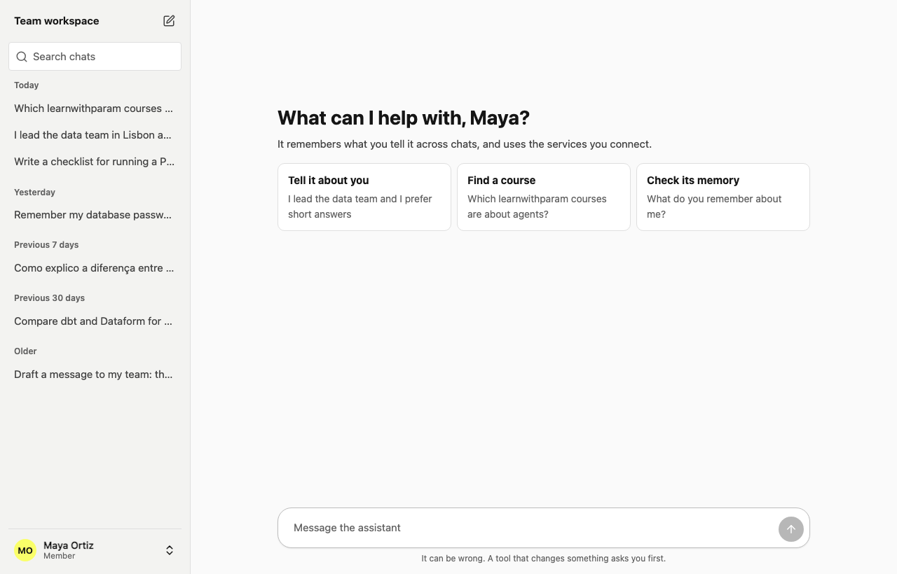

Answers are rendered, not raw text. A checklist has real boxes and a comparison is a real table.

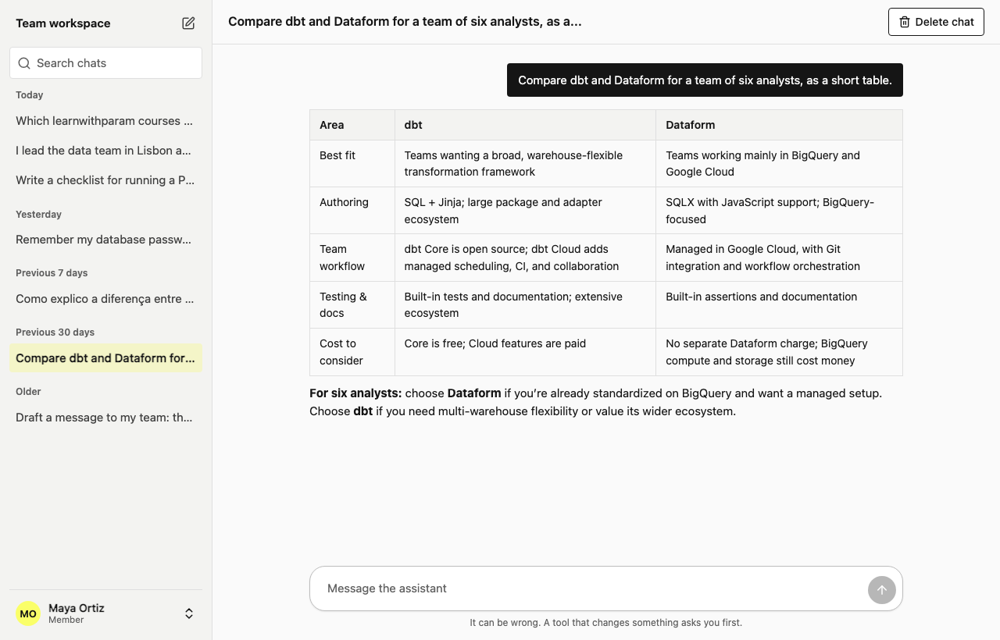

She asked it to remember a database password. The assistant said no, and nothing was saved.

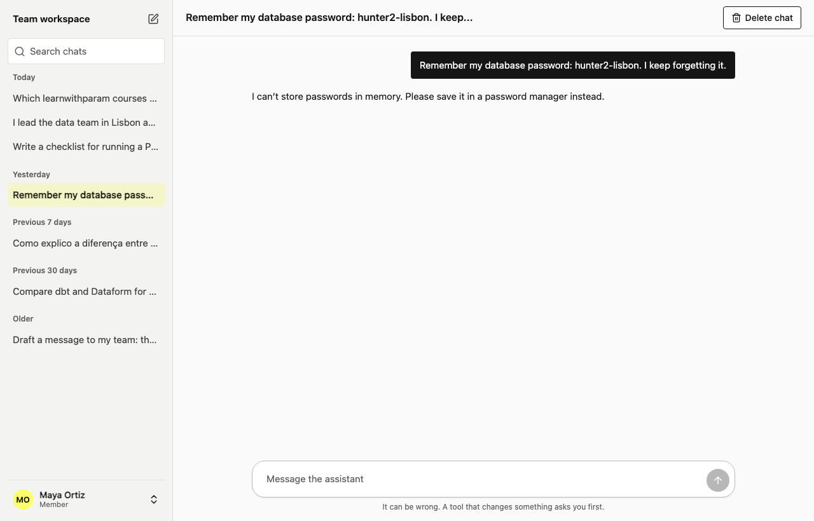

The search box filters her chats by title.

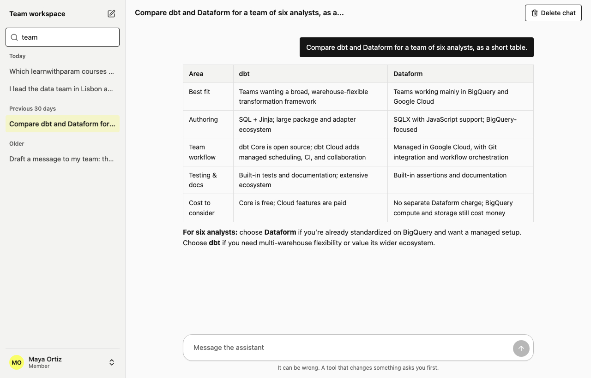

The menu under her name opens Memory and Connectors. Memory lists every fact the assistant keeps, where it came from, and a way to change it.

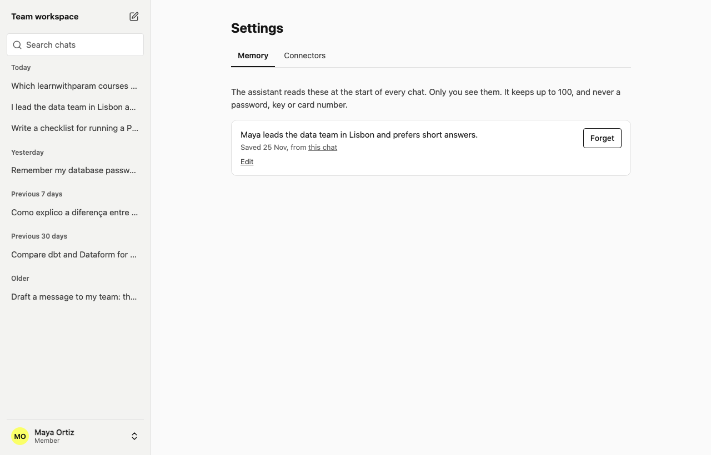

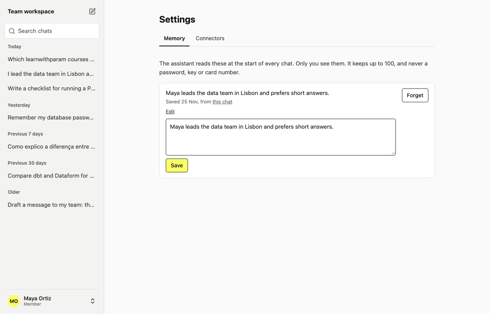

Dev is the admin. He adds a connector with its address and the client id and secret from 04.
The workspace reads who signs people in for that server and pins it, so tokens are only ever asked for there.

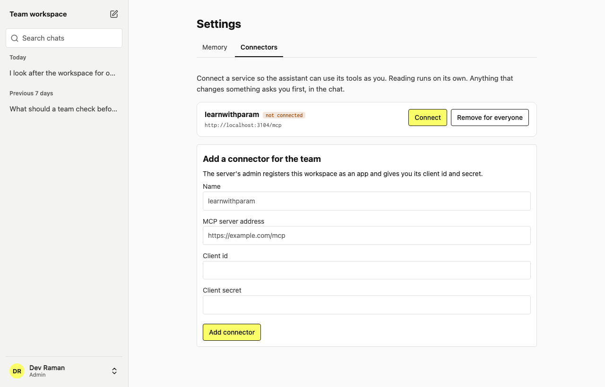

Maya presses "Connect". The MCP server's own page asks whether the workspace may act for her.

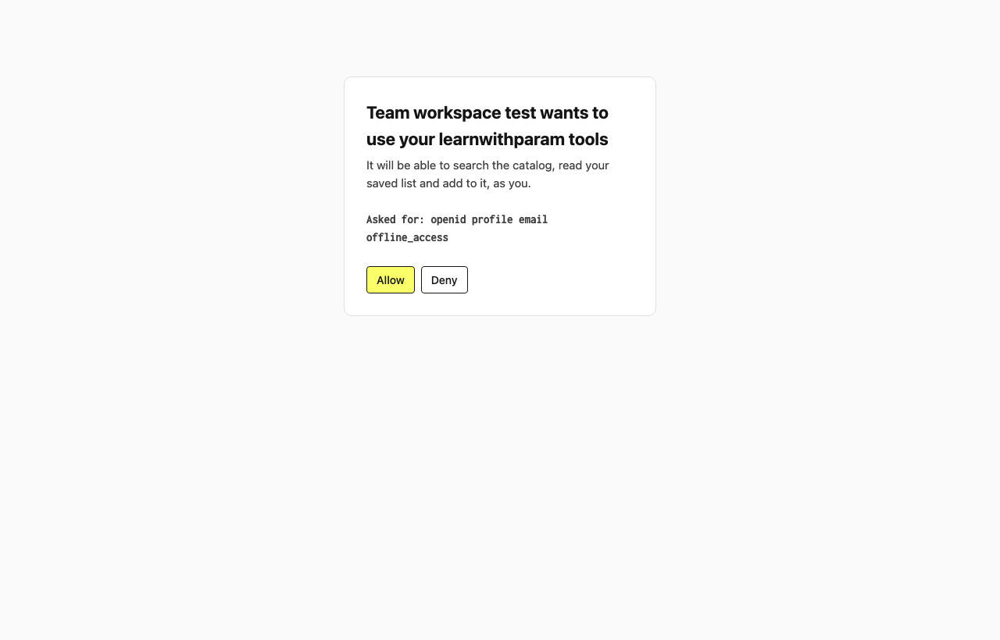

She presses "Allow" and is back on Connectors, connected with her own account.

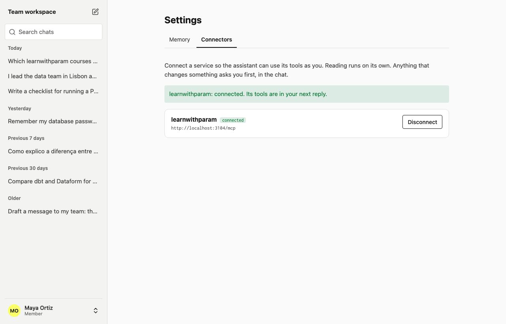

She asks for courses for her team and to save the first. Each search shows as one quiet line with what it looked for.
Saving changes something on the server, so the chat shows what will be sent and waits.

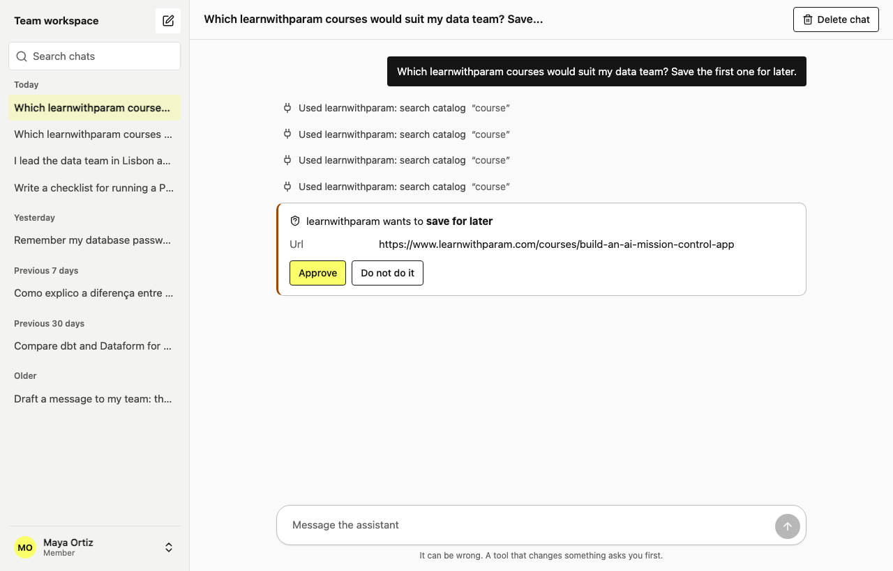

She presses "Approve". The save runs with her tokens, and the assistant says what it saved.

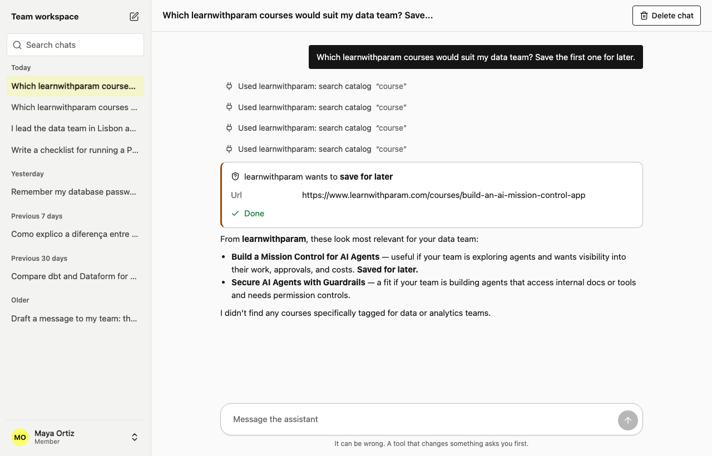

On a phone the sidebar folds behind a menu button.

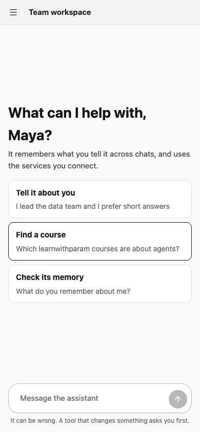

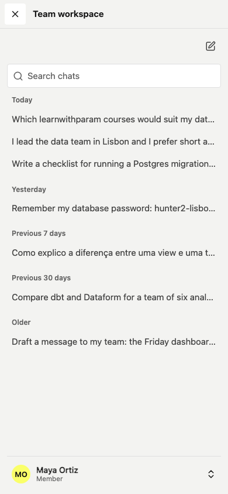

## How it works

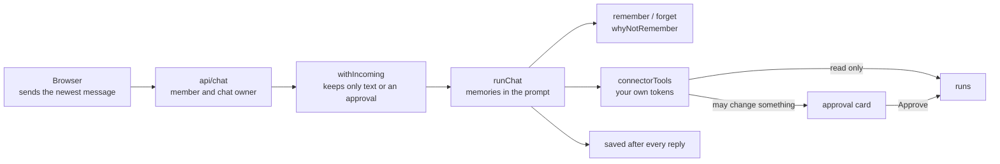

1. **The server keeps the history.** The browser sends the chat id and its newest message.
   `withIncoming` keeps only the text of a new message, so a forged tool result cannot ride along.
   An approval is copied only onto the card that waits for it, in the last reply.
2. **Memories go into the prompt, each with its id.** The model can forget one by its id.
   `whyNotRemember` refuses a password, a key or a card number, a fact that is too short or too long, and more than 100 facts.
   The database layer checks again, and a lock per person keeps ten saves at once from passing the limit.
3. **A memory is only saved from what the person said.** If a connector tool ran in this reply, `remember` is not offered,
   so text inside a tool result cannot plant a memory.
4. **Each connector is pinned when an admin adds it.** `discoverSignIn` reads the server's sign-in server and token address once.
   If the server later points somewhere else, the sign-in stops with a clear error.
5. **Tokens are per person and sealed.** A connector's tools run with the tokens of the person in the chat.
   The client secret and every token are stored sealed, never as plain text.
6. **Only a read-only tool runs alone.** A tool the server marks `readOnlyHint` runs at once. Any other tool waits for approval,
   and the approved call runs with the input the model asked for, never one edited in the browser.

## Try these

1. Ask "What do you remember about me?" in a new chat.
   Expect: the facts from the Memory page, and no new memory saved.
2. Say "My password is orange-kettle-42, please remember it."
   Expect: the Memory page does not change.
3. Press "Forget" on a memory, then ask about it in a new chat.
   Expect: the assistant no longer knows it.
4. Ask it to save a course, then press "Do not do it".
   Expect: the card says "you said no", and nothing is saved on the server.
5. Sign in with an account that is not in the team and open the workspace.
   Expect: a not-found page.
6. Add a connector with an `http://` address that is not this computer.
   Expect: "The server address must use https." and nothing added.

## Read the code

Read in this order. Each file is short.

1. `agent/agent.ts` - start here. The prompt with memories, the tools, the approval rule and the step limit.
2. `rules/memory.ts` - what may be remembered, and how memories are shown to the model.
3. `rules/chat.ts` - what the browser may send, and the limits on a chat.
4. `agent/tools/memory.ts` and `db/memories.ts` - the remember and forget tools, and the lock that holds the limit.
5. `rules/connectors.ts` - tool names, which tools need approval, and the https rule.
6. `agent/discover.ts` and `agent/oauth.ts` - finding and pinning each server's sign-in, and each person's tokens.
7. `agent/mcp.ts` - connecting to each server and turning its tools into the agent's tools.
8. `app/api/chat/route.ts` - the chat route, guarded by `requireMember` and the chat's owner.
9. `components/Chat.tsx` and `components/cards.tsx` - the chat, the memory notes, the tool lines and the approval card.
10. `agent/seed.ts` - the sample team, made through the real sign-up path and the real model.

## Prove it

```bash
bun test 09-team-workspace/tests/rules.test.ts   # memory rules, what the browser may send, connectors, the queries; no model
bun run proof team-workspace                     # the real model, the real MCP server, and the whole path in a browser
```

`tests/agent.test.ts` is the metric. It runs the real model against the real MCP server from 04.
A fact told in one chat is used in another. A password is never kept.
A read-only tool runs alone, a save waits for approval, and an input edited in the browser never reaches the server.
A tool result cannot plant a memory.

`tests/e2e.test.ts` walks the path in a real browser: a member connects the MCP server through its own sign-in page,
tells the assistant a fact, finds it on the Memory page, and approves a save in a new chat. A signed-in account that is not in the team gets a 404.

Last run: $0.0017 for the five agent tests, about 24 seconds. Every memory and approval check passed.

## Learn the idea in depth

Memory and MCP clients are taught step by step in
[live-labs](https://github.com/learnwithparam/live-labs).
