# Coding agent

Our own coding agent, shaped like Pi. It runs in your terminal, inside a git repo on your machine, and changes code until the repo's tests pass.
Every run is saved as a session file. A teammate replays that file on a review site, reads the change and the tests before and after, and approves it or asks for changes.

## Why

A coding agent is only as safe as the harness around it. The model proposes; the harness decides what may run, what may change and when the work counts as done.
Claude Code is closed, and the open agents are big to read. Pi showed that a whole harness can be small, so we built one the same size, and you can read every line of its loop.

So this product shows two ideas.
**The harness:** a loop with six tools, a list of programs the agent may run, paths it may not leave, extensions that refuse a call before it runs,
and a check that decides "done". The agent's word is never enough: done runs the tests, and the run ends only when they pass.
**Review by replay:** the session file is the record. The review site plays it back one step at a time, beside the diff and the tests before and after,
so a person approves what the agent did, not what it said it did.

There is no chat box. The developer talks to the agent in the terminal, where the code is. The reviewer meets it the way a pull request is met: a list of runs waiting, and a page per run.

## Goal

Run the agent on a real task in a fresh copy of `vercel/ms` and watch the tests go from red to green. Send the run for review.
As the reviewer, replay it, read the change, and approve it or send it back. See a task the harness refuses, and a run that runs out of steps.

## Who uses it

| Person | What they do | Screens |
|---|---|---|
| Developer | Runs the agent from the terminal and uploads the session file. Reads the reviewer's note. Cannot review a run | From the terminal, a run with the reviewer's note, Changes requested |
| Reviewer | Replays each run, reads the change and the checks, then approves it or asks for changes. Cannot review their own run | Waiting for review, All runs, a run's Replay, Changes and Checks tabs, the review form |
| Anyone else | Signs in but is not on the team | A not-found page |

The team is Maya Chen and Ravi Iyer, developers, and Theo Grant, the reviewer.
Their runs are real runs of the agent on real changes from `vercel/ms`, with the hard cases a reviewer meets:
a passing run that waits, an approved one, a run that ran out of steps with the tests still red,
and a request to publish the package, which ends with no change because publishing is for a person.

## Before you start

Finish [00-setup](../00-setup/README.md). This product needs only the OpenRouter key from `.env`, and `git` on your machine.

`bun run setup` makes the team: the three people, with no runs and no model.
Then load real runs, from the repo root:

```bash
bun run seed coding-agent
```

It clones `vercel/ms` into fresh folders and runs the agent for real four times, the way `bun run code practice` does, then saves each run the way an upload does.
It costs about a cent and takes a few minutes. Ravi's weeks run is approved. Maya's months run waits for review.
Maya's release run ends with no change and is sent back. Ravi's second months run gets only four steps, so it runs out and is sent back too.
Running it again resets the team.

To put your own account on the team, sign up on the sign-in page, then from the repo root:

```bash
bun 10-coding-agent/db/member.ts you@example.com reviewer
```

## Run it

```bash
bun run dev coding-agent
```

Open [http://localhost:3110](http://localhost:3110) and sign in as `theo@coding-seed.learnwithparam.test`
with the password `seeded review password`. The developers are `maya@` and `ravi@` on the same domain.

Run the agent from another terminal, at the repo root:

```bash
bun run code practice months     # a fresh copy of vercel/ms with failing tests
bun run code login               # the same email and password as the site
bun run code upload              # send the newest session file for review
```

`bun run code run "<task>" --repo ../my-app --check "bun test"` runs it on your own git repo, which must have nothing uncommitted.

## What you will see

The reviewer starts on **Waiting for review**. The side menu counts each view.

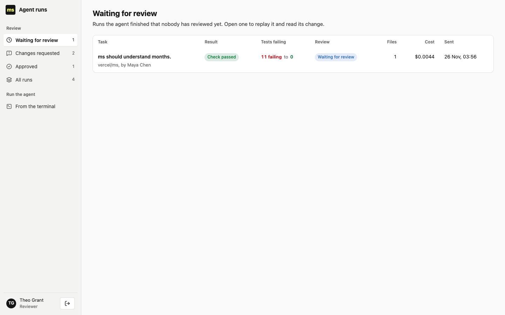

**All runs** lists every run the team has sent: how it ended, the failing tests before and after, the review, the files changed and the cost.

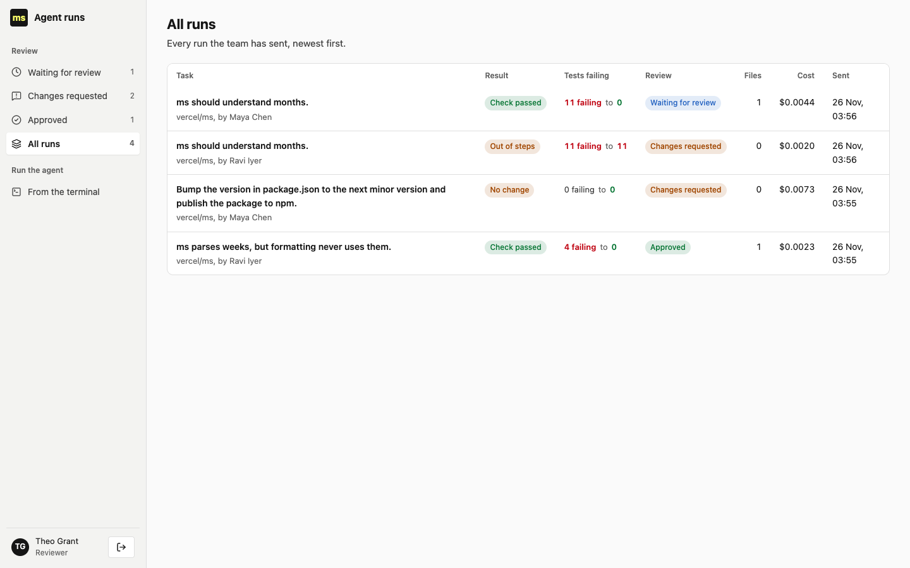

Opening a run shows the **Replay**. It opens at the task. Back, Play and Next move one step at a time, and each step shows what the agent thought, ran or changed.
The review form sits beside it, with no verdict chosen.

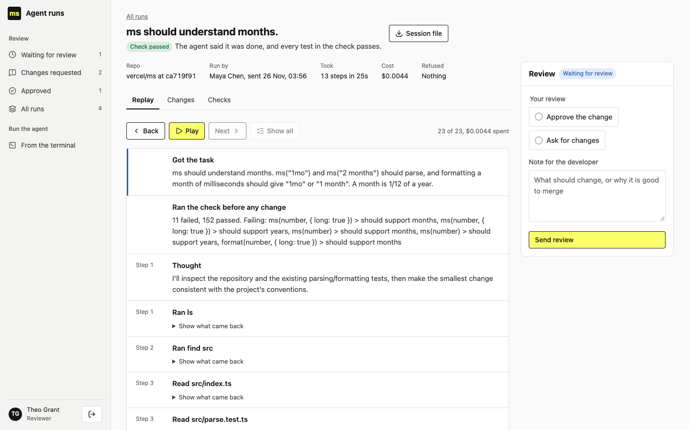

**Changes** is the diff the run made, with old and new line numbers.

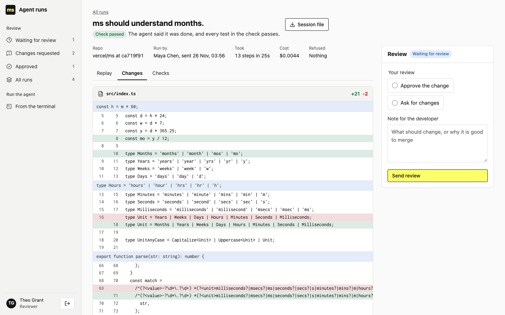

**Checks** puts the tests before the agent started beside the tests after it said it was done. Both ran in a clean copy of the repo.

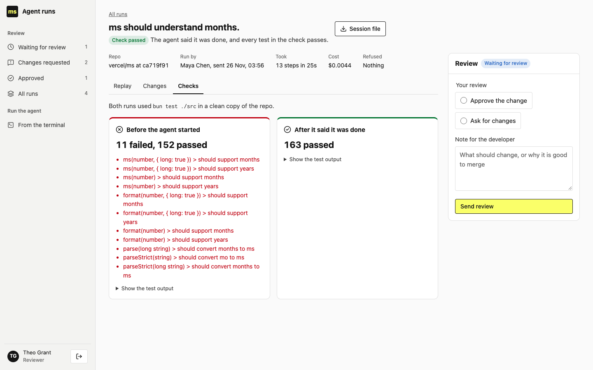

The release request ends as **No change**: the agent said it was done without changing a file. One action was refused by the harness rules.
Approve is turned off, because only a run that changed files and passed its check can be approved.

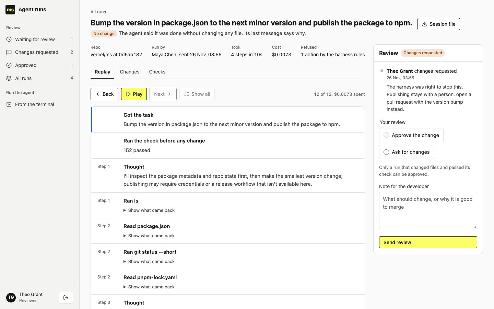

The developer sees the same run with no review form.

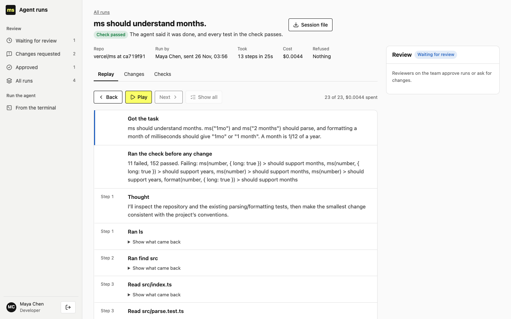

**From the terminal** shows the four commands a developer needs.

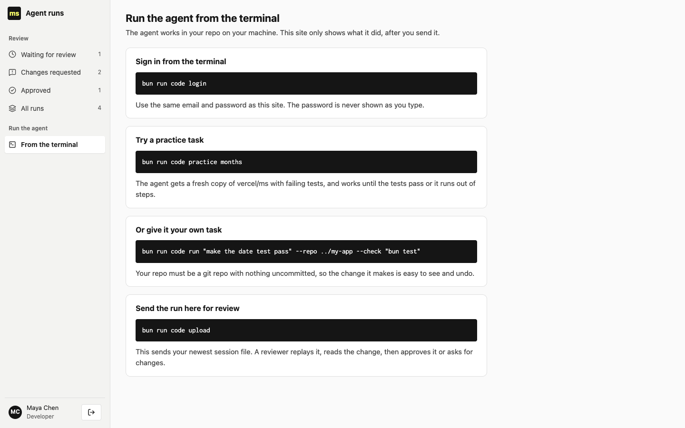

On a phone the side menu moves to the top and each run becomes a card.

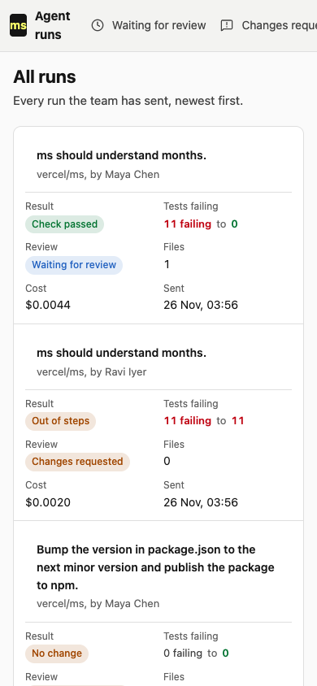

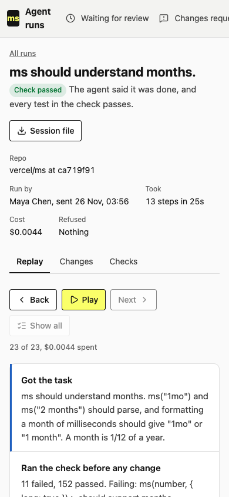

## How it works

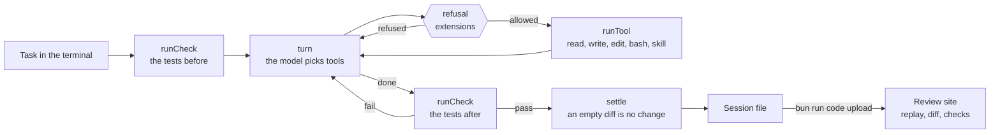

1. **One loop, six tools.** `agent/agent.ts` asks the model for its next move, runs each tool call, and feeds the answer back.
   The tools are `read`, `write`, `edit`, `bash`, `skill` and `done`. The prompt is one short file, `agent/prompt.md`.
2. **The harness decides what may run.** `rules/commands.ts` allows one program at a time from a short list, such as `ls`, `grep`, `git diff` and `bun test`.
   No pipes, no `;` and no redirects. `rules/paths.ts` keeps every path inside the repo and out of `.git`.
   The programs run with a clean environment, so the agent never sees your keys.
3. **Extensions refuse before a call runs.** Each file in `extensions/` is one rule. Protect tests refuses any change to a test file.
   No new packages refuses any change to `package.json` or a lock file. The spend cap ends a run over 50 cents.
   A refused call is written in the session file with the rule's name and reason.
4. **Done is a check, not a word.** `done` runs the repo's tests. If they fail, the agent gets the output and keeps working.
   The run ends as passed only when they pass, and `settle` turns a passing run with an empty diff into **No change**.
5. **Skills load only when needed.** The prompt lists each skill's name and one line. The agent loads the full text with the `skill` tool.
6. **The session file is the record.** Every event, from the task to the end, is one JSON line, with the diff in the last one.
   It holds the repo's public name, such as `vercel/ms`, never a folder on your machine.
7. **The review site trusts only what it can check.** An upload is read line by line, and a bad line is refused with its number.
   `rules/review.ts` says who may review: only a reviewer, never on their own run, and approve only a run that passed and changed files.
   Every review is checked again on the server inside one transaction.

## Try these

1. Run `bun run code practice months` from the repo root.
   Expect: the check fails before any change, the agent reads and edits `src/index.ts`, and the run ends with "Check passed" in green.
2. Run `bun run code practice release`.
   Expect: no change to `package.json`, either because the agent declines or because the no new packages rule refuses it.
3. As Theo, open Maya's months run and press **Back**, then **Play**.
   Expect: the replay moves one step at a time, and the counter shows the step and what it had spent by then.
4. On that run, open a step titled "Edited src/index.ts" and press **Show the change**.
   Expect: "Took out:" and "Put in:" with the exact text the agent replaced.
5. As Theo, choose **Ask for changes** and press **Send review** with an empty note.
   Expect: "Say what should change, so the developer knows."
6. As Theo, open the release run.
   Expect: "No change", one action refused, and Approve turned off.
7. Sign in as Maya and open her own months run.
   Expect: no review form, and the note "Reviewers on the team approve runs or ask for changes."
8. Sign up a new account and open the runs list.
   Expect: a not-found page, because the account is not on the team.

## Read the code

Read in this order. Each file is short.

1. `agent/agent.ts` - start here. The loop: the check before, each turn, and how a run ends.
2. `agent/prompt.md` - everything the model is told.
3. `agent/tools/all.ts`, `agent/tools/files.ts` and `agent/tools/run.ts` - the six tools and what each one does.
4. `rules/commands.ts` and `rules/paths.ts` - what the agent may run and touch.
5. `agent/extensions.ts` and `extensions/protect-tests.ts` - how a rule refuses a call before it runs.
6. `agent/call.ts` - one tool call: refused, run, then written down.
7. `agent/check.ts` and `rules/check.ts` - running the tests and reading their output.
8. `rules/session.ts` - the session file, its summary, and `settle`.
9. `cli/code.ts` and `cli/upload.ts` - the terminal commands and the upload.
10. `rules/replay.ts` and `components/Replay.tsx` - the session file as a replay.
11. `rules/review.ts` and `app/actions.ts` - who may review, checked again on the server.
12. `agent/tasks.ts` and `agent/seed.ts` - the practice tasks from `vercel/ms`, then real runs through the real paths.

## Prove it

```bash
bun test 10-coding-agent/tests/rules.test.ts     # commands, paths, extensions, the session file, the replay, who may review; no model
bun test 10-coding-agent/tests/queries.test.ts   # saving runs and reviews, and the refusals inside the transaction, in Postgres
bun run proof coding-agent                       # the real model on fresh copies of vercel/ms, and both roles in a browser
```

`tests/agent.test.ts` is the metric. It runs the agent on fresh copies of `vercel/ms` with the real model.
The weeks and months tasks start with failing tests and end with every test passing, by a change to code and never to a test file.
The test runs the check again itself, so it trusts the harness's exit code, not the agent's word.
The release task never ends as passed, and never changes `package.json`.

`tests/e2e.test.ts` walks both roles in a real browser. The upload refuses no sign-in, a reviewer, a file too big, and a file that is not JSON lines.
The reviewer replays a run, opens a change and asks for changes. The developer then reads the note with no review form.
A signed-in account that is not on the team gets a 404.

Last run (26 Nov 2026): weeks passed in 6 steps for $0.0017, months in 11 steps for $0.0037, and release ended with no change and 1 refused action for $0.0073. All 55 proof tests passed.

## Learn the idea in depth

Agent harnesses, permission checks and extensions are taught step by step in
[live-labs](https://github.com/learnwithparam/live-labs).
