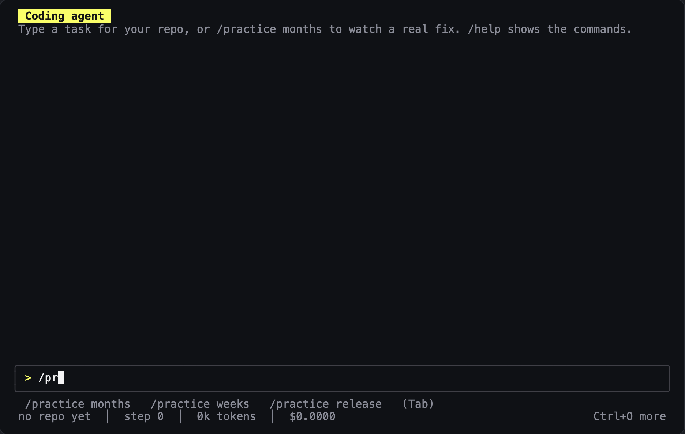
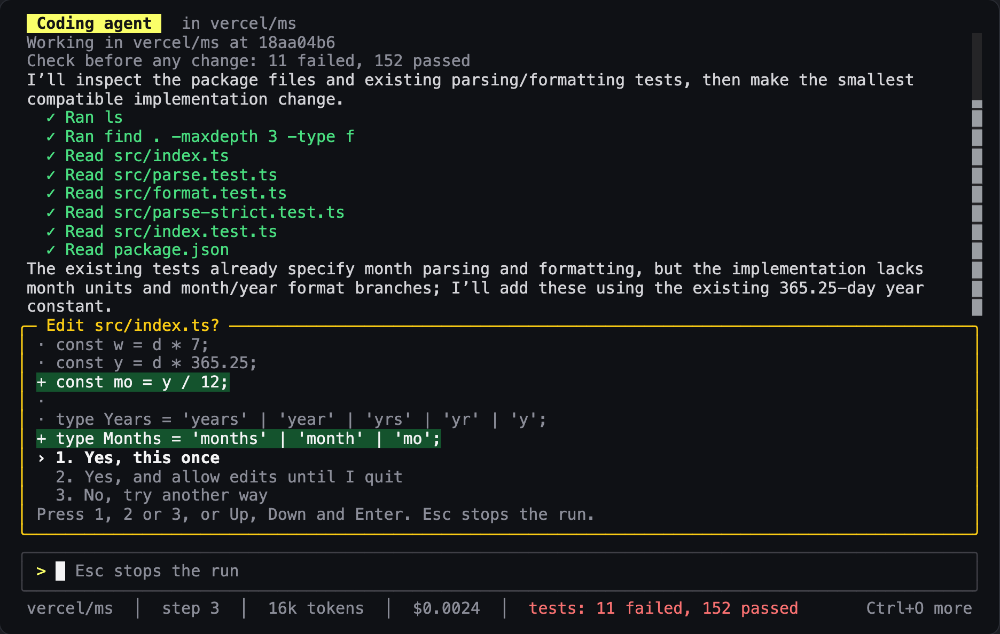
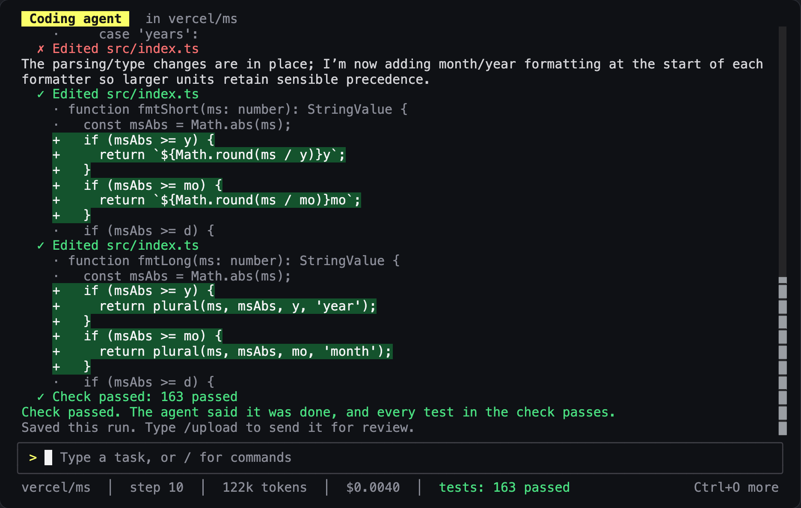
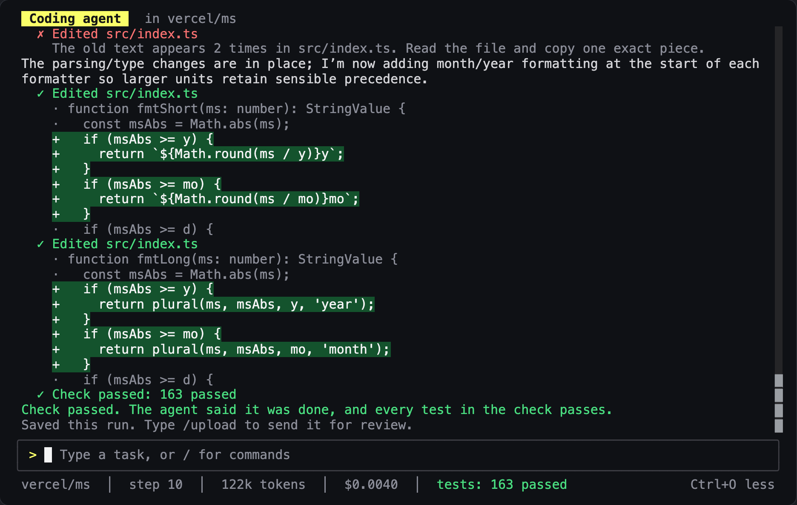
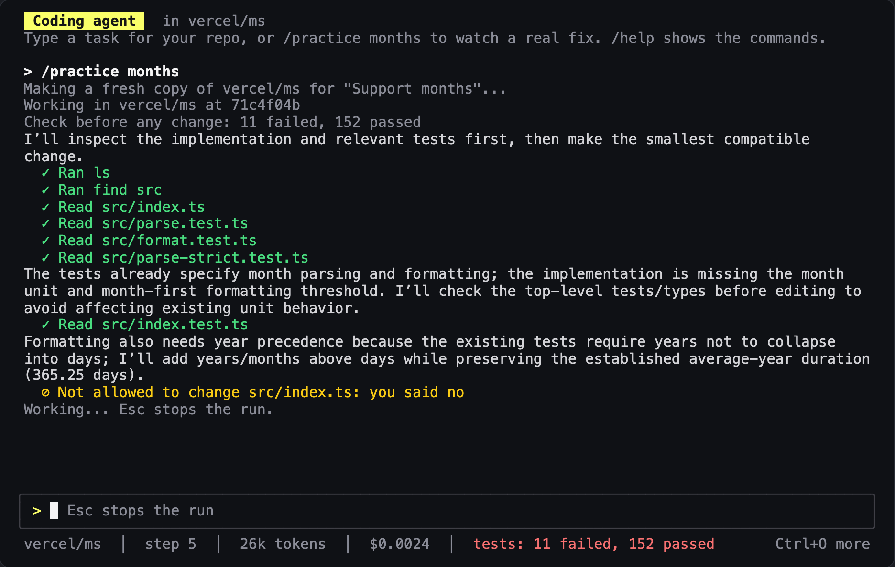
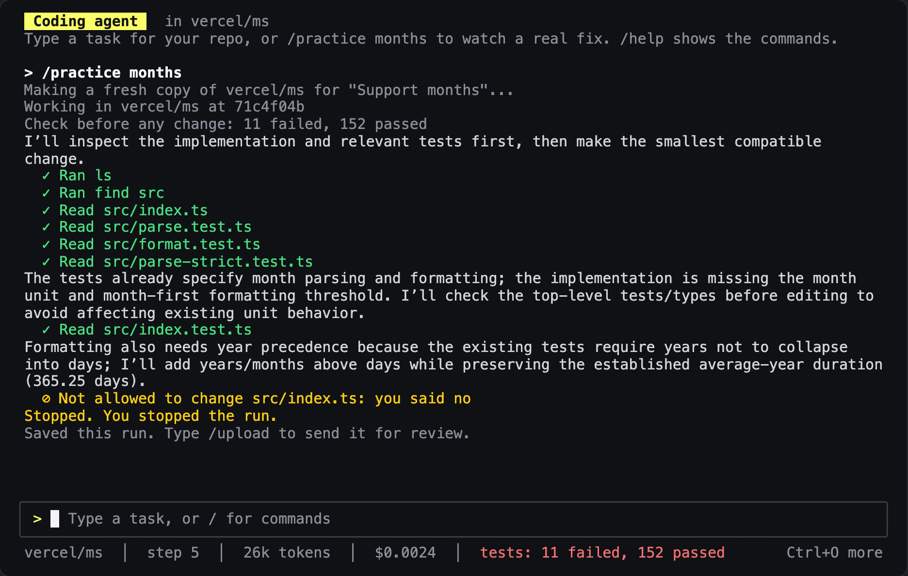
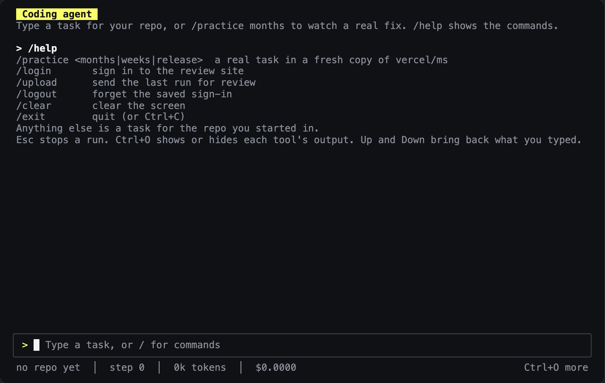
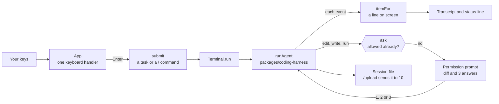

# Coding agent terminal

The coding agent from 10, as a terminal app you work in, shaped like Claude Code and Pi.
You type a task. The agent's words stream in, each tool call shows as one line, and every edit shows its diff.
Before it changes a file or runs a program, it stops and asks you. Esc stops the run at any moment.

## Why

10 runs the agent as one command: it prints what happened, then the run is over.
That is right for a job you hand off, and wrong for a job you do together.
When you sit with the agent, you want to read each change before it lands, say no to the one that looks wrong, and stop it when it wanders.

So this product shows two ideas.
**A terminal UI is a real UI.** It has components, state and a keyboard handler, written in React with OpenTUI, the library OpenCode runs on.
It is tested the way a web page is: frames rendered in a test, and the real app driven in a real pseudo-terminal.
**A person in the loop, at the right moments.** Reading never waits. Changing a file or running a program waits for a yes.
The harness rules still come first: what they refuse is refused, and no answer from you can allow it. You can only say no to what they would allow.

The agent, its tools and its rules are the same code as 10's, in `packages/coding-harness`. Only the screens and the questions are new.

## Goal

Run `/practice months` and watch the tests go from 11 failing to all passing. Read the first edit's diff in the prompt, and allow edits until you quit.
Then run it again and say no: the agent tries another way, and nothing changes. Press Esc to stop it. Send a run to 10's review site with `/upload`.

## Who uses it

| Person | What they do | Screens |
|---|---|---|
| Developer | Types tasks, reads each change, answers each prompt, stops a run, sends a run for review | The transcript, the permission prompt, the input box, the status line |
| Reviewer | Replays a run the developer uploaded, on 10's review site | 10's Waiting for review and Replay pages |

There is no sign-in to use the app. `/login` and `/upload` use the same account as `bun run code login` in 10,
so a run made here shows up on 10's review site like any other run.

## Before you start

Finish [00-setup](../00-setup/README.md). This product needs only the OpenRouter key from `.env`, and `git` on your machine.
To send a run for review, also run 10's review site: see [10-coding-agent](../10-coding-agent/README.md).

## Run it

From the repo root:

```bash
bun run terminal                                  # then type /practice months
bun run terminal --repo ../my-app                 # give it tasks in your own git repo
bun run terminal --repo ../my-app --check "bun test"
```

Your own repo must have nothing uncommitted, the same rule as 10. The check is the command that says done; it is `bun test ./src` unless you pass one.

## What you will see

The app opens with an input box and a status line. Type `/` and the commands appear; Tab fills one in.



`/practice months` makes a fresh copy of `vercel/ms`, runs its tests before any change (11 fail), and starts the agent.
Each tool call is one line. The first edit stops and asks, with the change itself in the prompt.



Press 2 and the agent carries on. Each later edit shows its diff in the transcript. The run ends when the check passes, and the status line turns green.



Ctrl+O opens each tool's output, such as the tests the agent ran.



Press 3 instead and the agent hears that you said no. It tries another way, and the change never lands.



Esc stops the run. The run is saved either way, so you can still send it for review.



`/help` lists every command and key.



## How it works



1. **The screen is React.** `tui/App.tsx` lays out the header, the transcript, the prompt, the input box and the status line with OpenTUI's flexbox.
   One `useKeyboard` handler decides where each key goes: to the prompt while one waits, else to the input box. So a key never does two things.
2. **One store, many screens.** `agent/agent.ts` holds a `Terminal`: the lines on screen, the status, the prompt that waits.
   The screens read it with `useSyncExternalStore`, and the tests read the same object without a screen at all.
3. **Harness events become lines.** `runAgent` from the harness reports each event. `rules/screen.ts` turns each one into a line with a tone
   (green for done, red for failed, yellow for refused) and keeps the status: steps, tokens, money and the last check.
4. **The harness asks, the person answers.** Before an edit, a write or a program that is not read-only, the harness calls `ask`.
   `Terminal.ask` resolves straight away if you said "allow until I quit" for that kind of call; else it shows the prompt and waits.
   `rules/answers.ts` turns 1, 2, 3, y or n into an answer. A no goes back to the model as a refused call, so it tries another way.
5. **Diffs are worked out, not trusted.** `rules/diff.ts` compares the file before and after line by line, so the prompt shows what will change, not what the model says.
   Each line carries its sign: + added, - taken out, a dim · kept. So code is never read as the model's words, by you or by the screen check.
6. **The model's markdown is drawn, not printed.** `rules/markdown.ts` turns backticks and bold into styled pieces. The tests fail if raw markdown reaches the screen.
7. **Esc is a real stop.** It aborts the model call in flight. The run ends as stopped and is still saved.

## Try these

1. Run `bun run terminal`, type `/pr` and press Tab, then Enter.
   Expect: `/practice months` runs, the check before shows 11 failed, and the first edit stops at a prompt with its diff.
2. At the prompt, press 2.
   Expect: no more prompts for edits, the run ends with "Check passed: 163 passed", and the status line turns green.
3. Run `/practice months` again and press 3 at the first prompt.
   Expect: "Not allowed to change src/index.ts: you said no", and the agent tries another way.
4. While it works, press Esc.
   Expect: "Stopped. You stopped the run." and "Saved this run".
5. Press Ctrl+O, then Ctrl+O again.
   Expect: each tool's output opens under its line, then closes.
6. Press Up in the empty input box.
   Expect: the last thing you typed comes back.
7. Type `/upload` before `/login`.
   Expect: a message in words asking you to sign in first, and the app keeps running.
8. Type `fix the typo in the readme` without `--repo`.
   Expect: "No repo to work in", with the two ways to give it one.

## Read the code

Read in this order. Each file is short.

1. `tui/main.tsx` - start here. The options, the renderer, and quitting cleanly.
2. `tui/App.tsx` - the layout and the one keyboard handler.
3. `agent/agent.ts` - the `Terminal` store: run, ask, answer and stop.
4. `rules/screen.ts` - a harness event as a line on screen, and the status line.
5. `rules/answers.ts` and `../packages/coding-harness/rules/permission.ts` - which calls wait for you, and what each answer does.
6. `tui/Permission.tsx`, `tui/Diff.tsx` and `rules/diff.ts` - the prompt and the diff inside it.
7. `tui/editor.ts`, `rules/history.ts` and `rules/commands.ts` - the input box, Up and Down, and the slash commands.
8. `tui/Transcript.tsx`, `tui/Prose.tsx` and `rules/markdown.ts` - the model's words with their markdown drawn.
9. `agent/commands.ts` - what Enter does, and how a failure shows in words.
10. `../packages/coding-harness/agent/agent.ts` - the same loop 10 runs, with `ask` and `signal` passed in.

## Prove it

```bash
bun test 12-coding-agent-terminal/tests/rules.test.ts   # commands, history, answers, diffs, lines, markdown; no model
bun test 12-coding-agent-terminal/tests/tui.test.tsx    # the screens rendered in a test: the prompt, Always, Esc, Tab, Ctrl+O
bun run proof coding-agent-terminal                     # the real model, and the real app in a pseudo-terminal
```

`tests/agent.test.ts` is the metric. It runs the real model on fresh copies of `vercel/ms`, answering each prompt the way a person would.
A yes to each prompt ends with the check passing, and the test runs the check again itself.
A no to each prompt ends with an empty diff, and every refusal in the session file is one you made.
Esc after the first tool ends the run as stopped, and the run is still saved.

`tests/tui.test.tsx` renders the screens in a test and presses keys: the edit prompt shows its diff and 3 says no;
2 means the next edit runs without a prompt; Esc while a prompt waits answers no.

`tests/e2e.test.ts` starts `bun run terminal` in a real pseudo-terminal and reads the screen through xterm.js, the terminal emulator in VS Code.
It types `/pr`, presses Tab and Enter, says yes at each prompt, and waits for the real fix to pass. Each screen goes through `checkScreen`,
which fails on raw markdown or a raw tool id. The session file it finds on disk must say passed.

Last run (26 Nov 2026): yes passed in 11 steps after 1 prompt for $0.0037; no ended out of steps with 9 refusals and no change for $0.0156;
Esc stopped after 1 step. The pseudo-terminal run passed in 23 seconds.

## Learn the idea in depth

Terminal apps, human in the loop and agent harnesses are taught step by step in
[live-labs](https://github.com/learnwithparam/live-labs).
