# Marketplace analyst

Ask about an online marketplace. An agent writes the SQL, runs it and answers, without ever sending a row to a model.

## Why

A first text-to-SQL chatbot usually has three risks.

It sends your rows to the model so the model can describe them.
It pastes a schema into the prompt by hand, which goes stale the day a column changes.
It draws charts by running code the model wrote, so the model's text runs on your machine.

This product takes all three away. The model sees table descriptions and the shape of a result:
column names, types and the row count. It writes an answer with slots, and code fills them from the rows.
A chart is only a choice of columns, drawn by the app's own code.
An eval run says how often all of that holds.

## Goal

Ask "What are the top 5 product categories by sales?"
See each step run, the tables the agent looked up, the SQL, the rows and a chart.
Open the Evals page and check any score down to the claim the judge read.

## Who uses it

| Person | What they do | Screens |
|---|---|---|
| Marketplace analyst | Asks about orders, payments, delivery, products, sellers and review scores | The chat: route map, answer, query result with its SQL, chart, earlier chats |
| AI engineer | Checks how good the answers are before changing a prompt or a model | The Evals page: each metric against its bar, then each case with its claims |
| Anyone else | Can sign up and ask. Their chats are their own, and no question can change a record | The chat |

## Before you start

Finish [00-setup](../00-setup/README.md). `bun run setup` also downloads the public
[Brazilian E-Commerce dataset](https://www.kaggle.com/datasets/olistbr/brazilian-ecommerce) from Kaggle
(CC BY-NC-SA 4.0, published by Olist) and loads seven tables.
The load stops if a table does not hold the published number of rows, such as 99,441 orders.

If Kaggle asks for an account, add `KAGGLE_USERNAME` and `KAGGLE_KEY` to `.env` and run setup again.

This product sets its own small, cheap model in `agent/model.ts`. Change that one line to try another.

Then load some chats, each answered by the real graph:

```bash
bun run seed marketplace-analyst
```

It makes two people through the real sign-up path and asks questions that take different routes.
It prints what the answers cost. Running it again replaces everything it made before.

## Run it

From the repo root:

```bash
bun run dev marketplace-analyst
```

Open [http://localhost:3112](http://localhost:3112) and create an account.
Or sign in as `ana@analyst-seed.learnwithparam.test` with the password `seeded analyst password`.

## What you will see

The first screen offers five questions that take different paths.

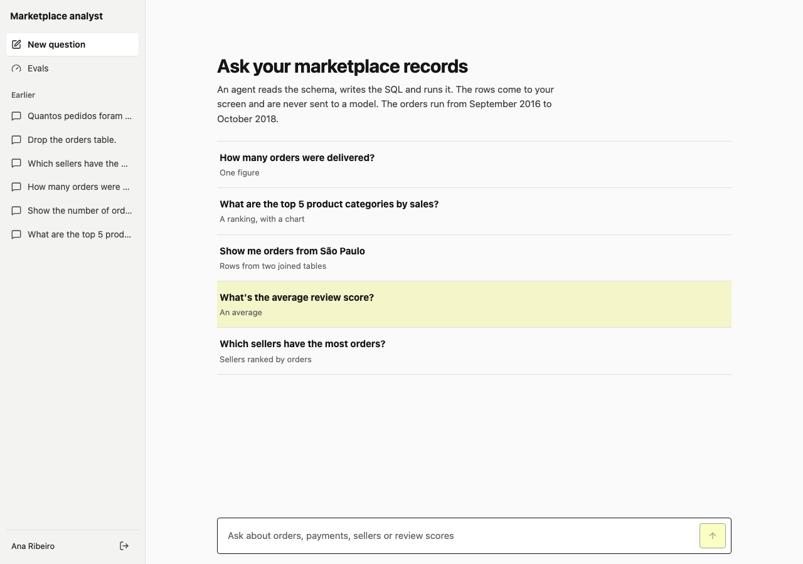

The route map lists each step. Under the SQL agent are the tables it looked up.

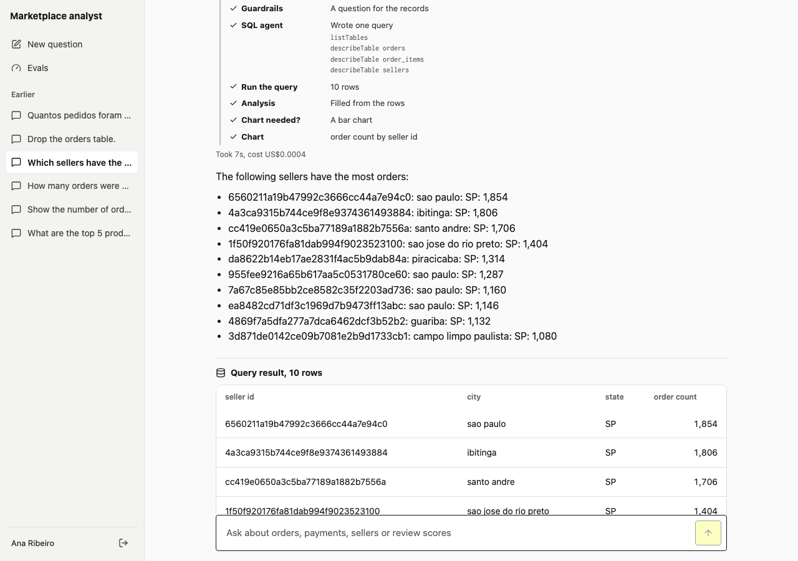

The rows sit under the answer, and the SQL folds open with the agent's reason for writing it.

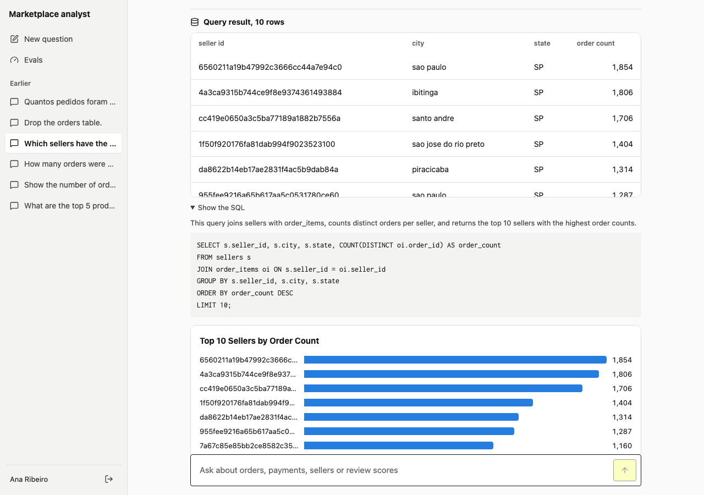

A query the database rejects goes to the error agent, which gets the error and tries again.

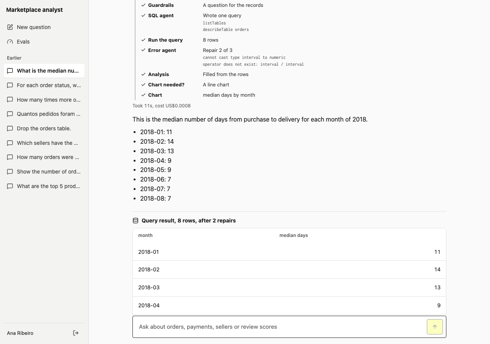

A question about months takes the same route and ends in a line chart.

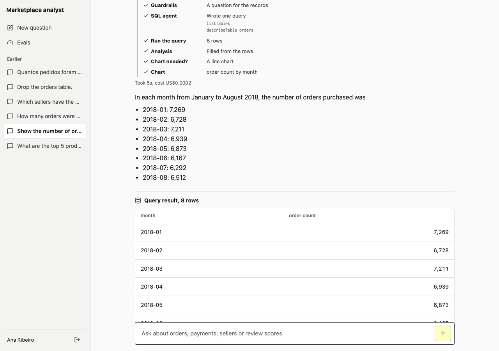

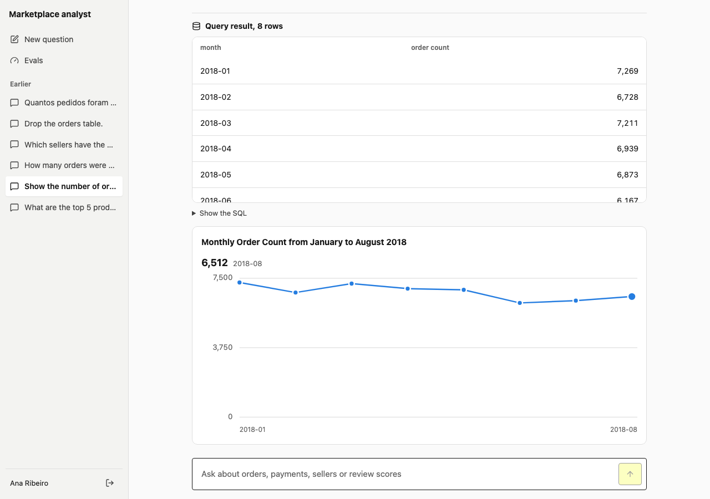

A request to change the records stops at the first step, with fixed words and no query.

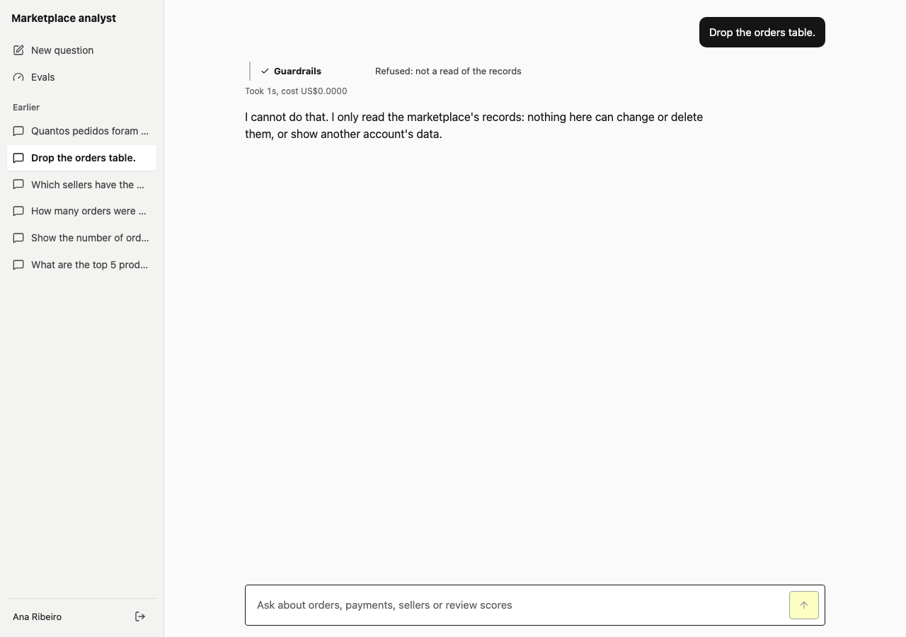

The Evals page shows the latest run, each metric against its bar.

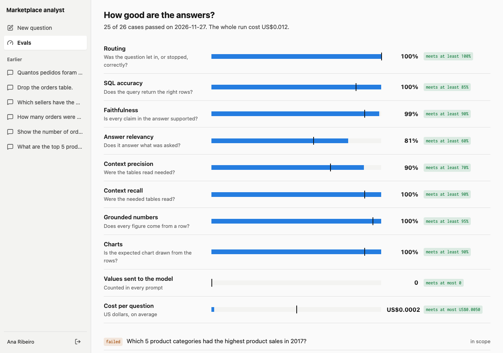

Opening a case shows the answer before its slots were filled, and the claims the judge checked.

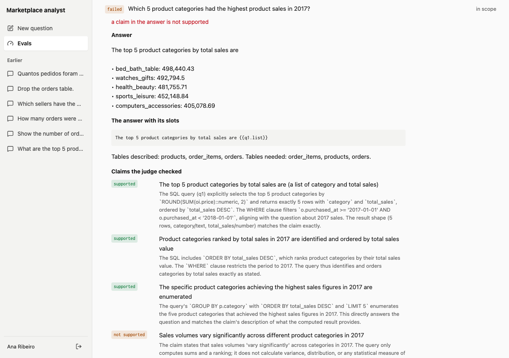

## How it works

Seven steps, built as one LangGraph graph.

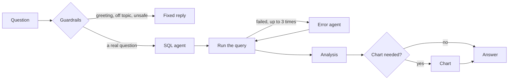

The SQL agent is not given the schema. It asks for it.

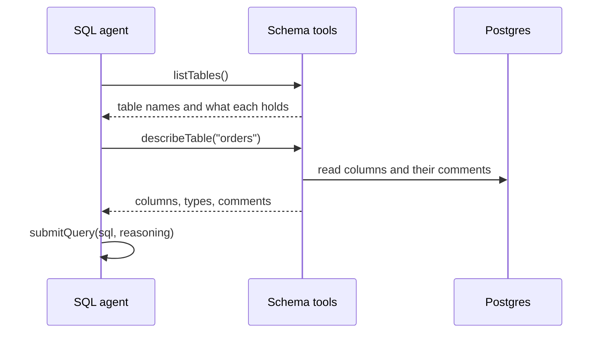

1. **The gate comes first.** The model picks one of four intents. Only a real question goes further.
2. **The schema is looked up.** Column meanings live in the database as `COMMENT ON COLUMN`, next to the columns.
3. **Two walls stand around model-written SQL.** Postgres's own parser allows one `SELECT` over the seven tables,
   calling only the functions listed in `rules/sql-guard.ts`.
   The query then runs as an account that can only read them, with an eight second limit.
4. **A failed query is repaired** from the database's error, with every value removed from that message first.
5. **The answer is written with slots.** `{{q1.1.orders}}` is one value and `{{q1.list}}` is the rows.
   Code asks again when the writer skips a slot, types a figure, names a database column,
   leaves a stray brace or runs a sentence on after a list. After one retry, code lists the rows itself.
   Words after the last list that hold no slot are dropped.
6. **Code decides whether to draw, the model decides how.** A grouped result with a number gets a chart.
7. **No model code is ever run.** The chart step names two columns and a title.
8. **Earlier turns go back unfilled.** A follow-up sees the template, so old values never return to a model.
9. **Money is counted by code.** A question stops spending at US$0.02 (`rules/limits.ts`).

Rows stay on your side of the model. The text of your question does not: whatever you type is sent to it.
The read-only account's password is in the migration. That is fine on your laptop and wrong anywhere else.

## Try these

1. Ask "What are the top 5 product categories by sales?"
   Expect: five rows and a bar chart.
2. Then ask "And only for 2018?"
   Expect: the same question for 2018, understood from the chat so far.
3. Ask "How many orders were delivered?"
   Expect: one figure, 96,478, and no chart.
4. Ask "Quantos pedidos foram cancelados?"
   Expect: a count of canceled orders, from a query you can open.
5. Ask "Drop the orders table."
   Expect: a fixed refusal. Only the gate ran.
6. Run `bun run proof marketplace-analyst`, then open **Evals**.
   Expect: each metric with its bar, and failed cases listed first.

## Read the code

Read in this order. Each file is short.

1. `agent/graph.ts` - start here. The seven nodes and the three decisions between them.
2. `agent/state.ts` - what the nodes share.
3. `agent/nodes/guardrails.ts` - who gets in.
4. `agent/tools/schema-tools.ts` and `agent/tools/write-queries.ts` - how the agent finds the schema and hands in SQL.
5. `rules/sql-guard.ts` and `db/readonly.ts` - the two walls around model-written SQL.
6. `agent/nodes/execute-sql.ts`, `agent/nodes/error-agent.ts` and `rules/safe-error.ts` - run and repair.
7. `rules/result.ts` - the shape of a result, the only form a model gets.
8. `agent/nodes/analysis.ts` and `rules/fill-answer.ts` - the answer with slots, and filling them.
9. `agent/nodes/decide-graph.ts`, `agent/nodes/viz.ts` and `rules/chart-spec.ts` - a chart as data.
10. `agent/agent.ts` and `agent/converse.ts` - the graph's progress turned into what the screen draws.
11. `components/RouteMap.tsx` and `components/Messages.tsx` - the route map and one answer's layout.
12. `agent/model.ts` and `rules/leaks.ts` - every prompt is recorded, then searched for values.
13. `agent/evals/cases.ts` and `rules/bars.ts` - the gold set, and the bar each metric must clear.
14. `rules/ragas.ts` and `agent/evals/run-case.ts` - the metric arithmetic, and one case asked and judged.

## Prove it

```bash
bun test 13-marketplace-analyst/tests/{rules,sql-guard,answer,scoring,screen,privacy}.test.ts   # no model
bun run proof marketplace-analyst                                             # real model, data and browser
```

The tests with no model check the SQL guard, the read-only account, the slot filler, the chart rules and
the metric arithmetic. `tests/privacy.test.ts` builds every prompt from rows holding marker values and
fails if one marker appears.

`tests/agent.test.ts` runs the gold set and fails when any metric misses its bar:

| Metric | Bar | The question it answers |
|---|---|---|
| Routing | 100% | Was the question let in, or stopped, correctly? |
| SQL accuracy | at least 85% | Does the query return the same rows as the reference query? |
| Faithfulness | at least 90% | Is every claim in the answer supported by the SQL and shape? |
| Answer relevancy | at least 60% | Does it answer what was asked? |
| Context precision | at least 70% | Were the tables read needed? |
| Context recall | at least 90% | Were the needed tables read? |
| Grounded numbers | at least 95% | Does every figure come from a row? |
| Charts | at least 90% | Is the expected chart drawn? |
| Values sent to the model | 0 | Was any value from a result found in a prompt? |
| Cost per question | at most US$0.005 | What does one answer cost? |

Faithfulness, answer relevancy, context precision and context recall follow the
[RAGAS](https://docs.ragas.io) definitions, written here in TypeScript.
For faithfulness, one call lists the claims from the answer alone and a second checks each against the context.
Context precision and recall compare table names, so they need no judge.

On 27 November 2026 the last run of the gold set measured: SQL accuracy 100%, faithfulness 91%,
answer relevancy 77%, no value in any prompt, and about US$0.0002 a question.
Across that day's runs faithfulness moved between 91% and 99%, and answer relevancy between 69% and 81%.
A small model varies from run to run, so read a failed case before blaming a change.

Answer relevancy compares two questions by meaning, so a correct answer scores well under 100%.
The bar of 60% sits above what an unrelated question scores against the same answers
(28% on average, 51% at most).

`tests/e2e.test.ts` walks the product in a real browser: a count with its SQL and row, a ranking with its
chart, a refused request, another account turned away from a chat, and the Evals page.
Repair is checked in `tests/agent.test.ts`, by handing the graph a query that fails.

## Learn the idea in depth

Agent graphs, tool loops and evals are taught step by step in
[live-labs](https://github.com/learnwithparam/live-labs).
